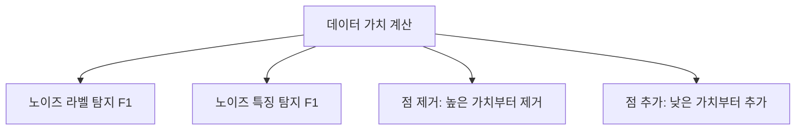
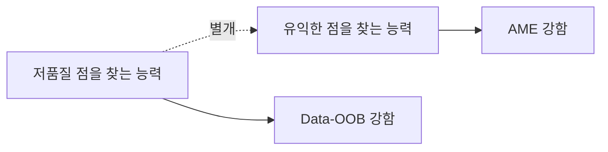

# 데이터 가치 평가 하위 과제

> 데이터 가치 평가 알고리즘이 "좋은가"를 재려면 **가치를 어디에 쓰는지(하위 과제)** 를 정해야 한다. OpenDataVal은 **오라벨 탐지, 노이즈 특징 탐지, 점 제거 실험, 점 추가 실험** 네 과제로 가치의 품질을 평가한다.

## 쉽게 말하면
요리사의 실력을 재려면 "칼질", "간 맞추기", "플레이팅"처럼 구체적인 시험 과목이 필요하다. 데이터 가치도 "나쁜 데이터를 찾는가", "중요한 데이터를 찾는가"처럼 과목별로 채점한다.

## 자세히
(OpenDataVal, arXiv 2306.10577 본문 확인)
- **네 과제**
  | 과제 | 방법 | 좋은 가치의 신호 |
  |---|---|---|
  | **노이즈 라벨 탐지** | 학습 데이터의 p% 라벨을 뒤집고(이진 반전) 가치 계산, 가치를 K-Means로 2군집(유익/해로운)으로 나눠 낮은 군집을 노이즈로 예측, 진짜 노이즈 표시와의 **F1** 측정 | 높은 F1 |
  | **노이즈 특징 탐지** | p% 점의 특징에 표준 가우시안 오차 추가 후 같은 탐지 절차 | 높은 F1 |
  | **점 제거** | 가치가 **높은 순으로** 하나씩 제거하며 로지스틱 회귀 정확도 측정 | 정확도가 **빨리 떨어짐**(유익한 점을 먼저 제거) |
  | **점 추가** | 가치가 **낮은 순으로** 추가 | 정확도가 **낮게 시작**(해로운 점을 먼저 추가) |
  노이즈 비율 p ∈ {5, 10, 15, 20}%. 가치 계산에 정답 노이즈 표시는 쓰지 않고 평가에만 쓴다. 점 제거·추가 실험은 20% 라벨 노이즈 데이터, 홀드아웃 시험 3,000개.
- **무엇을 재는가가 다르다(같은 논문의 결과)**
  - **노이즈 라벨 탐지**: **Data-OOB**가 가장 좋았다(MiniBooNE 20% 노이즈에서 F1 0.65, 2위 KNN-Shapley 0.53, 무작위 기준선 0.29). DVRL·KNNShapley·DataShapley·BetaShapley가 두 번째 군, Volume-based Shapley·LAVA·LOO·InfluenceFunction·AME·DataBanzhaf는 **무작위 수준**. 50회 독립 실험, 95% 신뢰구간.
  - **노이즈 특징 탐지**: **LAVA**가 큰 격차로 우수(비용 함수가 특징 노이즈에 민감하게 설계됨).
  - **점 제거**: Data-OOB를 제외한 모든 알고리즘이 무작위보다 좋았고 AME·DataShapley·BetaShapley·KNNShapley가 우수. Data-OOB는 **무작위보다 나쁜 경우도** 있어 "저품질 점을 찾는 것"과 "유익한 점을 찾는 것"은 별개임을 보여 준다.
- **과제 정의의 요령(권장)**: ① 가치를 쓰는 의사결정(삭제? 수집? 오라벨 검수?)과 같은 과제를 고른다 ② 합성 노이즈가 아니라 **실제 오라벨 표본**으로도 확인 ③ 지표(F1, 정확도 곡선)와 비교 기준선(무작위) 정하기.
- **한계**: 합성 노이즈(이진 라벨 뒤집기·가우시안 특징 오차)와 로지스틱 회귀를 평가 모델로 쓴 결과이며 다른 노이즈·모델에서는 달라질 수 있다([체계적 라벨 오류](#systematic-vs-random-label-errors)).

## 그림으로 보기



## 예시
```python
# OpenDataVal 형태의 개념 코드 (함수명은 개념 표기)
values = compute_values(train, algorithm="data_oob")
noisy_pred = kmeans_low_cluster(values)             # 낮은 군집 = 노이즈 예측
print(f1_score(is_noisy_true, noisy_pred))
```
- 사내 데이터 정제 프로젝트: "오라벨 검수 우선순위"가 목적이면 노이즈 라벨 탐지 F1, "학습 데이터 선별"이 목적이면 점 제거·추가 곡선으로 알고리즘을 비교.

## 헷갈리는 것과 비교
| 과제 | 물음 |
|---|---|
| 노이즈 라벨 탐지 | 라벨이 틀린 점을 찾는가 |
| 노이즈 특징 탐지 | 특징이 오염된 점을 찾는가 |
| 점 제거 | 유익한 점을 높게 평가하는가 |
| 점 추가 | 해로운 점을 낮게 평가하는가 |

관련: [노이즈 라벨 탐지용 가치 평가](#data-valuation-for-label-noise), [OpenDataVal](#opendataval)

## 더 읽을거리
- [OpenDataVal (arXiv 2306.10577)](https://arxiv.org/abs/2306.10577) — 네 과제와 결과(PDF 본문 확인).
