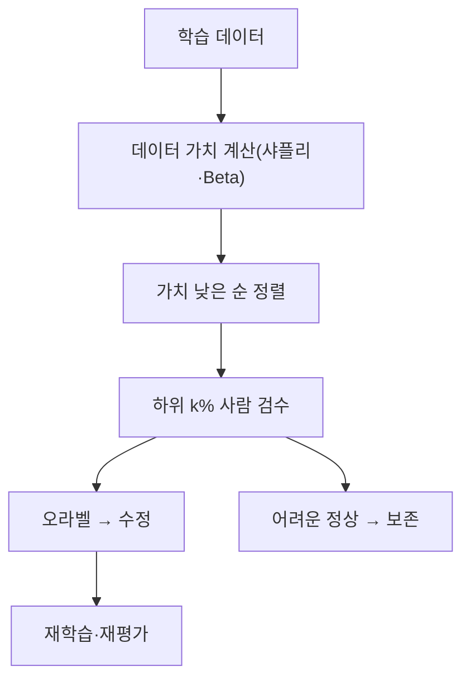
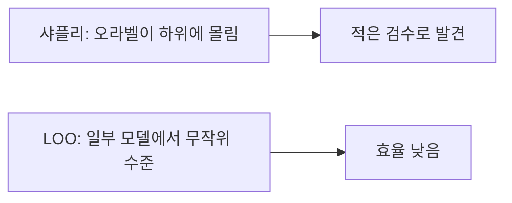

# 노이즈 라벨 탐지용 데이터 가치 평가

> 학습 데이터 각 점의 **가치**(모델 성능에 대한 기여)를 계산하면 **가치가 낮거나 음수인 점**이 잘못된 라벨·오염된 이미지일 가능성이 높다. 이 점들부터 사람이 검수하면 무작위로 뒤지는 것보다 훨씬 적은 검수로 오라벨을 찾는다.

## 쉽게 말하면
시험 대비 문제집에서 풀 때마다 모의고사 점수를 떨어뜨리는 문제가 있다면 정답이 틀렸을 가능성이 크다. 점수에 미친 영향이 나쁜 문제부터 정답을 재확인하면 오답지를 빨리 찾는다.

## 자세히
- **방법**: 데이터 샤플리·Beta Shapley 같은 데이터 가치를 계산한 뒤 **가장 낮은 값부터** 검수 목록을 만든다. 낮은 값은 그 점이 모델 성능을 오히려 해치거나(음수) 도움이 안 된다는 뜻이다.
- **Data Shapley 논문의 실험(Ghorbani & Zou, arXiv 1904.02868, 본문 확인; 저자 보고)**
  - 오라벨이 섞인 **세 데이터셋(서로 다른 모델)** 에서 가치가 낮은 점부터 검사했더니 오라벨이 **가장 낮은 가치군에 있어 일찍 발견**됐다. 스팸 분류(스팸 데이터 중 600개 라벨 뒤집기), 꽃 이미지(100개 오라벨), MNIST T셔츠·상의 vs 셔츠(100개 오라벨) 같은 설정이 부록에 있다.
  - **LOO와 비교**: LOO는 로지스틱 회귀에서는 쓸 만했지만 **다른 두 모델에서는 무작위 검사와 비슷한 수준**이었다. 샤플리가 데이터 품질을 더 잘 반영.
  - 이미지 오염: 개 vs 물고기 1,000장 중 10%에 백색 소음을 더하자 **소음이 클수록 해당 점의 평균 가치가 청결한 점보다 낮아졌다**(10회 반복 평균).
  - 저비용 웹 검색 이미지(1,155장)로 학습한 피부 병변 분류에서 **음수 가치 점을 삭제하고 나머지를 가치로 가중**하는 방식으로 성능을 개선했다고 보고.
- **Beta Shapley 논문의 비교(arXiv 2110.14049, 본문 확인)**: 15개 데이터셋에서 라벨 10%를 뒤집고 K-Means로 두 군집 중 낮은 쪽을 노이즈로 판정해 F1 비교. Beta(16,1)이 가장 좋고 Northcutt의 불확실성 기반 기법(평균 F1 0.42)보다 앞섰다([Beta 가중치](#beta-weight-tuning)). CIFAR100 시험 세트는 이미지의 약 5.85%가 오라벨이라는 추정치(Northcutt 외 2021b) 위에서 실험.
- **운영 절차(권장)**
  1. 신뢰할 수 있는 별도 **검증 세트**로 효용 함수를 정한다([효용 함수 선택](#utility-function-choice)).
  2. 값을 계산(근사는 [수렴 점검](#shapley-convergence-check)).
  3. 하위 k%(예: 3~5%)를 사람이 검수해 **정밀도**(그중 실제 오라벨 비율)를 구간과 함께 기록.
  4. 오라벨이면 수정하고 재학습·재평가, 아니면 "어려운 정상 예시"로 분류해 보존.
  5. 한 번에 다 지우지 말고 점진적으로.
- **한계**: 가치가 낮다 = 오라벨이 아니다. 희귀 클래스나 소수 집단 예시는 가치가 낮게 나와 **지워서는 안 되는 어려운 사례**일 수 있다([평균이 가리는 약한 집단](#average-masking-weak-groups)). 가치는 검증 세트·모델에 의존하고 계산 비용이 크다.

## 그림으로 보기



## 예시
```python
phi = data_shapley(train, utility)          # 값 계산(개념)
order = np.argsort(phi)                     # 낮은 값부터
review = order[: int(0.03 * len(order))]    # 하위 3% 검수
precision = confirmed_label_errors / len(review)
```
- 고객 문의 데이터 10만 건 중 하위 3%(3,000건)를 검수해 2,100건이 오라벨이면 정밀도 70%.

## 헷갈리는 것과 비교
| 방법 | 원리 |
|---|---|
| 데이터 가치(샤플리) | 성능 기여로 점수화 |
| 확신 학습(Confident Learning) | 모델 예측 확률과 라벨 불일치 |
| 모델 오분류 점검 | 틀린 예측 확인 |
| [Beta 가중치 선택](#beta-weight-tuning) | 가치 계산의 가중 설정 |

## 더 읽을거리
- [Data Shapley (arXiv 1904.02868)](https://arxiv.org/abs/1904.02868) — 오라벨 탐지와 LOO 비교(PDF 본문 확인).
- [Beta Shapley (arXiv 2110.14049)](https://arxiv.org/abs/2110.14049) — 15개 데이터셋 F1 비교(PDF 본문 확인).
