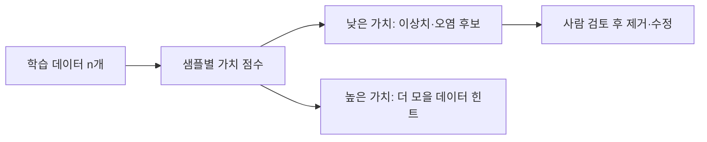
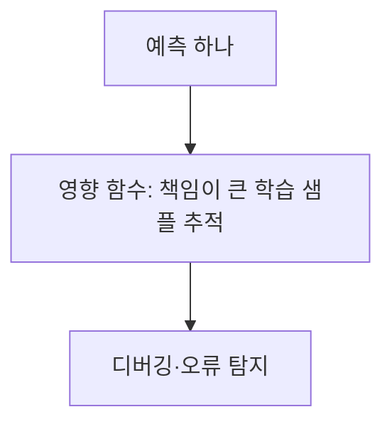

# 데이터 가치 평가

> 학습 데이터의 각 샘플이 모델 성능에 얼마나 기여했는지를 점수로 매기는 일이다. 낮은 가치의 샘플은 이상치·오염 데이터일 가능성이 높고, 높은 가치는 어떤 데이터를 더 모을지의 힌트가 된다.

## 쉽게 말하면
축구팀에서 선수 한 명이 팀 성적에 얼마나 기여했는지 따지는 것이다. 한 명을 뺀 경기 결과만 보면(한 명씩 빼 보기) 비슷한 선수가 둘이면 서로 대체되어 기여가 작아 보인다. 여러 선수 조합을 폭넓게 평균해야 공정한 기여도가 나온다.

## 자세히
(두 논문의 초록을 직접 확인. 수식과 실험 수치는 초록에 없어 확인하지 못했다.)
- **Data Shapley(Ghorbani·Zou, arXiv:1904.02868, 초록 확인)**: n개 데이터로 학습하는 알고리즘이 주어졌을 때 **각 학습 샘플이 예측기 성능에 갖는 가치**를 정량화한다. 협력 게임 이론의 Shapley 값을 빌려 "공평한" 값을 준다고 설명하며, 의료·소비자 시장에서 데이터를 만든 개인에게 보상해야 하는지라는 문제의식에서 출발했다고 한다. 복잡한 모델(신경망)과 큰 데이터에서도 계산할 수 있도록 **몬테카를로·경사 기반 추정**을 제안한다. 활용: **가치가 낮은 데이터는 이상치·오염을 잡아내는 경향**이 있고, **가치가 높은 데이터는 어떤 새 데이터를 얻을지** 시사한다고 한다. 저자들은 한 개씩 빼는 방식(leave-one-out)이나 레버리지 점수보다 더 유익하다고 주장한다. (중복 샘플에서 leave-one-out이 왜 실패하는지는 초록에 없었다. 강의 노트에서 "Data Shapley는 여러 부분집합에 걸쳐 영향을 평균해 중복 샘플을 더 공정하게 평가한다"고 읽은 설명은 [표적 데이터 수집](#targeted-data-collection)에서 정리했다.)
- **영향 함수(Koh·Liang, arXiv:1703.04730, 초록 확인)**: 로버스트 통계의 고전 도구인 influence function을 써서 모델 예측을 책임이 큰 학습 샘플로 거슬러 추적한다. 구현은 기울기와 헤시안-벡터 곱만 필요해 현대 모델에 확장된다. 비볼록·미분 불가능 모델에서는 이론이 깨지지만 근사로도 유용한 정보를 얻는다고 한다. 선형 모델과 합성곱 신경망에서 **모델 동작 이해, 디버깅, 데이터셋 오류 탐지, 눈에 띄지 않는 학습 세트 공격 생성**에 쓸 수 있음을 보였다.
- **용도 정리**: 오류·오염 샘플 찾기([라벨 오류 탐지](#label-error-detection)와 상보), 추가 수집 방향 결정, 데이터 거래·보상 설계의 논의 근거.
- **한계(일반적)**: 계산 비용이 크고 근사 오차가 있다. 가치는 특정 모델·평가 세트에 의존한다. 이번 조사에서 대규모 LLM에 대한 적용 사례는 확인하지 못했다.

## 그림으로 보기

## 예시
- 문의 분류 데이터에서 가치 점수가 가장 낮은 하위 1%를 사람이 열어 보니 라벨이 뒤바뀐 사례가 다수 → 수정 후 재학습(가상의 시나리오, 제안).
- 교육 소재: "데이터 100개 중 어느 것이 가장 쓸모 있었나"를 보여 주는 데이터 시각화.

## 헷갈리는 것과 비교
| 개념 | 차이 |
|---|---|
| Data Shapley | 여러 부분집합을 평균한 공정한 기여도 |
| Leave-one-out | 한 개를 빼 본 변화 |
| 영향 함수 | 특정 예측에 영향을 준 학습 샘플 추적 |
| [데이터 유지·관리](#data-maintenance) | 가치 평가는 데이터 이해 과제의 한 갈래 |

## 더 읽을거리
- [Data Shapley (arXiv:1904.02868)](https://arxiv.org/abs/1904.02868) — 샘플 가치 정량화(초록 직접 확인).
- [Understanding Black-box Predictions via Influence Functions (arXiv:1703.04730)](https://arxiv.org/abs/1703.04730) — 영향 함수(초록 직접 확인).
