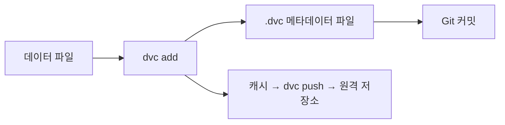
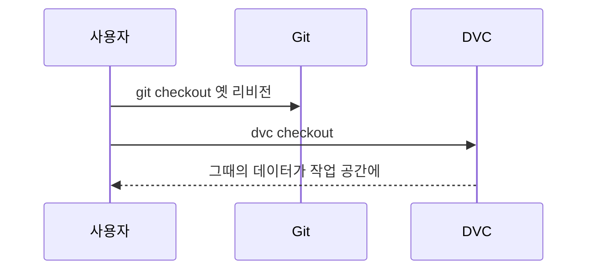

# 데이터 버전 관리

> 코드처럼 데이터에도 변경 이력을 남겨, "그때 학습에 쓴 데이터가 정확히 무엇이었나"를 되살릴 수 있게 하는 일이다. 모델 결과를 재현하고 문제가 생기면 이전 버전으로 되돌리는 데 필요하다.

## 쉽게 말하면
문서에 "최종_진짜최종_수정본2"를 쌓아 두는 대신, 저장할 때마다 번호가 붙고 언제든 옛 버전으로 돌아갈 수 있는 서랍장을 쓰는 것이다. 데이터는 용량이 커서 일반 코드 저장소에 그대로 넣기 어려우니, 서랍장 목록(메타데이터)만 코드 저장소에 두고 실물은 따로 보관하는 방식이 흔하다.

## 자세히
(DVC 공식 시작 문서를 직접 열어 확인. 이번에 직접 설치·실행해 보지는 않았다.)
- **DVC의 방식**: 문서는 DVC가 "기술적으로 그 자체로는 버전 관리 시스템이 아니다"라고 설명한다. DVC가 작은 `.dvc` 파일을 다루고 **Git이 그 파일의 버전을 관리**한다.
  - `dvc add data/data.xml`: 파일을 프로젝트 캐시로 옮기고 작업 공간에 링크하며, Git이 추적할 작은 `data/data.xml.dvc`를 만들고 실제 데이터 파일은 `.gitignore`에 넣는다.
  - `git add data/data.xml.dvc data/.gitignore` 후 `git commit`으로 메타데이터를 기록.
  - 원격 저장소: `dvc remote add -d myremote <경로>`로 지정, `dvc push`로 캐시된 데이터를 올리고 다른 사본에서 `dvc pull`로 받는다.
  - 버전 전환: `git checkout <revision>` 후 `dvc checkout`으로 해당 `.dvc`에 맞는 데이터를 작업 공간에 맞춘다.
  - 이전 데이터셋 버전으로 되돌리기: `git checkout HEAD~1 data/data.xml.dvc` → `dvc checkout` → `git commit data/data.xml.dvc -m "Revert dataset updates"`. 이전 버전은 이미 원격에 저장되어 있어 `dvc push`가 필요 없다.
- **왜 필요한가(일반적 설명)**: 같은 코드라도 데이터가 바뀌면 모델 성능이 달라진다. 코드 커밋 해시 + 데이터 버전을 함께 기록해야 실험을 재현할 수 있다.
- **LLM·RAG에서**: 문서 인덱스도 버전이 필요하다. 어느 시점의 문서로 만든 인덱스인지 기록하지 않으면 답이 바뀐 이유를 추적하기 어렵다(제안, [낡은 문서 정리](#stale-document-cleanup)).
- **대안·비교(이번에 미확인)**: Git LFS, 객체 저장소 버전 기능, lakeFS 등 다른 도구가 있다는 정도만 알고 직접 확인하지 못했다.
- **주의**: 개인정보가 든 데이터는 버전이 쌓이면 삭제 요청이 있을 때 모든 버전에서 지우기 어렵다(일반적 우려, [목적 제한](#purpose-limitation)).

## 그림으로 보기



## 예시
```bash
dvc init
dvc add data/data.xml
git add data/data.xml.dvc data/.gitignore
git commit -m "Add raw data"
dvc remote add -d myremote /tmp/dvcstore
dvc push
```
(공식 문서 예시 그대로.) 교육 소재: "모델 v3의 데이터는 어느 버전이었나요?"에 답하는 실습.

## 헷갈리는 것과 비교
| 개념 | 차이 |
|---|---|
| 데이터 버전 관리 | 데이터의 변경 이력과 복원 |
| 코드 버전 관리(Git) | 텍스트 코드 이력, 대용량 데이터엔 부적합 |
| [데이터 유지·관리](#data-maintenance) | 품질·신뢰성 관리 전반 |
| [사내 데이터 카드](#internal-data-card) | 데이터의 출처·허용 용도 문서 |

## 더 읽을거리
- [DVC 시작 문서](https://doc.dvc.org/start) — 데이터 버전 관리 흐름과 명령(직접 열어 확인).
