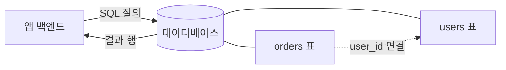

# 데이터베이스

> 앱의 데이터를 파일이 꺼져도 남도록 저장하고, 필요할 때 빠르게 조회·수정하게 해 주는 시스템.

## 쉽게 말하면
도서관 서고와 사서다. 책(데이터)을 분류 체계에 맞춰 보관하고, 요청하면 사서(DB 엔진)가 찾아 준다. 책상 위에 펼쳐 둔 메모(변수·메모리)는 퇴근하면 사라지지만 서고에 둔 책은 남는다.

## 자세히
- **관계형(SQL)**: 표(테이블)와 행·열로 저장. PostgreSQL, MySQL, SQLite. 표끼리 키로 연결한다. 대부분의 업무 앱 기본값.
- **문서형·키-값(NoSQL)**: JSON 비슷한 문서나 키-값 쌍. 구조가 자주 바뀌는 데이터에 쓴다.
- **벡터 DB**: 임베딩을 저장해 의미가 비슷한 것을 찾는다([검색·지식 연결](#knowledge-retrieval)).
- SQLite 공식 문서 기준 선택법: 기기 안 단일 앱 저장, 분석용 파일, 하루 약 10만 접속 이하의 소규모 웹사이트에 적합하다. **여러 서버가 한 DB를 공유**하거나 **쓰기가 동시에 많거나** 데이터가 TB급이면 PostgreSQL 같은 클라이언트/서버 DB가 맞다. SQLite는 읽기는 동시에 여러 개, 쓰기는 한 번에 하나다.
- 바이브코딩에서 흔한 실수: DB 없이 만들어 새로고침하면 데이터가 사라짐, DB 접속 정보를 코드에 하드코딩([환경 변수](#secrets-env)).
- 스키마(표 구조)를 바꾸는 마이그레이션은 AI에게 맡기더라도 실제 데이터 백업 후에 실행한다.

## 그림으로 보기


## 예시
```sql
SELECT name, total FROM orders
JOIN users ON orders.user_id = users.id
WHERE total > 100000;
```
- 개인 도구는 SQLite 파일 하나로 시작하고, 사용자가 늘면 PostgreSQL로 옮긴다.

## 헷갈리는 것과 비교
| 개념 | 차이 |
| --- | --- |
| 데이터베이스 | 구조화된 저장·조회 엔진 |
| 파일 저장 | 단순 보관. 질의·동시성 관리 약함 |
| 스프레드시트 | 사람이 보기 좋음. 앱의 백엔드로는 한계 |

## 더 읽을거리
- [Appropriate Uses For SQLite](https://www.sqlite.org/whentouse.html) — SQLite vs 클라이언트/서버 DB 선택 기준
