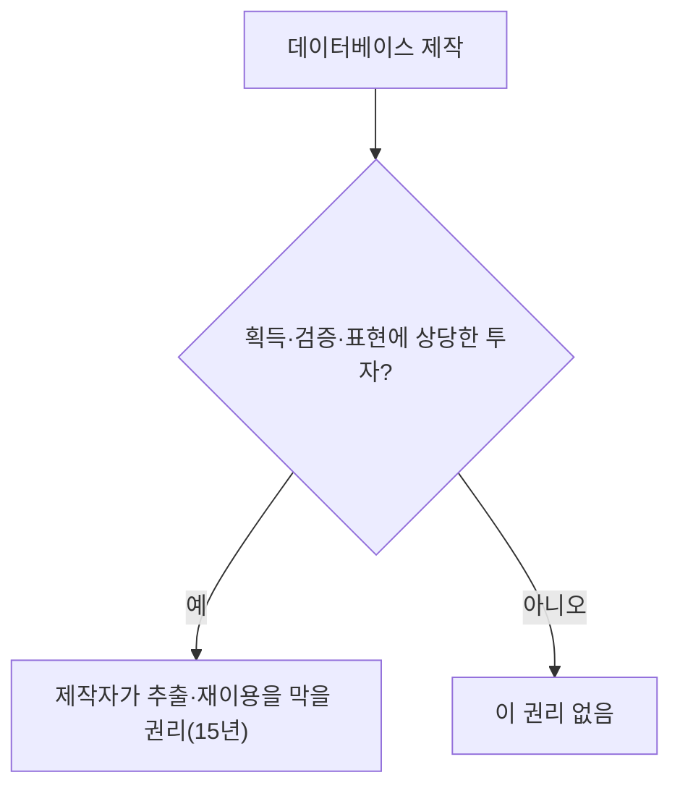

# 데이터베이스권(sui generis)

> EU의 데이터베이스 지침(96/9/EC)이 만든 **저작권과 별개의 권리**로, 데이터베이스를 구축하는 데 **상당한 투자**를 한 제작자가 내용의 전부 또는 상당 부분을 **추출·재이용**하는 것을 막을 수 있게 한다. 데이터 한 건이 저작물이 아니어도 모은 데이터 덩어리가 보호될 수 있다는 뜻이다.

## 쉽게 말하면
전화번호부의 개별 번호는 사실이라 저작물이 아니지만, 번호부를 만드는 데 큰 비용을 들인 사람은 그 번호부를 통째로 복사해 가는 것을 막을 권리를 가질 수 있다. 한 줄이 아니라 "번호부 전체"를 보호하는 권리다.

## 자세히
(EUR-Lex의 지침 96/9/EC 본문 제7조·제10조를 직접 읽음. 법률 자문이 아니며 국가별 이행 법률과 판례를 확인해야 한다)
- **보호 대상(제7조 1항)**: 내용의 **획득·검증·표현에 질적 또는 양적으로 상당한 투자**가 있었다는 점을 보인 데이터베이스 제작자는 내용의 **전부 또는 상당 부분**(질적·양적 평가)의 **추출 및/또는 재이용**을 막을 권리를 갖는다.
- **용어(제7조 2항)**: **추출**은 데이터베이스 내용의 전부 또는 상당 부분을 다른 매체로 어떤 수단·형태로든 **영구적 또는 일시적으로 옮기는 것**.
- **보호 기간(제10조)**: 완성일의 다음 해 1월 1일부터 **15년**. 공중에 제공된 경우는 **처음 공개된 해의 다음 해 1월 1일부터 15년**. 내용에 상당한 변경(질적·양적)이 있으면 새 투자로 보아 새 기간이 시작될 수 있다(본문 3항의 취지).
- **저작권과의 관계**: 지침 전문(recital)은 데이터베이스의 구조 선택·배열에 대한 저작권과, 내용을 복제해 재배열하는 행위에 대한 별도 보호의 필요를 구분해 설명한다. 즉 sui generis 권리는 저작권 보호가 닿지 않는 틈새(내용 복제)를 메우려는 권리다.
- **라이선스와의 연결**: CC BY 4.0은 "Copyright and Similar Rights"에 sui generis 데이터베이스 권리를 **포함**한다고 정의한다. ODC-By·ODbL은 처음부터 데이터베이스 권리를 다루는 라이선스다([ODC-By vs CC BY vs ODbL](#odc-by-vs-cc-by-odbl)).
- **웹 크롤링과의 관련(제안·논점)**: 웹에서 대규모로 수집해 만든 학습 데이터셋이 다른 사람의 데이터베이스를 상당 부분 추출한 것이 되는지는 지역·사안별 법적 쟁점이다. 이 글은 결론을 내리지 않는다. 데이터 계보 기록과 이용 약관 확인이 기본이다([옵트아웃의 한계](#opt-out-limits-existing-data)).

## 그림으로 보기

## 예시
- 유료 부동산 DB의 매물 목록을 대량 추출해 자기 서비스에 재게시하면 sui generis 권리 침해 주장이 가능(해석은 사안별).
- 교육: "개별 사실은 자유롭지만 모은 덩어리는 보호될 수 있다"는 AI 데이터 저작권 논의의 한 축.

## 헷갈리는 것과 비교
| 개념 | 차이 |
|---|---|
| 저작권 | 창작성 있는 선택·배열 보호 |
| sui generis 권리 | 상당한 투자를 한 DB 내용의 추출·재이용 방지, EU 기반 |
| 라이선스 | 이용자에게 권리를 허락하는 계약 |

## 더 읽을거리
- [EU 데이터베이스 지침 96/9/EC (EUR-Lex)](https://eur-lex.europa.eu/legal-content/EN/TXT/HTML/?uri=CELEX:31996L0009) — 제7조 보호 대상, 제10조 보호 기간(본문 읽음).
