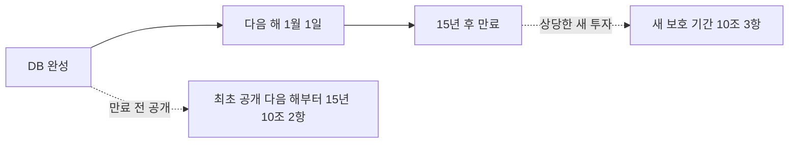
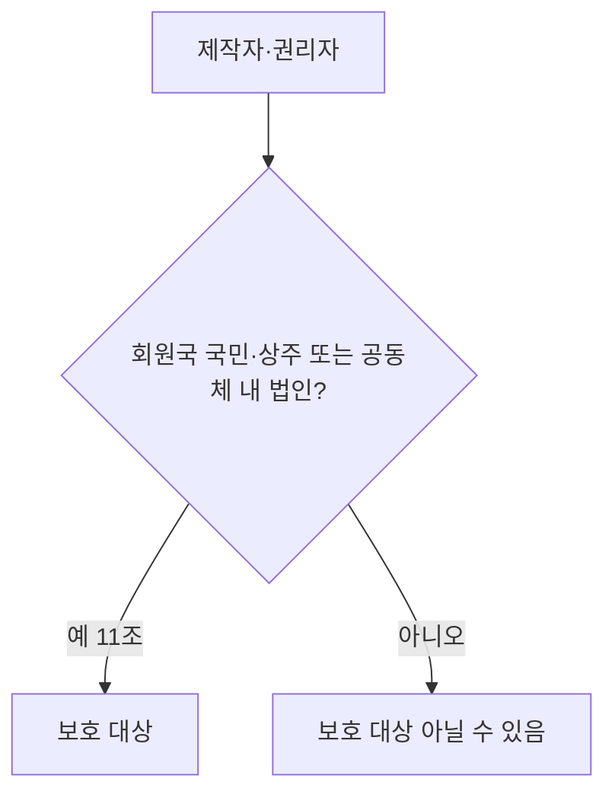

# 데이터베이스권 보호 기간

> EU 데이터베이스 지침의 독자적(sui generis) 권리는 **완성된 해의 다음 해 1월 1일부터 15년** 동안 보호되고, 데이터베이스를 **상당히 바꿔 새 투자를 하면 그 결과물이 새 기간**을 얻는다. (법률 자문이 아니라 조문 요약이다.)

## 쉽게 말하면
책의 저작권은 작가 사망 후 수십 년이지만, 데이터베이스 투자 보호는 훨씬 짧은 "투자 회수 기간"이다. 그런데 계속 크게 고쳐 새로 투자하면 시계가 다시 시작된다. 그래서 자주 갱신되는 DB는 사실상 계속 보호될 수 있다.

## 자세히
(지침 96/9/EC 제3장, legislation.gov.uk의 2019-06-06 개정본을 직접 읽음)
- **10조 1항**: 완성 시점부터 보호가 시작되어 **완성일이 속한 해의 다음 해 1월 1일부터 15년**이 지나 만료된다. 완성일 15년 뒤가 아니라 다음 해 1월 1일 기준이다. 예: 2010년에 완성되면 2011-01-01부터 15년, 즉 2025년 말까지(단순 산술).
- **10조 2항**: 만료 전에 공중에 공개됐다면 **최초로 공중에 제공된 해의 다음 해**부터 15년으로 계산한다.
- **10조 3항**: 내용의 **상당한 변경**(연속된 추가·삭제·변경의 누적 포함)이 상당한 새 투자에 해당하면 그 투자로 생긴 데이터베이스는 **자기만의 보호 기간**을 얻는다.
- **11조(수혜자)**: 제작자나 권리자가 회원국 국민이거나 공동체에 상주하는 경우, 또는 회원국 법에 따라 설립된 회사로서 공동체 내에 등록 사무소·중앙 관리·주된 영업소가 있는 경우 보호된다. 등록 사무소만 공동체에 있다면 사업이 회원국 경제와 지속적·실질적으로 연결돼야 한다.
- **AI 데이터에서의 의미(일반 설명, 판단은 법무 몫)**: 수년마다 갱신되는 웹 크롤 아카이브나 상품 DB는 새 투자가 인정되는 변경이면 기간이 갱신될 수 있다. 오래된 스냅샷은 만료됐을 수 있지만, 만료 여부와 별개로 그 안의 개별 저작물은 저작권이 남을 수 있다. 지침은 EU 법이라 한국에 직접 적용되지 않는다.
- **주의**: "상당한 변경"이 어느 정도인지는 조문에 수치가 없다. 개정(2019/790)의 영향은 이번에 확인하지 못했다.

## 그림으로 보기

## 예시
| 상황 | 보호 기간 계산 |
|---|---|
| 2010년 완성, 미공개 | 2011-01-01부터 15년 → 2025년 말 |
| 2024년 완성 | 2025-01-01부터 15년 → 2039년 말 |
| 상당한 새 투자로 대규모 개편 | 개편 결과물에 새 15년 |
- 업무 장면: 오래된 공개 데이터베이스를 학습에 쓰려는 경우 완성·공개 시점과 이후 대규모 개편 이력을 확인하고 법무에 문의한다.

## 헷갈리는 것과 비교
| 개념 | 차이 |
|---|---|
| DB권 보호 기간 | 15년, 상당한 변경 시 갱신 |
| 저작권 보호 기간 | 저작자 사후 수십 년(국가별) |
| [추출과 재이용](#extraction-reutilization) | 보호받는 행위 |
| [독자적 데이터베이스 권리](#database-right-sui-generis) | 권리 전체 개요 |

## 더 읽을거리
- [Directive 96/9/EC 제3장 (legislation.gov.uk)](https://www.legislation.gov.uk/eudr/1996/9/chapter/III) — 10·11조(직접 읽음).
