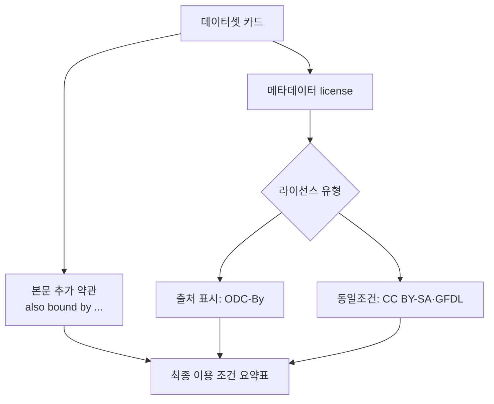
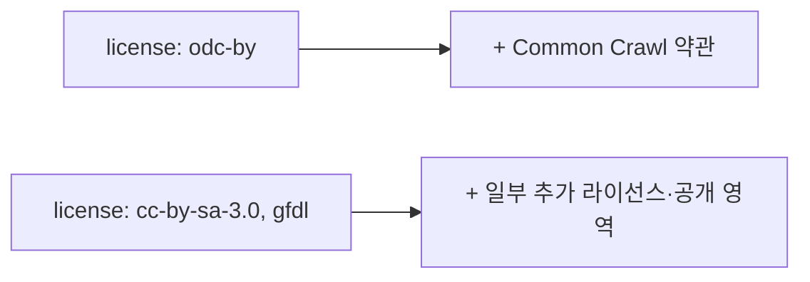

# 데이터셋 카드 라이선스 확인

> 데이터셋을 쓰기 전에 **카드의 라이선스 항목과 "함께 적용되는 약관"까지 읽는** 점검. 라이선스 한 줄(`license: odc-by`)만 보고 끝내면 추가 조건을 놓친다. (법률 자문이 아니다.)

## 쉽게 말하면
가전제품 보증서 앞면의 "1년 무상 수리"만 보지 말고 뒷면의 "단, 소모품 제외"까지 읽는 일이다. 데이터셋 카드도 첫 줄 라이선스와 본문의 추가 조건을 함께 읽어야 한다.

## 자세히
(Hugging Face 데이터셋 README를 직접 읽음)
- **C4(`allenai/c4`)**: 메타데이터 `license: odc-by`, 본문 "Licensing Information"은 ODC-BY 조건으로 공개하며 "이를 사용하면 데이터에 포함된 내용에 대해 **Common Crawl 이용약관에도 구속**된다"고 적는다. 카드는 콘텐츠 소유권이나 개인정보 처리에 대해서는 언급하지 않았다.
- **FineWeb(`HuggingFaceFW/fineweb`)**: ODC-By 1.0과 Common Crawl 이용약관, 그리고 PII 처리 범위(이메일·공개 IP만)와 삭제 요청 이력까지 카드에 있다([FineWeb 이용 조건](#fineweb-license-terms)).
- **Wikipedia(`wikimedia/wikipedia`)**: 메타데이터에 `cc-by-sa-3.0`과 `gfdl` 두 라이선스가 있고, 본문은 "원본 텍스트 콘텐츠는 GFDL과 CC BY-SA 3.0으로 라이선스"되며, "일부 텍스트는 CC 라이선스로만 제공될 수 있고" "일부 저자의 글은 추가 라이선스나 퍼블릭 도메인으로 공개될 수 있다"고 적는다. 상세는 Wikimedia 법적 안내와 이용약관을 참고하라고 하며, 출처 표시 요건이나 미디어 라이선스는 이 섹션에 없었다. CC BY-SA·GFDL은 동일조건변경허락 요소가 있어 [Share-alike](#share-alike) 확인이 필요하다(요약은 직접 읽은 CC BY-SA 설명 기준).
- **같은 "공개"라도 조건이 다르다**: ODC-By(출처 표시), 추가 약관(Common Crawl), CC BY-SA·GFDL(동일조건 포함). 한 줄 라이선스 이름으로 판단하지 않는다.
- **점검표(제안)**: ① 메타데이터의 `license` ② 본문의 추가 약관 문장(예: "also bound by") ③ 라이선스 유형: 출처 표시만인지 동일조건인지 ④ 콘텐츠 소유권·제3자 자료 언급 ⑤ 개인정보 처리 서술 ⑥ 삭제·변경 이력 ⑦ 우리 사용 목적(상업·공개 배포·내부 연구). 불명확하면 법무에 문의([라이선스 요약과 전문](#license-summary-vs-legal-text)).
- 한계: 이번에는 세 카드의 일부만 읽었고, Wikipedia 카드 본문은 길이 때문에 라이선스 섹션만 확인했다.

## 그림으로 보기

## 예시
| 카드 | 라이선스 | 함께 읽을 것 |
|---|---|---|
| C4 | odc-by | Common Crawl 이용약관 |
| FineWeb | ODC-By 1.0 | Common Crawl 약관, PII 범위, 삭제 이력 |
| Wikipedia | cc-by-sa-3.0, gfdl | 추가 라이선스·Wikimedia 약관 |
- 업무 장면: 교육용 말뭉치를 정할 때 후보 데이터셋 5개의 라이선스·추가 약관·동일조건 여부를 표로 정리해 선택 근거로 첨부한다.

## 헷갈리는 것과 비교
| 개념 | 차이 |
|---|---|
| 카드 라이선스 확인 | 메타데이터+본문 조건 읽기 |
| [데이터 카드 읽기](#data-card-reading) | 카드 전체 읽는 법 |
| [라이선스 요약과 전문](#license-summary-vs-legal-text) | 요약과 전문의 차이 |
| [Share-alike](#share-alike) | 동일조건 요소 확인 |

## 더 읽을거리
- [allenai/c4 데이터셋 카드](https://huggingface.co/datasets/allenai/c4) — ODC-BY와 Common Crawl 약관 문구(README 직접 읽음).
- [wikimedia/wikipedia 데이터셋 카드](https://huggingface.co/datasets/wikimedia/wikipedia) — CC BY-SA·GFDL 서술(README 직접 읽음).
