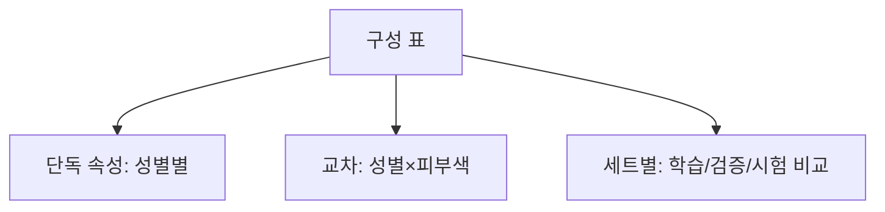

# 데이터 구성 표

> 데이터셋을 속성(성별·피부색·연령·지역 등)별로 몇 건이고 몇 %인지 한 표에 정리한 것이다. 어떤 집단이 적게 대표되는지 학습 전에 확인하고, 집단별 성능 격차의 원인 후보를 찾는 첫 단계다.

## 쉽게 말하면
급식을 준비하기 전에 학생 명단을 학년·알레르기 유형별로 세어 보는 일이다. 알레르기가 있는 학생이 2%뿐인데 평균 만족도만 보면 그 학생들의 불편이 보이지 않는다. 구성 표는 "누가 얼마나 들어 있는가"를 보여 준다.

## 자세히
(Gender Shades 논문 PDF 본문의 데이터셋 분석 절을 직접 확인하고, 표 작성은 pandas로 직접 실행.)
- **사례(Gender Shades)**: 저자들은 성별·피부 유형(Fitzpatrick)으로 기존 벤치마크의 구성을 표로 분석했다. 밝은 피부 비중이 IJB-A **79.6%**, Adience **86.2%**. IJB-A에서는 어두운 피부 여성이 가장 적게(**4.4%**), Adience에서는 어두운 피부 남성이 가장 적게(**6.4%**) 대표됐고, 밝은 피부 남성은 고유 피험자 중 가장 많았다(IJB-A 59.4%, Adience 41.6%). 이 분석이 새 균형 데이터셋 PPB(1,270명) 설계의 동기가 됐다([Gender Shades](#gender-shades)).
- **만드는 법(제안)**
  1. 점검할 속성을 정한다(법적·윤리적으로 중요한 속성, 서비스 대상 집단 속성).
  2. **교차표**(예: 성별×피부색)와 한 속성 단독 표를 모두 만든다 — 단독으로는 안 보이는 작은 칸이 교차표에서 드러난다.
  3. 칸마다 **건수와 비율**을 같이 적는다. 건수가 너무 작은 칸은 평가 신뢰도가 낮다고 표시([작은 시험셋의 변동](#small-test-set-variance)).
  4. 학습·검증·시험 세트마다 같은 표를 만들어 분포가 같은지 확인.
  5. 실제 사용 대상 집단의 비율(기준)과 나란히 비교.
- **직접 실행(가상 100명, pandas `crosstab`)**: 여성 40(어두운 4·밝은 36), 남성 60(어두운 10·밝은 50). 전체 비율은 어두운 여성 4.0%, 밝은 여성 36.0%, 어두운 남성 10.0%, 밝은 남성 50.0% — 어두운 피부 전체가 14%뿐이고 그중 여성이 4%로 가장 작은 칸. 이처럼 교차표에서만 가장 작은 칸이 선명해진다.
- **한계(제안)**: 속성 정보가 없거나(민감 속성 수집 제한) 라벨링 자체가 부정확할 수 있다. 표는 대표성의 한 단면이며 집단별 성능은 따로 측정해야 한다. 속성을 지워도 상관 특징이 남는 문제는 [대리 변수](#proxy-variables).
- 문서화: 구성 표는 [사내 데이터 카드](#internal-data-card)의 "알려진 한계"에 포함시킨다.

## 그림으로 보기



## 예시
```python
import pandas as pd
print(pd.crosstab(df.gender, df.skin, margins=True))                    # 건수
print((pd.crosstab(df.gender, df.skin, normalize="all") * 100).round(1)) # 비율(%)
```
- 채용 서류 스크리닝 학습 데이터: 직군×성별×연령대 표를 만들어 5% 미만 칸을 표시하고 추가 수집·가중치 보정을 검토([재가중·오버샘플링](#reweighting-oversampling)).

## 헷갈리는 것과 비교
| 개념 | 차이 |
|---|---|
| 데이터 구성 표 | 속성별 건수·비율(입력 데이터의 구성) |
| 집단별 성능 표 | 속성별 오류율(모델 출력의 격차) |
| [사내 데이터 카드](#internal-data-card) | 데이터 문서화(구성 표를 포함) |
| [데이터 분포 편향](#data-distribution-bias) | 구성 불균형이 일으키는 문제 개념 |

## 더 읽을거리
- [Gender Shades (PMLR 81, 2018)](http://proceedings.mlr.press/v81/buolamwini18a/buolamwini18a.pdf) — 기존 벤치마크 구성 분석과 PPB(PDF 본문 확인).
