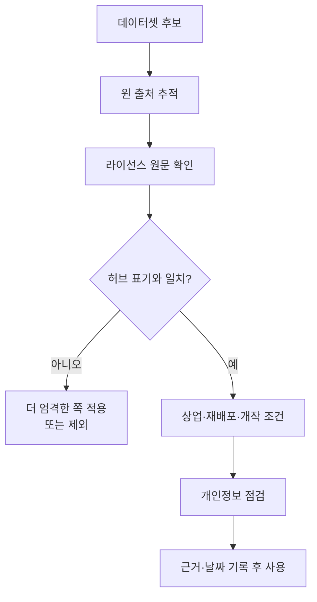

# 데이터셋 라이선스 체크리스트

> 데이터셋을 모델 학습·평가·제품에 쓰기 전에 출처·라이선스·사용 조건·재배포 제한을 항목별로 확인하는 점검표다. 데이터 허브에 적힌 라이선스 표기를 그대로 믿으면 틀릴 확률이 높다는 감사 결과 때문에 필요하다.

## 쉽게 말하면
중고 부품을 사서 제품에 넣기 전에 원래 제조사 보증서와 판매 허가를 확인하는 일이다. 중간 판매자가 "자유롭게 쓰세요"라고 적었어도 원 제조사 조건이 더 엄격할 수 있다.

## 자세히
- **왜 점검하나**: Data Provenance Initiative 감사(Longpre 외, arXiv 2310.16787, 초록 직접 확인)는 1,800개 이상 텍스트 데이터셋을 추적해 널리 쓰이는 호스팅 사이트에서 **라이선스 누락 70% 이상, 분류 오류 50% 이상**이라고 보고했다(버전에 따라 72%로 표기된 사본도 있음). 저자들은 Data Provenance Explorer로 계보를 추적하게 했다.
- **후속 연구(2024-12, arXiv 2412.17847, 직접 확인)**: 텍스트·음성·영상 3,916개 감사. 데이터셋 자체 라이선스가 출처 약관과 충돌하는 비율이 텍스트 토큰 79%, 음성 55%, 영상 65%. 텍스트의 99.8%는 최소 한 출처에서 비상업 제한이 있는데 비상업 라이선스로 표기된 건 25%뿐이었다. 라이선스·용도 문서가 아예 없는 비율은 텍스트 19%, 영상 36%.
- **체크리스트(이 글의 정리)**
  1. 원 출처 확인: 데이터가 어디서 왔나(웹·합성·다른 데이터셋 파생?)
  2. 데이터셋 라이선스 원문과 허브 표기 비교
  3. 상업적 이용 가능 여부, 출처별 제한(예: 모델 약관 기반 합성 데이터의 "경쟁 모델 학습 금지")
  4. 개작·재배포 조건([CC ShareAlike](#cc-sharealike) 등 상속 조항)
  5. 개인정보·초상·민감 데이터 여부
  6. 모음집(collection)이면 하위 데이터셋별 확인
  7. 확인 일자·버전·근거 링크를 기록(데이터 카드·출처 기록)
- **한계**: 체크리스트는 법률 자문이 아니다. 출처 단계 약관은 바뀔 수 있어 확인 일자를 남겨야 한다. 후속 논문은 "모든 개발자에게 맞는 하나의 기준을 제안하지 않는다"고 밝힌다.

## 그림으로 보기

## 예시
- 오픈 파인튜닝 모음에서 데이터를 고를 때: 허브가 "Apache-2.0"이라 해도 하위 데이터가 모델 출력(합성)이면 해당 모델 약관을 확인.
- 교육 소재: 같은 데이터셋 3개를 주고 "상업 사용 가능?"을 조사해 표로 채우는 실습.

## 헷갈리는 것과 비교
| 개념 | 차이 |
|---|---|
| 데이터셋 라이선스 | 데이터셋 배포자가 붙인 조건 |
| 출처 약관 | 원 출처의 조건(더 엄격할 수 있음) |
| [robots.txt와 이용약관 불일치](#robots-txt-vs-tos) | 수집 시점의 신호 해석 |
| [AI 크롤러 차단](#ai-crawler-blocking) | 사이트 측 차단 신호 |

## 더 읽을거리
- [The Data Provenance Initiative (arXiv 2310.16787)](https://arxiv.org/abs/2310.16787) — 1,800+ 텍스트 데이터셋 감사(초록 확인).
- [Bridging the Data Provenance Gap (HF Papers 2412.17847)](https://huggingface.co/papers/2412.17847.md) — 3,916개 멀티모달 감사 수치(열어 확인, 앞 100,000자).
