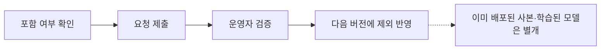
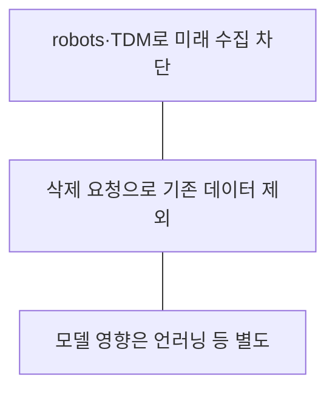

# 데이터셋 삭제 요청

> 이미 공개·수집된 데이터셋에서 **내 콘텐츠를 빼 달라고 요청하는 절차**다. 운영자마다 방법·적용 범위가 다르고, 대개 **앞으로 만들 버전에 반영**되며 이미 배포된 파일이나 학습된 모델이 바뀐다는 보장은 없다.

## 쉽게 말하면
이미 인쇄된 책에서 내 글을 빼 달라고 출판사에 요청하는 것과 같다. 다음 쇄(개정판)에서는 빠질 수 있지만, 이미 서점에 풀린 책은 회수되지 않는다.

## 자세히
- **BigCode "The Stack"(코드 데이터셋)**(공식 문서 열람, 2026-11-27): ① "Am I in The Stack?" 도구로 내 저장소가 포함됐는지 먼저 확인 ② GitHub의 **opt-out 저장소에 이슈**를 만들어 요청(소유자 검증을 위해 이슈 방식, 저장소 전체 또는 일부, 커밋·이슈 포함 가능) ③ 문제가 있으면 이메일 문의. **반영 시점**: v1.1은 2022-11-15까지, v1.2는 2023-02-09까지 접수된 요청이 제외됐다고 문서가 표기한다. 계획은 **3개월마다 데이터셋 갱신**(요청 수에 따라 바뀔 수 있음). 검증된 요청과 코드 포인터는 저장해 이후 버전에서 제외한다. **이미 학습된 모델**에 대한 언급은 문서에 없다.
- **Common Crawl**(2025-09-17 블로그 글 열람): 법적 옵트아웃 요청 **전체 목록을 공개**하며, 이 목록은 이후 이름이 "Opt-Out Registry"에서 **"Opt-Out Ledger"**로 바뀌었고 "변경 불가한(immutable) 성격"을 반영한 이름이라고 설명한다. 문의·제출은 info@commoncrawl.org. 글은 요청이 **미래 크롤에만 적용되는지, 기존 아카이브에도 적용되는지 명시하지 않는다**. 제3자 보도(검색 결과 요약, 직접 열어 확인하지 않음)는 출판사들이 이미 수집된 콘텐츠의 삭제를 요구해 왔고 일부만 제거됐다고 전하며, 이는 분쟁이 진행 중이라는 뜻이다(원문·보도 미확인 — 단정 금지).
- 공통 구조(비교 요약):
  | 항목 | The Stack | Common Crawl |
  |---|---|---|
  | 요청 창구 | GitHub 이슈 + 이메일 | 이메일, 공개 목록(ledger) |
  | 반영 | 다음 버전부터 | 문서에 범위 명시 없음 |
  | 소유권 확인 | 이슈로 검증 | (문서에 상세 없음) |
  | 이미 학습된 모델 | 언급 없음 | 언급 없음 |
- 실무(제안): ① 요청 전에 포함 여부를 확인 ② 요청 날짜·접수 번호·응답을 저장 ③ **robots.txt·TDM 신호도 함께 설정**해 이후 수집을 줄임([옵트아웃 신호 지형](#opt-out-signal-landscape)) ④ 수집자라면 요청을 받을 수 있도록 [데이터 계보 기록](#data-lineage-record)을 두고 다음 버전에 확실히 반영.
- 한계: 법적 권리(삭제 요구권 등)의 존재·범위는 지역과 사안마다 다르다. 이 문서는 법률 자문이 아니다.

## 그림으로 보기

## 예시
- 개발자가 "Am I in The Stack?"으로 내 저장소를 확인한 뒤 opt-out 저장소에 이슈를 올려 다음 버전에서 제외 요청.
- 교육: 데이터 거버넌스 과제 — "삭제 요청을 받으면 어느 기록에서 무엇을 찾을 것인가?"

## 헷갈리는 것과 비교
| 개념 | 차이 |
|---|---|
| 옵트아웃(미래) | 앞으로 수집하지 말라는 의사 |
| 삭제 요청(과거) | 이미 있는 데이터에서 빼 달라는 요청 |
| [머신 언러닝](#machine-unlearning) | 이미 학습된 모델의 영향을 줄이는 기술 |

## 더 읽을거리
- [BigCode: The Stack](https://www.bigcode-project.org/docs/about/the-stack/) — opt-out 절차(읽음).
- [Common Crawl: Opt-Out Registry(→ Ledger)](https://commoncrawl.org/blog/common-crawl-foundation-opt-out-registry) — 공개 목록(읽음).
