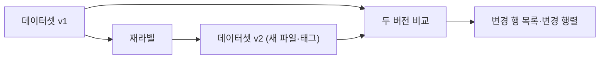
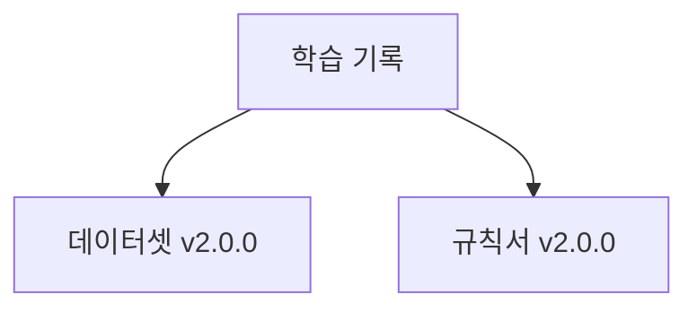

# 재라벨 후 데이터셋 버전

> 재라벨 후 데이터셋 버전은 규칙 변경에 따라 라벨을 고친 결과를 옛 데이터를 덮어쓰지 않고 새 버전으로 저장하고, 두 버전을 비교(무엇이 바뀌었나)할 수 있게 하는 관리 방식이다.

## 쉽게 말하면
문서를 고칠 때 "원본 보존 + 수정본 저장"을 하면 언제든 되돌리고 차이를 볼 수 있다. 데이터셋도 라벨 수정본을 새 버전으로 남겨야 학습 결과가 왜 달라졌는지 추적된다.

## 자세히
- **도구 사례(DVC 문서)**: DVC는 어떤 데이터셋·모델을 추적할지 적은 작은 메타파일을 Git에 넣고, 데이터 자체는 별도 저장소(로컬·클라우드)에 두며, "데이터와 모델의 버전을 Git 커밋에 담는다"고 한다. 각 버전은 중복 없이 캐시되고 작업 공간이 그 캐시에 연결된다. 이전 버전으로 이동하는 방법은 `dvc checkout`으로 연결된다. 문서의 해당 페이지는 비교 전용 단계나 태그를 다루지 않는다. 같은 일을 CSV와 git 태그만으로도 할 수 있다([규칙서를 git으로 관리](#guideline-in-git)).
- **직접 실행한 버전 비교(pandas, 가상 5건)**: v1과 v2를 `id`로 합쳐 라벨이 다른 행을 뽑으면 `id 1: 긍정→부정`, `id 4: 중립→부정` 2건(5건 중)이 나온다. `pd.crosstab(label_v1, label_v2)`로 변경 행렬도 얻었다(긍정 2건 유지·1건 부정으로, 중립 1건 부정으로, 부정 1건 유지). 변경 행렬은 [규칙 변경 영향 분석](#impact-analysis-for-rule-change)의 표와 같은 구조다.
- **저장 규칙(해석)**: ① 새 버전은 새 파일·새 태그(데이터셋 `v2.0.0`)로 저장하고 옛 것은 덮어쓰지 않는다 ② 버전마다 어떤 규칙서 버전에 해당하는지 기록([라벨 메타데이터 기록](#annotation-metadata-tracking)) ③ 변경된 행 목록(`id, 옛 라벨, 새 라벨, 재라벨자, 날짜`)을 함께 저장 ④ 평가셋은 버전을 고정한다([평가셋 고정](#evaluation-set-freeze)) ⑤ 학습 기록에 사용한 데이터셋 버전을 남긴다([버전 기준 학습 데이터 필터](#version-filtered-training)).
- **비교 확인(해석)**: 변경 건수가 [재라벨 표본 시험](#relabel-sample-test)에서 추정한 변경률과 크게 다르면 검색식이나 재라벨 과정을 점검한다.

## 그림으로 보기

## 예시
- `merge(v1, v2, on="id")`로 변경 행을 뽑아 `changes_v1_to_v2.csv`로 저장하고 데이터셋 v2와 함께 보관한다.
- 교육 활용: 가상 라벨 5건으로 v1/v2를 만들어 변경 행과 변경 행렬을 직접 구한다.

## 헷갈리는 것과 비교
| 개념 | 차이 |
| --- | --- |
| 새 버전 저장 | 옛 것을 보존하고 새 파일 |
| 덮어쓰기 | 이전 상태를 잃음 |
| [버전 기준 학습 데이터 필터](#version-filtered-training) | 어느 버전 라벨로 학습할지 |
| [재라벨 우선순위](#relabel-prioritization) | 어떤 순서로 고칠지 |

## 더 읽을거리
- [DVC: Versioning Data and Models](https://doc.dvc.org/use-cases/versioning-data-and-models) — 데이터 버전을 Git 커밋과 연결
