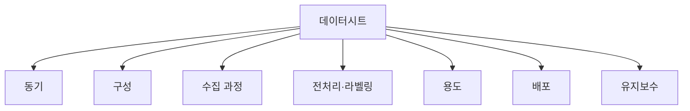

# 데이터시트(Datasheets for Datasets)

> 데이터셋마다 **동기·구성·수집 과정·전처리·용도·배포·유지보수에 관한 질문에 답하는 표준 설명서**를 붙이자는 Gebru 외(2018) 제안. 데이터 카드·모델 카드 같은 문서화 관행의 출발점이다.

## 쉽게 말하면
전자부품에는 "전압 범위, 사용 조건, 주의 사항"이 적힌 데이터시트가 붙는다. 데이터셋에도 같은 설명서를 붙이자는 아이디어다. 만드는 사람은 만들면서 되돌아보고, 쓰는 사람은 쓰기 전에 판단할 정보를 얻는다.

## 자세히
(Gebru 외, "Datasheets for Datasets", arXiv 1803.09010, 2018-03 제출·2021-12 CACM 게재. ar5iv 본문을 직접 읽음)
- **목표**: 제작자에게는 "데이터셋을 만들고 배포하고 유지하는 과정에 대한 신중한 성찰"을, 사용자에게는 "데이터셋 사용을 판단하는 데 필요한 정보"를 제공한다.
- **일곱 섹션과 대표 질문**:
  | 섹션 | 질문 예 |
  |---|---|
  | 동기(Motivation) | 왜 만들었나, 누가·누구를 위해 만들었나, 누가 자금을 댔나 |
  | 구성(Composition) | 인스턴스는 무엇이며 몇 개인가, 전체인가 표본인가(대표성은), 오류·잡음·중복·기밀·공격적 내용이 있나 |
  | 수집 과정 | 각 인스턴스를 어떻게 얻었나, 수집 참여자의 보상은, 윤리 심의가 있었나 |
  | 전처리·정제·라벨링 | 어떤 처리를 했나, 원본도 보관했나, 처리 소프트웨어는 공개됐나 |
  | 용도 | 이미 쓰인 과제는, 쓰면 안 되는 과제는, 구성·처리가 특정 집단에 불공정한 결과를 낳을 수 있나 |
  | 배포 | 제3자에게 어떻게 공유하나, 라이선스·이용 조건은, 수출 통제 등 규제는 |
  | 유지보수 | 누가 호스팅·유지하나, 업데이트와 사용자 알림은, 이전 버전은 계속 지원하나 |
- **실무 연결**: 이 질문들은 데이터 카드와 모델 카드의 항목으로 이어진다. 예를 들어 "처리를 했나, 원본을 보관했나"는 제외 데이터 보고와, "유지보수·업데이트"는 문서화 갱신과, "라이선스·이용 조건"은 카드의 라이선스 확인과 겹친다([데이터 카드 읽기](#data-card-reading), [문서화 갱신](#documentation-maintenance), [제외 데이터 보고](#excluded-data-report), [데이터셋 카드 라이선스 확인](#dataset-card-license-check)).
- **사용법(제안)**: 제작자는 데이터 수집 전에 질문에 먼저 답해 설계를 점검하고, 사용자는 답이 비어 있는 항목을 "확인되지 않음"으로 취급한다.
- 한계: 모든 질문에 답하기에는 비용이 들 수 있고, 답이 제작자의 자기 보고라는 점은 변하지 않는다([카드의 자기 보고 한계](#card-self-report-limits)).

## 그림으로 보기

## 예시
| 질문 | 답 예(가상 사내 데이터) |
|---|---|
| 왜 만들었나 | 고객 문의 분류 모델 학습용 |
| 표본인가 | 2024년 상담 로그의 무작위 표본, 대표성 한계 있음 |
| 개인정보 | 전화번호·이름 마스킹, 주민번호 미포함 확인 |
| 유지보수 | 분기별 갱신, 담당 팀 연락처 |
- 업무 장면: 교육용 데이터셋을 만들 때 7개 섹션 템플릿으로 한 장짜리 데이터시트를 쓰고 모델 카드에 링크한다.

## 헷갈리는 것과 비교
| 개념 | 차이 |
|---|---|
| 데이터시트 | 데이터셋 설명서의 원조 제안 |
| [데이터 카드](#data-card-reading) | Hugging Face 등의 구현 형태 |
| [모델 카드](#model-card-data-attribution) | 모델의 설명서 |
| [Datasheets for Datasets](#datasheets-for-datasets) | 같은 제안을 다룬 보조 노드 |

## 더 읽을거리
- [Datasheets for Datasets (arXiv 1803.09010)](https://arxiv.org/abs/1803.09010) — 7개 섹션과 질문(ar5iv 직접 읽음).
