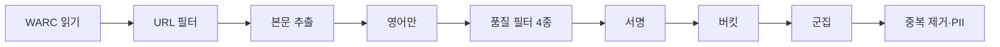
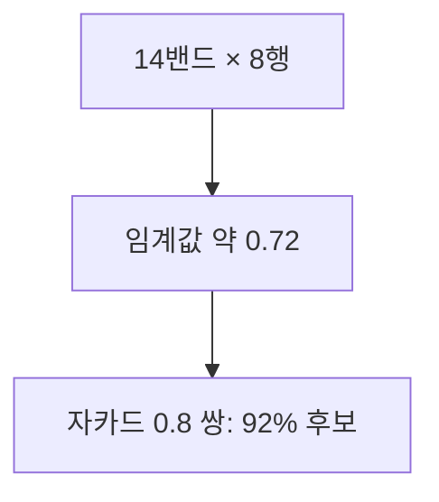

# datatrove FineWeb 재현 예제

> Hugging Face가 FineWeb 데이터셋을 만든 과정을 datatrove 코드로 옮겨 둔 `examples/fineweb.py`다. **Common Crawl 원본 → 필터 → MinHash 중복 제거**가 실제 대규모 파이프라인에서 어떤 단계와 숫자로 이어지는지 보여 주는 교재다.

## 쉽게 말하면
요리책의 대표 레시피 한 편이다. 재료 손질(웹페이지에서 본문 뽑기) → 거르기(언어·품질 필터) → 같은 접시 중복 치우기(MinHash)를 순서대로 하고, 각 단계에 몇 명의 요리사를 쓸지까지 적혀 있다.

## 자세히
(datatrove 저장소 `examples/fineweb.py`를 직접 읽음. 덤프 `CC-MAIN-2023-50` 기준)
- **1부 기본 처리**(SlurmPipelineExecutor, 8,000 task, 10시간, partition `hopper-cpu`): WarcReader → URLFilter → Trafilatura(`favour_precision=True`로 본문 추출) → LanguageFilter(영어만) → GopherRepetitionFilter → GopherQualityFilter → C4QualityFilter → FineWebQualityFilter → JsonlWriter.
- **2부 MinHash 중복 제거**(덤프마다): 공통 설정 sha1, 64비트, `num_buckets=14`, `hashes_per_bucket=8`, `n_grams=5`.
  1. `MinhashDedupSignature`(1,000 task): 문서별 서명 계산.
  2. `MinhashDedupBuckets`(700 task = 14 버킷 × 50 worker): 서명을 버킷으로 묶어 후보 쌍 찾기.
  3. `MinhashDedupCluster`(1 task, 25GB/CPU, 8 CPU, 30시간): 중복 군집을 만들어 제거 대상 ID 결정.
  4. `MinhashDedupFilter`(+TokensCounter, PIIFormatter, JsonlWriter; 1,000 task): 중복 제거와 개인정보(PII) 치환 후 저장.
- **설정 해석(직접 계산)**: 14개 밴드 × 8행이면 [밴딩 곡선](#lsh-banding-curve)의 임계값이 (1/14)^(1/8) ≈ 0.72다. 후보 확률은 자카드 0.5에서 0.053, 0.7에서 0.565, 0.8에서 0.924, 0.9에서 1.0. 5-그램 단위라 [섀글링](#shingling-ngrams) 길이는 5(단어 기준으로 보이나 코드의 단위는 직접 확인하지 않았다).
- 각 단계가 앞 단계 완료에 `depends`로 묶이는 구조라 단계 이름(`mh1_`~`mh4_`)별로 따로 재시작할 수 있다([실행기 종류](#pipeline-executor-types)).
- 재현에는 수천 CPU 시간이 필요해 개인 PC에서는 단계 구조만 학습용으로 따라 하고 규모는 줄여 돌린다(제안).

## 그림으로 보기

## 예시
- 소규모 모사: WARC 대신 HTML 수십 개를 읽는 Reader로 바꾸고, 필터·MinHash 단계 이름과 순서를 유지해 본다.
- 교육: "웹 데이터가 모델 학습 데이터가 되기까지" 전체 공정도로 쓴다.

## 헷갈리는 것과 비교
| 개념 | 차이 |
|---|---|
| FineWeb 예제 | 웹 크롤→정제→중복 제거 공정 |
| [MinHash·LSH](#minhash-lsh) | 중복 제거 4단계 중 핵심 알고리즘 |
| [datatrove](#datatrove) | 이 예제를 담은 라이브러리 |

## 더 읽을거리
- [datatrove examples/fineweb.py](https://github.com/huggingface/datatrove/blob/main/examples/fineweb.py) — 본 글의 단계·수치 출처(원문 읽음).
