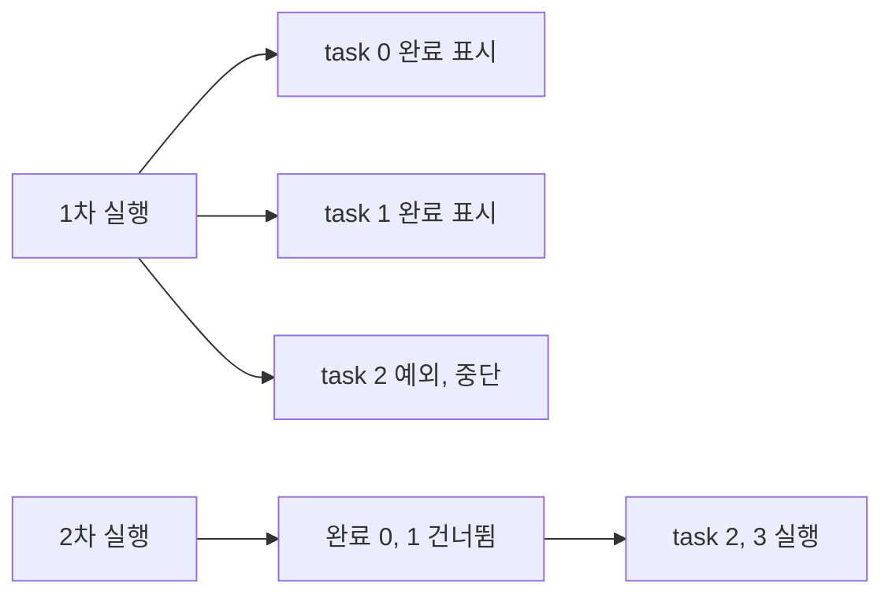
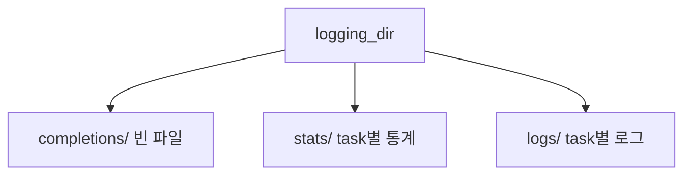

# skip_completed와 재개

> datatrove는 task(조각) 하나가 끝날 때마다 `logging_dir/completions/`에 빈 파일을 남기고, `skip_completed=True`(기본값)일 때 다시 실행하면 **끝난 조각은 건너뛰고 못 끝낸 조각만** 돌린다.

## 쉽게 말하면
이삿짐 상자 4개를 옮기는데 2개를 옮기고 일이 터졌다고 하자. 옮긴 상자에 스티커를 붙여 두었다면 다음 날 스티커 없는 상자만 옮기면 된다. 스티커가 완료 표시 파일이다.

## 자세히
- **README 확인**: `skip_completed`는 기본 True. 각 task가 끝나면 `${logging_dir}/completions`에 빈 파일을 만들고, 실패가 있었던 실행은 **같은 executor를 다시 실행**하면 미완료 task만 돈다. 단, 전체 task 수를 바꾸면 입력 파일 분배(sharding)가 달라져 안 되고, `logging_dir`을 다른 파이프라인과 같이 쓰면 통계·로그·완료 표시를 덮어쓴다. task마다 `stats/00000.json` 같은 통계와 개별 로그가 남는다.
- **직접 실행**(datatrove 최신판 pip 설치, JSONL 4파일 각 50문서, tasks=4, workers=1): 2번 조각(rank 2)에서 예외를 일부러 던졌다.
  - 1차 실행: rank 0·1은 문서 50개씩 처리하고 완료 표시 `00000`, `00001` 생성. rank 2에서 예외로 중단되어 **rank 3은 시작도 못 함**(workers=1일 때 순차 실행).
  - 2차 실행: 로그에 "Skipping 2 already completed tasks", rank 2·3만 50문서씩 처리, 완료 표시 4개.
  - 즉 중단 지점 이후의 조각도 이어서 돌았고, 앞의 두 조각은 다시 계산하지 않았다.
- 한계: 한 task가 중간에 죽으면 그 task는 **처음부터** 다시 한다(완료 표시는 task 단위). 그래서 task를 너무 크게 잡으면 재시도 비용이 커진다. 이 점은 실험의 구조에서 나온 해석이다.
- 주의: 코드를 바꿔 같은 `logging_dir`로 다시 돌리면 이전 결과가 완료로 취급돼 건너뛴다. 파이프라인이 바뀌면 `logging_dir`을 새로 쓰거나 `skip_completed=False`.

## 그림으로 보기

## 예시
- 서버가 밤새 죽어 수천 조각 중 일부만 끝난 경우: 같은 실행 스크립트를 그대로 다시 실행.
- 교육: 일부러 오류를 넣고 재실행해 완료 표시 폴더가 어떻게 바뀌는지 관찰하게 한다.

## 헷갈리는 것과 비교
| 개념 | 차이 |
|---|---|
| `skip_completed` | task 단위 건너뛰기 |
| 체크포인트 | 학습 도중 상태 저장. 여기선 task 완료만 기록 |
| `logging_dir` 재사용 | 다른 작업에 쓰면 덮어씀 |
| [실행기 종류](#pipeline-executor-types) | 이 기능은 모든 실행기에서 같은 개념 |

## 더 읽을거리
- [huggingface/datatrove README](https://github.com/huggingface/datatrove) — skip_completed, completions, 재개 규칙(열어 확인).
