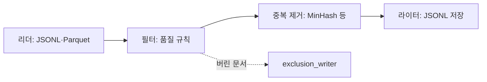
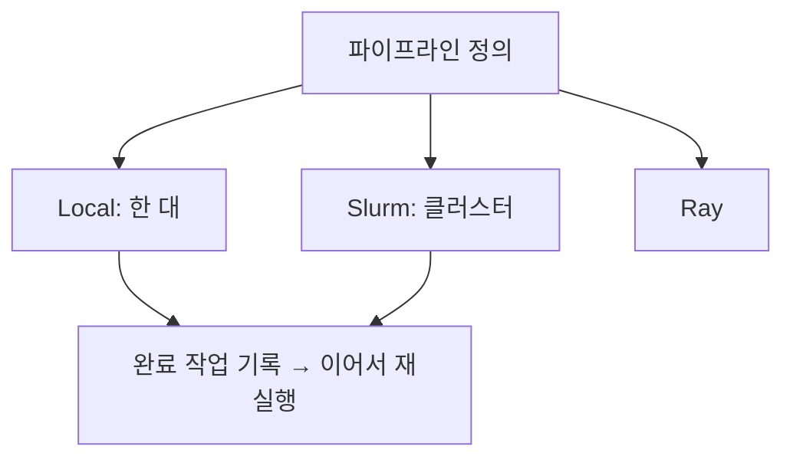

# datatrove

> Hugging Face가 만든 대규모 텍스트 데이터 처리·필터링·중복 제거 파이썬 라이브러리다. 블록(리더→필터→중복 제거→라이터)을 줄지어 파이프라인을 만들고, 한 대에서 또는 Slurm·Ray 클러스터에서 실행한다. 라이선스는 Apache-2.0.

## 쉽게 말하면
공장 컨베이어 벨트다. 원자재(웹 문서)가 벨트에 올라 불량 검사(필터), 중복 제거, 포장(저장)을 차례로 거친다. 작업이 중간에 멈춰도 끝난 구간은 기록돼 있어 이어서 돌릴 수 있다.

## 자세히
(GitHub 저장소 README를 직접 열어 확인.)
- **요구**: Python 3.11+. 설치는 `uv sync`에 `--extra io`, `--extra processing`, `--extra s3`, `--extra all` 등.
- **파이프라인 = 블록 리스트**: 각 블록은 `Document`(text·id·metadata) 스트림을 받아 새 스트림을 내놓는다.
  - **리더**: CSV·Parquet·JSONL 등(`CSVReader`, `ParquetReader`).
  - **필터**: 규칙에 따라 남기거나 버림. `SamplerFilter(rate=0.5)`는 약 절반을 무작위 유지. 버린 문서는 `exclusion_writer`로 저장 가능.
  - **중복 제거**: MinHash·문장 단위·정확 부분 문자열 방식(저장소에 각각 예제). 개념은 [MinHash·LSH](#minhash-lsh), [정확 부분 문자열 제거](#exact-substring-dedup).
  - **라이터**: `JsonlWriter` 등. 파일명에 rank·id·metadata 템플릿.
  - **기타**: Trafilatura 기반 HTML 텍스트 추출, 통계, 토크나이저.
- **실행기**: `LocalPipelineExecutor`(한 대, tasks·workers), `SlurmPipelineExecutor`(작업 배열, tasks·time·partition 필수, depends로 연결), `RayPipelineExecutor`, `JobsPipelineExecutor`(Hugging Face Jobs, 실험적).
- **재시작**: 완료된 작업을 기록하므로 다시 실행하면 안 끝난 것만 돌린다. 재실행 때 총 작업 수는 같아야 한다.
- **예제**: `fineweb.py`(FineWeb 재현), `process_common_crawl_dump.py`, `tokenize_c4.py`, `minhash_deduplication.py`, `sentence_deduplication.py`.
- 용도(제안): 사내 문서 코퍼스를 LLM 학습·RAG 인덱싱용으로 정제할 때, 수십만 건 이상에서 유용. 수천 건이면 pandas·datasketch로 충분하다.

## 그림으로 보기



## 예시
```python
from datatrove.executor import LocalPipelineExecutor
from datatrove.pipeline.readers import JsonlReader
from datatrove.pipeline.filters import SamplerFilter
from datatrove.pipeline.writers import JsonlWriter

LocalPipelineExecutor(
    pipeline=[JsonlReader("data/raw"), SamplerFilter(rate=0.5), JsonlWriter("data/out")],
    tasks=4, workers=4,
).run()
```
(README의 블록 이름을 조합한 최소 예시. 실제 인자는 버전에 따라 다를 수 있어 설치 후 확인 필요.)

## 헷갈리는 것과 비교
| 개념 | 차이 |
|---|---|
| datatrove | 대규모 텍스트 처리 파이프라인 프레임워크 |
| datasketch | MinHash·LSH 자료구조 라이브러리(부품) |
| [cleanlab](#cleanlab) | 라벨 오류·이상치 탐지(라벨링 데이터) |
| pandas | 단일 머신·소규모 표 데이터 처리 |

## 더 읽을거리
- [datatrove GitHub](https://github.com/huggingface/datatrove) — 블록·실행기·예제·라이선스(열어 확인).
