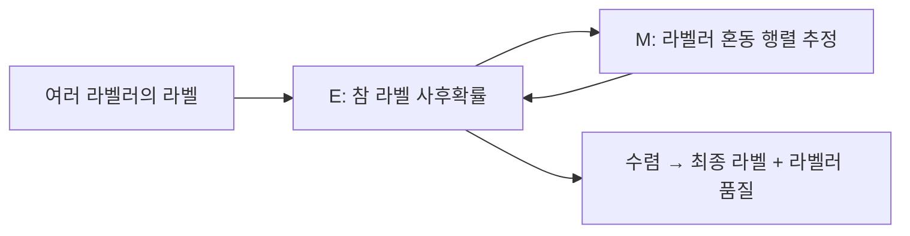
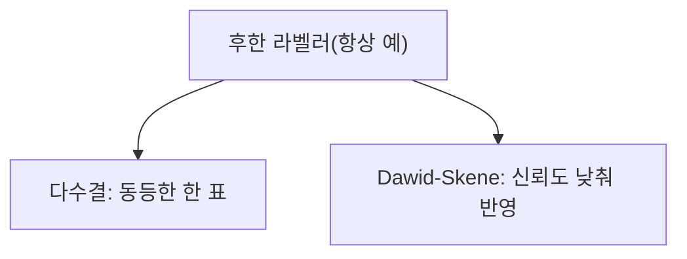

# Dawid-Skene 집계

> 여러 라벨러가 단 라벨을 합칠 때, 정답을 모르는 채로 EM 알고리즘으로 "라벨러마다의 오류 습관(혼동 행렬)"과 "각 항목의 참 라벨"을 동시에 추정해 신뢰도가 높은 라벨러에게 더 큰 비중을 주는 방법이다. 1979년에 제안된 고전 모델이다.

## 쉽게 말하면
다섯 명의 채점자 중 두 명이 늘 "합격"만 주는 후한 채점자라면, 그들의 "합격"은 덜 믿어야 한다. 이 방식은 정답지 없이도 각 채점자가 얼마나 후하거나 박한지를 서로의 답을 비교해 추정하고 그만큼 보정해 최종 판정을 낸다.

## 자세히
(Snow 등 EMNLP 2008 논문 PDF 본문의 관련 연구 절을 직접 확인하고, 이진 버전을 직접 구현해 시뮬레이션.)
- **기원(Snow 등 본문 요약)**: Dawid와 Skene는 **EM 알고리즘으로 주석자 편향과 잠재 라벨 클래스를 동시에 추정**하는 모델을 제안했다. 이 계열은 주석자의 신뢰도와 편향을 모델링해 라벨을 보정한다.
- **구성**: 항목마다 숨은 참 라벨이 있고, 라벨러마다 **혼동 행렬**(참 라벨이 A일 때 B라고 답할 확률)이 있다. ① E 단계: 현재 혼동 행렬로 각 항목의 참 라벨 사후확률 계산 ② M 단계: 사후확률로 혼동 행렬과 클래스 비율 재추정. 수렴할 때까지 반복.
- **직접 시뮬레이션(2,000건, 양성 29.5%, 이진 라벨러 5명)**: 라벨러의 (거짓 양성률, 참 양성률)을 (0.10, 0.80), (0.10, 0.75), **(0.60, 0.95)**, **(0.50, 0.90)**, (0.15, 0.70)로 설정 — 세 번째·네 번째는 "예"로 치우친 후한 라벨러.
  - 단순 다수결 정확도 **0.912**, Dawid-Skene(이진, 100회 EM) **0.932**.
  - 모델이 추정한 거짓 양성률 0.11·0.11·0.60·0.52·0.15, 참 양성률 0.80·0.75·0.97·0.91·0.73으로 **실제 값과 근접**, 클래스 비율 0.279(실제 0.295). 정답 없이 편향을 찾아냈다.
- **강점**: 라벨러마다 습관이 다를 때 다수결보다 낫고, 라벨러별 품질 점수를 부산물로 얻는다(품질 관리).
- **한계(제안)**: 라벨러당 응답이 충분해야 안정적이며, 라벨러가 서로 같은 방식으로 틀리면(상관) 과신한다. 초기값에 민감해 다수결로 초기화하는 것이 보통이다. 시뮬레이션은 독립·고정 혼동 행렬 가정이고 실제 크라우드 데이터는 더 복잡하다.
- **관련**: 약한 지도의 [라벨 모델](#label-model-denoising)은 같은 발상(정확도 추정 후 합치기)을 규칙(LF)에 적용한 것이다. 라벨러 품질을 정답 문항으로 직접 재는 방법은 [작업자 품질 골드 문항](#worker-quality-gold-questions).

## 그림으로 보기



## 예시
```python
# 이진 Dawid-Skene EM의 핵심 갱신(L: n×m 0/1 라벨, post: 양성 사후확률)
tp = [(post*L[:,j]).sum()/post.sum() for j in range(m)]
fp = [((1-post)*L[:,j]).sum()/(1-post).sum() for j in range(m)]
# 이어서 로그 우도로 post 재계산, 반복
```
- 사내 크라우드 라벨링에서 라벨러 8명의 오류 습관(과대 "긴급" 표시 등)을 추정해 신뢰도를 보정.

## 헷갈리는 것과 비교
| 개념 | 차이 |
|---|---|
| 다수결 | 모든 라벨러 동등 |
| Dawid-Skene | 라벨러별 혼동 행렬을 EM으로 추정 |
| [라벨 모델(Snorkel)](#label-model-denoising) | 규칙(LF)의 정확도를 추정해 합침 |
| 골드 문항 | 정답을 알고 직접 라벨러 정확도 측정 |

## 더 읽을거리
- [Cheap and Fast — But is it Good? (EMNLP 2008)](https://aclanthology.org/D08-1027/) — Dawid-Skene 계열 편향 보정 언급(PDF 본문 확인).
