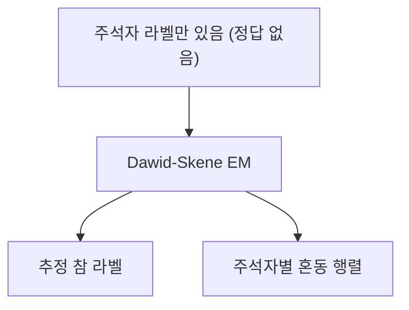

# Dawid-Skene 모델

> Dawid-Skene 모델은 정답을 모르는 상태에서 여러 주석자의 라벨만 보고, 샘플의 숨은 참 라벨과 주석자별 오류 패턴(혼동 행렬)을 EM 알고리즘으로 동시에 추정하는 1979년 통계 모델이다.

## 쉽게 말하면
아무도 정답을 모르는 시험에서 채점자 다섯 명의 점수만 있다고 하자. 채점자마다 어떤 유형을 후하게 주는지 추정해 가며 정답도 추정하고, 다시 정답 추정으로 채점자 성향을 고치는 과정을 반복하는 방식이다.

## 자세히
- **핵심 아이디어(검색 결과 요약, 논문 원문 미정독)**: Dawid & Skene(1979, Applied Statistics 28:20-28)는 각 주석자에게 혼동 행렬(참 클래스가 j일 때 클래스 k로 답할 확률)을 두고, 참 라벨은 관찰되지 않는 잠재 변수로 보아 관찰된 라벨의 우도를 최대화해 둘을 함께 추정한다. 핵심 가정은 참 라벨이 주어지면 주석자 응답이 조건부 독립이라는 것이다. EM은 ① 현재 혼동 행렬로 샘플별 참 클래스의 사후확률을 계산 ② 그 사후확률로 혼동 행렬과 클래스 사전확률을 다시 추정, 를 반복한다. 우도가 볼록하지 않아 EM이 나쁜 지역해에 빠질 수 있고, 이후 연구는 스펙트럴·텐서 방법으로 초기화한다고 한다.
- **Snow 외(2008)와의 연결**: 골드 정답이 있으면 혼동 행렬을 골드 빈도로 직접 추정하고, 없으면 Dawid-Skene EM을 쓴다고 본문이 설명한다([라벨러 편향 보정](#labeler-bias-correction)).
- **직접 시뮬레이션(샘플 1,000개, 이진, 주석자 5명 정확도 0.9/0.85/0.6/0.55/0.5, 독립, 다수결로 초기화한 EM 50회 반복, 라플라스 평활화)**: 단순 다수결 정확도 0.836, Dawid-Skene 0.897이었다. 추정된 주석자 정확도는 0.90/0.85/0.62/0.55/0.49로 실제값과 거의 일치했다. 정답 라벨 없이 주석자 품질까지 복원한 것이다. (한 번의 시뮬레이션이며 독립 가정이 충족된 이상적인 설정이다.)
- **한계(해석)**: ① 주석자가 독립이 아니면 과신 ([주석자 공통 편향](#shared-annotator-bias)) ② 샘플당 라벨이 1~2개면 추정이 불안정 ③ 클래스가 많으면 혼동 행렬 파라미터가 많아 데이터가 필요. CROWDLAB은 여기에 모델 예측을 더한 접근이다([CROWDLAB](#crowdlab)).

## 그림으로 보기

## 예시
- 위 시뮬레이션: 다수결 0.836 → DS 0.897. 정확도가 낮은 주석자(0.55, 0.50)에 자동으로 낮은 가중치가 붙는다.
- 교육 활용: 두 주석자의 혼동 행렬 예를 주고 EM 한 바퀴를 손으로 계산해 본다.

## 헷갈리는 것과 비교
| 개념 | 차이 |
| --- | --- |
| Dawid-Skene | 골드 없이 EM으로 참 라벨·혼동 행렬 추정 |
| [라벨러 편향 보정](#labeler-bias-correction) | 골드로 혼동 행렬을 직접 추정 |
| [CROWDLAB](#crowdlab) | 라벨 + 분류기 예측을 결합 |
| 단순 다수결 | 주석자 품질을 무시 |

## 더 읽을거리
- [Cheap and Fast — But is it Good? (Snow 외, 2008)](https://aclanthology.org/D08-1027/) — Dawid-Skene를 인용한 편향 보정
- [cleanlab multiannotator 튜토리얼](https://docs.cleanlab.ai/stable/tutorials/multiannotator.html) — CROWDLAB이 Dawid-Skene보다 낫다고 주장
