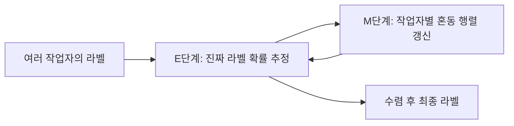
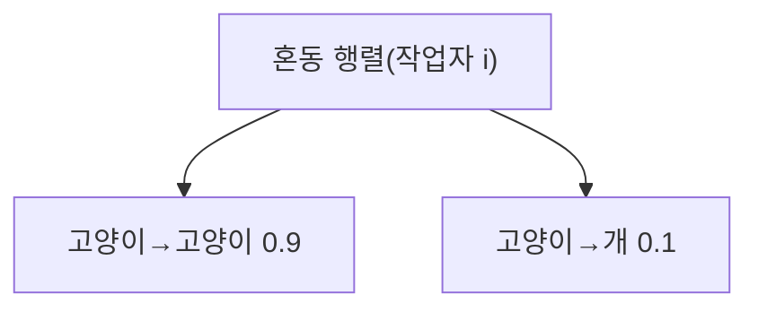

# Dawid-Skene 모델

> 여러 작업자가 단 불완전한 라벨에서 "진짜 정답"과 "작업자별 오답 습관"을 함께 추정하는 고전 통계 모델(Dawid & Skene, 1979)이다. 크라우드소싱 라벨 합치기와 약한 지도 라벨 모델의 뿌리다.

## 쉽게 말하면
채점자가 여러 명인데 사람마다 버릇이 다르다. 어떤 사람은 "고양이"를 자주 "개"로 적는다. 그 버릇표(혼동 행렬)를 추정하며 정답을 맞혀 가는 방식이다. 정답을 몰라도 서로의 일치·불일치로 누가 믿을 만한지 알아낸다.

## 자세히
(Zhang 외, JMLR 17(102) 2016 논문의 서론·초록을 직접 열어 확인.)
- **모델**: k개 범주 라벨링에서 작업자마다 **k×k 혼동 행렬**을 둔다. (l, c)번째 칸은 "클래스 l인 항목을 이 작업자가 c로 라벨할 확률". 진짜 라벨은 잠재 변수로 보고 **관측된 라벨의 가능도를 최대화**해 진짜 라벨과 혼동 행렬을 함께 추정한다.
- **풀이**: EM 알고리즘. E단계에서 현재 혼동 행렬로 각 항목 진짜 라벨의 사후확률을 추정하고, M단계에서 혼동 행렬을 갱신(반복).
- **한계**: 로그 가능도가 **비볼록**이라 EM이 **국소 최적**에 빠질 수 있어 이론적 보장이 어렵다. 해결책으로 **다수결로 초기화**하거나, 위 논문처럼 스펙트럴 방법으로 초기값을 얻은 뒤 EM으로 다듬는다(논문은 최적 수렴 속도, 로그 인자 제외를 보였다고 주장).
- **다수결과 비교**: 스패머가 많고 전문가가 적으면 다수결은 사실상 무작위 추측이 될 수 있다(Gao & Zhou 2014 인용). 반대로 모델이 가정에 어긋나면 다수결이 더 견고할 수 있다는 평가도 있다(검색 결과 요약 수준이며 개별 논문은 이번에 확인하지 않음).
- **약한 지도와의 관계(제안)**: LF를 "작업자"로 보면 LabelModel과 같은 문제다. Snorkel의 LabelModel은 일치·불일치로 정확도와 상관을 추정한다.

## 그림으로 보기

## 예시
- 크라우드 작업자 30명이 3,000장의 이미지를 일부씩 라벨 → 작업자별 혼동 행렬로 신뢰도 낮은 작업자의 표를 낮게 반영.
- 교육 활용: "믿을 만한 사람을 정답 없이 알아내는 법"의 직관.

## 헷갈리는 것과 비교
| 개념 | 차이 |
|---|---|
| Dawid-Skene | 작업자별 혼동 행렬 + EM |
| 다수결 | 모두 동등한 한 표 |
| [노이즈 인지 손실](#noise-aware-loss) | 합친 확률 라벨로 모델을 학습하는 다음 단계 |

## 더 읽을거리
- [Spectral Methods Meet EM (JMLR 17, Zhang 외 2016)](https://jmlr2020.csail.mit.edu/papers/volume17/14-511/14-511.pdf) — Dawid-Skene 설명, 한계, 스펙트럴 초기화.
