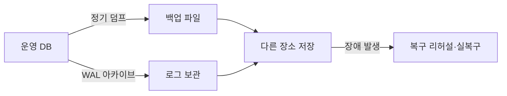
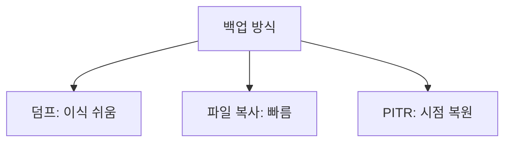

# 백업과 복구

> 백업은 데이터베이스의 복사본을 따로 보관하는 일, 복구는 사고 뒤 그 복사본으로 되돌리는 일이다. "복구해 본 적 없는 백업"은 백업이 아니라 희망이다.

## 쉽게 말하면
중요한 서류를 복사해 다른 건물 금고에 두는 것과 같다. 불이 나도 금고 서류로 일을 이어갈 수 있다. 하지만 금고 서류를 한 번도 꺼내 읽어 보지 않았다면, 위기 때 빈 종이일 수도 있다.

## 자세히
PostgreSQL 공식 문서는 세 가지 방식을 소개한다(25장):
1. **SQL 덤프**: `pg_dump`(DB 하나), `pg_dumpall`(클러스터 전체·역할 포함). 버전·플랫폼이 달라도 옮기기 쉽고 중소 규모에 알맞다. 큰 DB는 복원이 느리다. 예: `pg_dump -Fc -f mydb.dump mydb` → `pg_restore -d newdb mydb.dump`.
2. **파일시스템 백업**: 서버를 내린 상태에서 데이터 디렉터리를 복사하거나 원자적 스냅숏. 빠르지만 같은 메이저 버전·아키텍처가 필요.
3. **연속 아카이빙 + PITR**: 기본 백업(`pg_basebackup`)과 WAL 로그를 쌓아 원하는 시각으로 복원(예: 장애 직전). 설정이 복잡하고 저장 공간이 더 든다. PostgreSQL 17부터 증분 백업도 지원.
- **실무 최소 습관**: ① 자동 일정 ② 다른 장소·계정에 보관(원본과 같은 곳에 두지 않기) ③ 정기 복구 리허설 ④ 보관 기간 정하기 ⑤ 위험한 변경(대량 UPDATE/DELETE) 직전 수동 백업.
- **관리형 서비스**(Supabase·Neon 등)는 자동 백업을 제공하는 경우가 많지만 보관 일수·PITR 지원은 플랜마다 다르니 확인한다(주장: 개별 서비스 내용은 이 글에서 검증하지 않음).
- AI가 마이그레이션이나 대량 수정 SQL을 만들 때는 백업 후 실행을 규칙으로 둔다.

## 그림으로 보기



## 예시
```bash
pg_dump -Fc -f before-migration.dump mydb   # 위험 작업 직전
pg_restore -d testdb before-migration.dump  # 복원 리허설은 테스트 DB에
```
프롬프트: "이 마이그레이션을 실행하기 전 백업 단계와, 실패 시 복원 순서를 체크리스트로 써 줘."

## 헷갈리는 것과 비교
| 개념 | 차이 |
| --- | --- |
| 백업 vs 복제(replication) | 복제는 실수도 즉시 복사됨 — 삭제 사고엔 백업이 필요 |
| 논리(덤프) vs 물리(파일) | 전자는 SQL 문, 후자는 파일 자체 |
| [SQL 기초](#sql-basics) | 백업이 막아 주는 사고(WHERE 없는 DELETE)의 출처 |
| [롤백](#rollback) | 배포 되돌리기. DB 데이터 복구와는 별개 |

## 더 읽을거리
- [PostgreSQL: Backup and Restore](https://www.postgresql.org/docs/current/backup.html) — 세 가지 백업 방식
