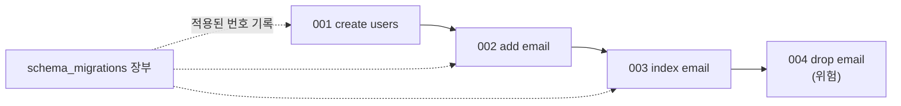
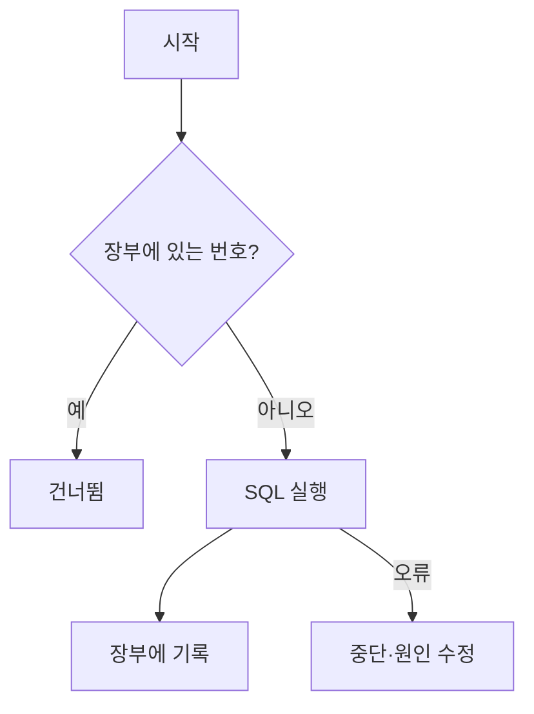

# 마이그레이션

> 데이터베이스의 **구조(테이블·컬럼·인덱스) 변경을 "번호가 붙은 작은 스크립트"로 기록하고 순서대로 자동 적용**하는 방식. 앱 코드와 DB 구조를 함께 버전 관리하고, 어느 환경(개발·테스트·운영)에서든 같은 순서로 같은 결과를 얻게 한다. AI가 DB 구조를 바꾸는 코드를 만들 때 **가장 조심해야 하는 영역**이다.

## 쉽게 말하면
집 설계도를 고칠 때마다 "수정 1호, 2호, 3호" 번호를 붙인 공사 지시서를 남기는 것이다. 새로 집을 지을 때는 1호부터 순서대로 따라 하면 되고, 이미 시행한 지시서는 장부에 적어 두어 다시 하지 않는다.

## 자세히
- **핵심 원칙**(Martin Fowler, "Evolutionary Database Design" 정리): ① 스키마·코드·기준 데이터를 **앱과 같은 저장소에서 버전 관리**, ② **모든 변경을 마이그레이션(작고 번호 있는 SQL)** 으로 만들고 어떤 것이 적용됐는지 추적하며 **임시(ad hoc) 변경 금지**, ③ Flyway·Liquibase 같은 도구로 **자동·순서대로 적용**, ④ 개발자마다 **개인 DB**를 두고 필요할 때 재생성, ⑤ **자주 통합**(CI가 마이그레이션을 적용하고 테스트 실행), ⑥ 변경을 **리팩터링**으로 다루어 스키마·데이터·접근 코드를 함께 수정하고 작게 유지, 호환을 깨는 변경은 **전환 기간**(예: 옛 인터페이스를 보존하는 뷰)을 둠.
- **직접 실행**(Python `sqlite3`, SQLite 3.53.1): 마이그레이션 3개(테이블 생성 → 이메일 컬럼 추가 → 이메일 인덱스)와 `schema_migrations` 장부 테이블로 적용 여부를 기록.

| 실행 | 결과 |
|---|---|
| 1차 실행 | 1·2·3번 적용 |
| 같은 스크립트 2차 실행 | 1·2·3번 **건너뜀**(장부에 있어 중복 적용 안 함) |
| 데이터 `kim / k@x.com` 입력 후 4번 "이메일 컬럼 삭제" 추가 | **오류**: `error in index idx_users_email after drop column: no such column: email` — 3번에서 만든 **인덱스가 그 컬럼에 의존**해 삭제가 막힘 |

  4번 마이그레이션은 장부에 기록되지 않고 중단됐다. 컬럼 삭제는 **데이터를 잃는 위험한 변경**이므로 의존 객체(인덱스·뷰·코드)를 먼저 정리하거나 단계적으로 진행해야 한다.
- **안전하게 하는 법**: ① 삭제·이름 변경은 **2단계**(먼저 코드가 옛 컬럼을 안 쓰게 배포 → 다음 배포에서 삭제), ② 운영 적용 전 **백업**과 **스테이징 시험**, ③ 되돌림(down) 스크립트 또는 복구 계획, ④ 마이그레이션 파일은 **적용 후 수정 금지**(새 번호로 추가).
- **AI와 쓸 때의 주의**: AI에게 "컬럼 이름 바꿔 줘"라고만 시키면 기존 데이터를 지우는 DROP+CREATE를 쓸 수 있다. **데이터를 보존하는 마이그레이션인지**, 운영에 적용하기 전에 사람이 검토한다.
- 한계: SQLite와 운영 DB(PostgreSQL 등)는 `ALTER`의 제약이 달라 실제 DB에서 다시 시험해야 한다.

## 그림으로 보기



## 예시
```sql
-- 002_add_email.sql
ALTER TABLE users ADD COLUMN email TEXT;
-- 003_index_email.sql
CREATE INDEX idx_users_email ON users(email);
```
- 프롬프트: "users.email을 NOT NULL로 바꾸는 마이그레이션을 써 줘. 기존 데이터는 보존하고, 단계(컬럼 추가→값 채우기→제약 추가)로 나눠 줘."

## 헷갈리는 것과 비교
| 개념 | 차이 |
|---|---|
| 마이그레이션 | 구조 변경의 버전 관리·자동 적용 |
| 백업 | 데이터 복사본(변경 전 안전망) |
| 시드 데이터 | 초기 기준 데이터 입력 |
| [Git과 GitHub](#git-github) | 코드와 함께 마이그레이션 파일도 버전 관리 |

## 더 읽을거리
- [Martin Fowler & Pramod Sadalage: Evolutionary Database Design](https://martinfowler.com/articles/evodb.html) — 마이그레이션 중심 DB 진화 방법.
- [SQLite: ALTER TABLE](https://www.sqlite.org/lang_altertable.html) — SQLite의 컬럼 변경 제약.
