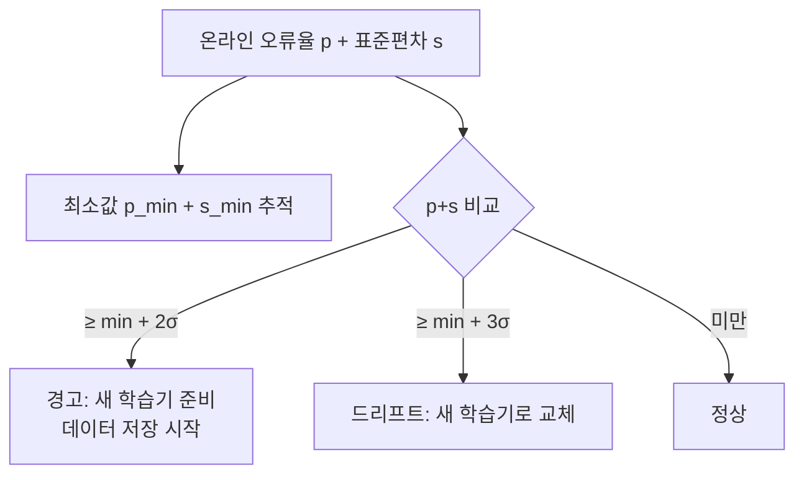

# DDM

> Drift Detection Method. 모델의 **온라인 오류율**을 계속 추적해, 오류율과 그 표준편차가 지금까지의 최소치보다 일정 폭 이상 커지면 **경고**(약 2σ), 더 크면 **드리프트**(약 3σ)로 판정하는 대표적 개념 드리프트 감지 알고리즘.

## 쉽게 말하면
학생의 오답률을 매주 기록해 두고, 최근 오답률이 최고 성적 때보다 눈에 띄게 올라가면 "주의", 더 올라가면 "수업 방식을 바꾸자"고 판단하는 담임 선생님과 같다. 그 사이 기록을 새 수업의 연습 자료로 쓴다.

## 자세히
출처: Lu 외 "Learning under Concept Drift: A Review"(arXiv 2004.05785, 원문 PDF의 DDM 서술을 내려받아 읽음) + 이 세션의 단순 구현 실험.
- **논문 서술**: DDM은 가장 많이 인용되는 감지 알고리즘 중 하나이고 **경고 수준과 드리프트 수준을 정의한 첫 알고리즘**이다. 모델을 만들고(데이터 모델링), 통계량은 **온라인 오류율**, 가설 검정은 온라인 오류율의 분포를 추정해 관찰된 오류율 변화의 신뢰 수준을 계산한다. 경고 수준에 이르면 새 학습기 구축을 시작하고, 드리프트 수준에 이르면 새 학습기로 교체한다(요지).
- **임계값(논문)**: 경고는 느슨한 조건(예: 95% 신뢰 또는 2σ), 드리프트는 엄격한 조건(예: 99% 또는 3σ). 경고와 드리프트 사이에 쌓인 데이터를 새 모델의 학습 데이터로 쓴다.
- **직접 확인(이 세션, 단순 구현, 합성 데이터)**: 오류율 p와 표준편차 s = √(p(1−p)/n)를 갱신하며 최소값(p_min, s_min)을 추적하고 `p+s ≥ p_min+2·s_min`이면 경고, `p+s ≥ p_min+3·s_min`이면 드리프트로 판정했다(최소 30건 이후). 오류율이 시점 2,000에서 10% → 30%로 **갑작스럽게** 변하는 4,000건 스트림을 20번 시도했다.
  - 드리프트 이후 감지에 성공한 실행: **8/20**, 드리프트 **이전**에 이미 드리프트로 판정한 거짓 경보: **12/20**.
  - 성공한 8번의 감지 지연 중앙값 117시점(최소 11~최대 273).
  - 이 결과는 **초보적인 구현과 하나의 설정**(재설정 규칙 없음, 3,000건 이상 긴 구간에서 최소값을 계속 추적)이다. 원 논문의 DDM 성능이나 일반적 거짓 경보율을 대표하지 않는다. 긴 스트림에서 최소값 기반 임계값이 우연한 변동에 걸려 거짓 경보가 늘 수 있다는 점은 이 실험에서 확인한 현상이다.
- **한계(논문)**: 대부분 감지기는 알림이 실제 드리프트 시점보다 늦고 최소한의 새 데이터가 필요하다.
- **전제**: 오류율을 쓰므로 **정답 라벨이 빨리 와야** 한다. 라벨이 늦으면 입력·예측 분포 기반 감시를 쓴다([지연 라벨 모니터링](#delayed-label-monitoring)).

## 그림으로 보기

## 예시
- 일일 오답 라벨을 받는 사기 탐지 모델: 오류율이 경고 선을 넘으면 최근 데이터로 후보 모델을 학습해 두고, 드리프트 선을 넘으면 교체.
- 점검: 경보가 너무 잦으면 임계값(2σ/3σ)이나 최소 표본 수를 조정하고 거짓 경보 비용을 따져 본다.

## 헷갈리는 것과 비교
| 개념 | 차이 |
|---|---|
| DDM | 오류율 기반 단일 지표 감지 |
| [드리프트 통계 검정](#drift-statistical-tests) | 분포 비교 검정, 라벨이 없어도 가능 |
| [PSI](#psi) | 입력 분포 거리 |
| [드리프트 감지 틀](#drift-detection-framework) | DDM이 들어가는 4단계 틀 |

## 더 읽을거리
- [Learning under Concept Drift: A Review (arXiv 2004.05785)](https://arxiv.org/abs/2004.05785) — DDM 서술(원문 확인)
