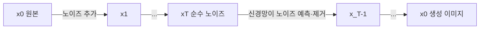
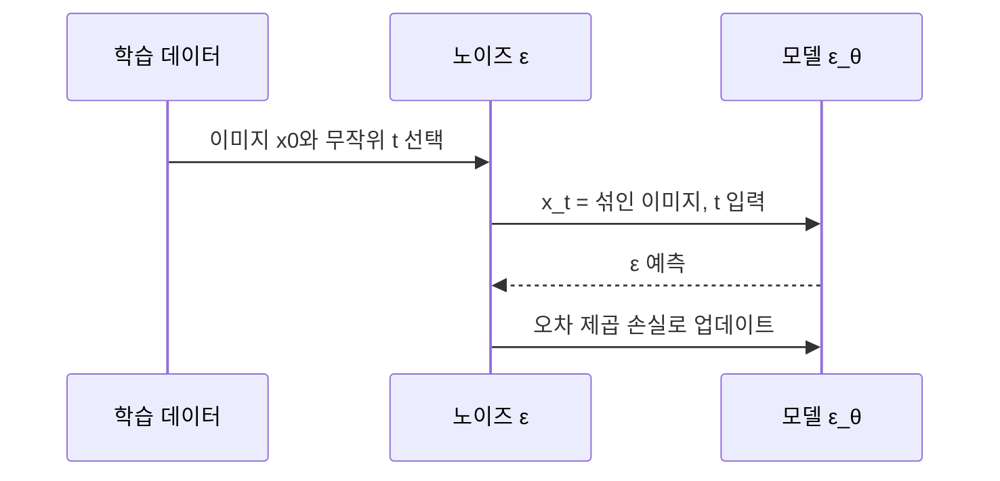

# DDPM

> DDPM(Denoising Diffusion Probabilistic Models, Ho 등 2020)은 이미지에 노이즈를 단계적으로 더하는 과정을 거꾸로 되돌리도록 신경망을 학습해, **순수 노이즈에서 이미지를 만들어 내는** 확산 모델의 표준 학습법이다.

## 쉽게 말하면
잉크 한 방울이 물에 번지는 영상을 거꾸로 돌리는 일이다. 번진 물(노이즈)만 보고 "방금 이 물에서 어떤 잉크가 빠졌지?"를 한 단계씩 맞히는 법을 배우면, 맑은 노이즈 한 컵에서 시작해 그림 한 장을 되살릴 수 있다.

## 자세히
- **순방향(forward)**: 원본 `x₀`에 T단계에 걸쳐 작은 가우시안 노이즈를 더한다. 각 단계 `q(x_t|x_{t-1}) = N(√(1-β_t)·x_{t-1}, β_t·I)`. 닫힌 형태로 임의의 t를 한 번에 만들 수 있다: `x_t = √ᾱ_t·x₀ + √(1-ᾱ_t)·ε`. 그래서 학습 때 단계를 순서대로 돌릴 필요가 없다.
- **역방향(reverse)**: `x_T ~ N(0, I)`에서 시작해 `p_θ(x_{t-1}|x_t)`로 T→0 방향으로 한 단계씩 노이즈를 제거한다.
- **노이즈 예측 손실(L_simple)**: 신경망(보통 U-Net) `ε_θ(x_t, t)`가 더해진 노이즈 `ε`를 맞히도록 `‖ε − ε_θ(x_t, t)‖²`를 최소화한다. 논문은 가중 변분 하한으로 학습할 때 가장 좋았고 이는 Langevin 역학 기반 denoising score matching과 연결된다고 설명한다.
- **스케줄**: 원 논문은 β를 `10⁻⁴`에서 `0.02`까지 선형 증가, T=1000. 이후 Nichol & Dhariwal(2021)이 코사인 스케줄을 제안.
- **성능**: CIFAR10 무조건 생성에서 FID 3.17, Inception score 9.46(당시 최고 수준이라고 주장). 256×256 LSUN은 ProgressiveGAN과 비슷한 품질.
- **약점**: 샘플링에 1000번 가까이 신경망을 돌려야 느리다. 이를 줄이려 DDIM 등이 나왔고, 픽셀 대신 잠재 공간에서 확산하는 [잠재 확산](#latent-diffusion)이 비용을 크게 낮췄다.

## 그림으로 보기

## 예시
- 학습 루프 의사코드: ① 이미지 `x0`, `t∈[1,1000]`, `ε~N(0,I)` 뽑기 ② `x_t` 계산 ③ `loss = mse(ε, model(x_t, t))` ④ 역전파.
- Hugging Face `diffusers`의 `DDPMScheduler`·`UNet2DModel`로 작은 데이터셋에서 직접 학습해 볼 수 있다.

## 헷갈리는 것과 비교
| 개념 | 차이 |
|---|---|
| DDPM | 픽셀 공간에서 노이즈 예측 학습, 느린 다단계 샘플링 |
| DDIM | 같은 모델을 더 적은 단계로 샘플링하는 방법 |
| [잠재 확산](#latent-diffusion) | 압축된 잠재 공간에서 확산해 비용 절감(Stable Diffusion) |
| GAN | 생성기·판별기 대결. DDPM은 안정적 학습, 느린 생성 |
| [손실 함수](#loss-function) | DDPM의 손실은 노이즈 예측 MSE |

## 더 읽을거리
- [DDPM 논문 (arXiv 2006.11239)](https://arxiv.org/abs/2006.11239) — 원 논문 초록과 성능.
- [Lilian Weng: What are Diffusion Models?](https://lilianweng.github.io/posts/2021-07-11-diffusion-models/) — 수식과 스케줄을 차근히 풀어 쓴 해설.
