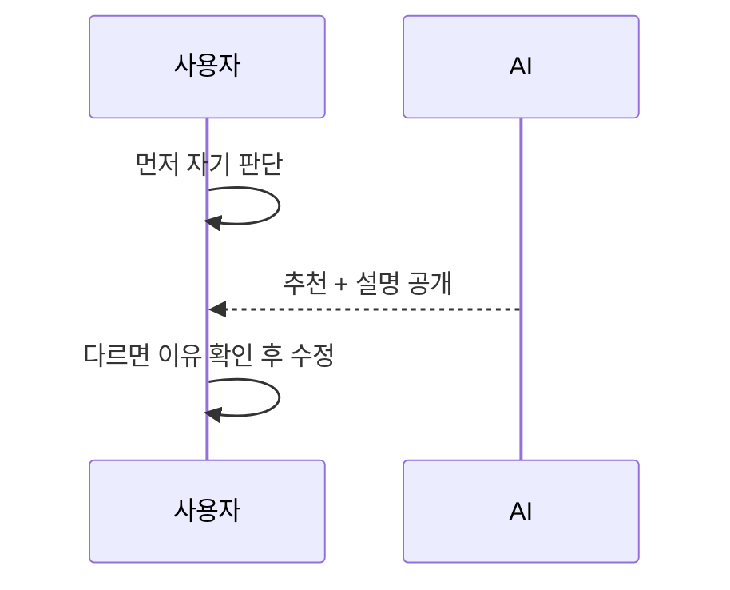

# 먼저 결정 후 공개

> 사용자가 **AI의 추천을 보기 전에 먼저 자기 판단을 내리게** 한 뒤 추천을 공개하는 설계다. 인지 강제 장치(cognitive forcing function)의 한 종류로, AI에 대한 맹목적 의존(과의존)을 줄이려는 목적이다.

## 쉽게 말하면
의사가 검사 결과 요약을 보기 전에 먼저 자기 소견을 적어 두는 것이다. 내 판단이 있으니 AI 의견과 다를 때 "왜 다르지?" 하고 따져 보게 된다.

## 자세히
(Buçinca·Malaya·Gajos, "To Trust or to Think"(CSCW 2021, arXiv 2102.09692) PDF를 직접 읽었다. 이 설계 *하나만*의 효과를 따로 발표한 수치는 논문에 없고, 인지 강제 3종을 묶어 비교했다.)
- **설계(논문의 Update 조건)**: 참가자는 먼저 AI 없이 초기 결정을 내리고, 그 뒤에 AI의 제안과 설명이 공개되면 **결정을 수정**할 수 있다. 저자들은 AI가 자신의 판단과 다를 때 "왜 다르게 보았는지" 궁금해져 설명을 더 보게 될 것이라고 가정했다.
- **실험**: MTurk에서 **199명**(260명 모집 중 제외 후), 영양 과제(식사 사진에서 탄수화물이 가장 많은 재료를 비슷한 맛의 저탄수 재료로 바꾸기). 시뮬레이션 AI 정확도 **75%**. 비교한 6조건: AI 없음, 단순 설명형 AI 2종(설명·불확실성), 인지 강제 3종(**on demand, update, wait**).
- **결과(논문, 묶음 비교)**: 인지 강제 조건은 틀린 AI 예측에서 **과의존이 단순 설명형 AI보다 유의하게 적었고**(탄수화물 재료 판별 기준 χ²(2, N=663)=44.35, p≪.0001) 정답도 더 많았다. 인지 강제 3종 사이엔 유의한 차이가 없었다. 단, 한 지표(전체 성능)에서는 과의존 감소가 유의하지 않았다.
- **대가**: 과의존을 가장 크게 줄인 설계가 주관 평가에서 가장 낮은 평가를 받았다(초록). 인지 강제 조건의 시스템 복잡도 평가도 단순 설명형보다 높았다.
- **함의(해석)**: 결정을 먼저 요구하면 시간과 노력이 늘어나므로, 고위험 결정에만 적용하는 식으로 선택한다.

## 그림으로 보기

## 예시
- 계약서 위험 조항 검토에서 AI 지적을 열기 전에 검토자가 조항별 위험도를 먼저 체크하게 한다(제안).
- 교육 소재: "AI 답 보기 전에 내 답 쓰기"를 학습 활동 규칙으로.

## 헷갈리는 것과 비교
| 개념 | 차이 |
|---|---|
| 먼저 결정 후 공개 | 내 판단을 먼저 기록 |
| 요청 시 공개(on demand) | 버튼을 눌러야 추천 표시 |
| [진단 타임아웃](#diagnostic-timeout) | 결정 직전 멈추고 대안 점검 |
| [의도적 마찰 설계](#friction-by-design) | 이 모든 접근의 상위 개념 |

## 더 읽을거리
- [Buçinca, Malaya, Gajos (2021) — To Trust or to Think](https://arxiv.org/abs/2102.09692) — 직접 읽음.
