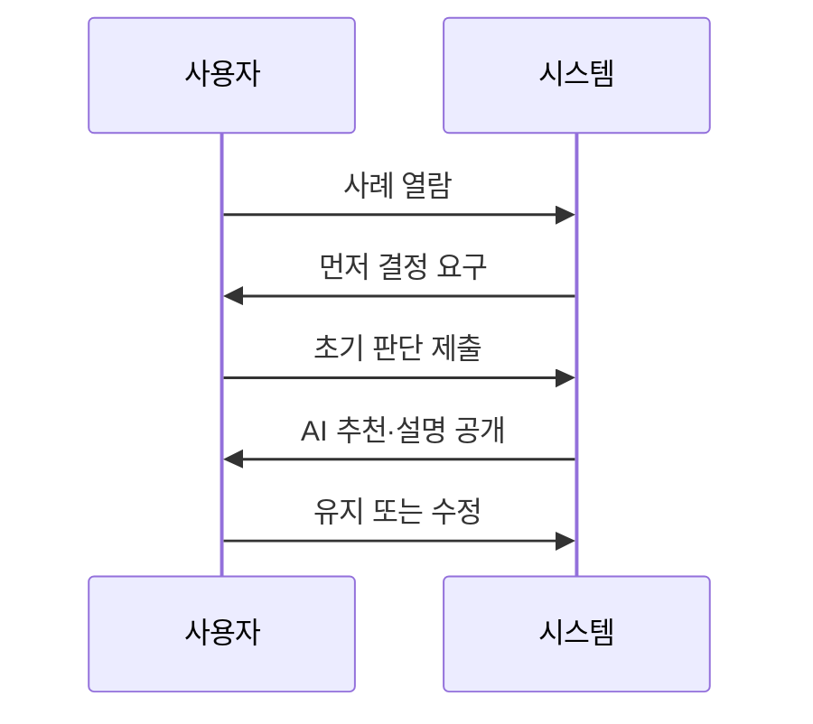
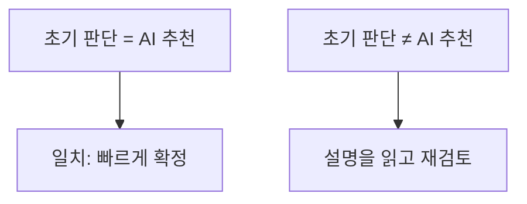

# 먼저 판단하고 AI 보기

> 사용자가 AI의 추천을 보기 **전에** 자기 판단을 먼저 내리게 하고, 그 뒤에 AI 추천과 설명을 공개해 수정할 기회를 주는 인터페이스 설계. Buçinca 외(2021)가 시험한 세 가지 인지적 강제 장치 중 "update" 조건에 해당한다.

## 쉽게 말하면
시험 답안지에 먼저 내 답을 쓰고 나서 정답지를 펼치는 방식이다. 정답지를 먼저 보면 "맞는 것 같다"는 느낌이 앞서 내 생각이 사라진다. 내 답을 먼저 써 두면 정답지와 달랐을 때 "왜 다르지?" 하고 설명을 제대로 읽게 된다.

## 자세히
출처: Buçinca, Malaya, Gajos "To Trust or to Think", CSCW 2021, arXiv 2102.09692 본문(직접 읽음). 실험실 과제의 결과이며 현업 직무로 일반화하려면 별도 검증이 필요하다.
- **실험 과제**: 접시 사진을 보고 탄수화물이 가장 많은 재료를 찾아 맛 유사도·탄수화물 감소가 가장 좋은 대체 재료로 바꾸는 식단 결정. 시뮬레이션 AI의 정확도는 75%로 고정(오류 유형과 비율을 통제하려고 실제 모델을 학습하지 않음). 실험 분석 대상 199명.
- **세 가지 강제 장치(CFF)**
  - **on demand**: AI 추천을 기본으로 숨기고 "See AI's suggestion" 버튼을 눌러야 본다. 가벼운 강제.
  - **update**: **먼저 AI 없이 초기 결정**을 내리고, 그 뒤에 AI 추천·설명을 보며 결정을 수정할 수 있다. 이 글의 주제.
  - **wait**: "AI is processing the image" 메시지를 **30초** 보여 준 뒤에 추천을 공개. 기다리는 동안 사용자가 스스로 가설을 세우리라는 가정.
- **비교 대상**: 단순 설명 방식 두 가지(설명만 즉시 표시, 불확실할 때 신뢰도 표시)와 AI 없는 기준 조건.
- **결과 요약**: AI가 맞을 때는 강제 장치와 단순 설명이 별 차이 없다. **AI가 틀렸을 때** 강제 장치 조건이 전체 성과와 탄수화물 원천 탐지 성과를 유의하게 더 높였고, AI 추천을 그대로 따르는 비율(과의존)도 탄수화물 원천 탐지에서 유의하게 낮췄다. 세 강제 장치 사이의 차이는 유의하지 않았다. 그럼에도 AI가 틀린 사례에서는 AI 없이 한 사람이 가장 잘했다 — 강제 장치로 과의존이 줄었지만 사라지진 않았다.
- **한계**: update 조건이 다른 강제 장치보다 낫다고 말할 근거는 없다(논문에서 조건 간 유의한 차이 없음). 또 사용자가 먼저 판단하는 시간 비용이 든다.
- **설계 시 팁(제안)**: 위험이 큰 결정(진단, 심사, 승인)에서만 사용하고 단순 정보 조회에는 쓰지 않는다. 사용자의 초기 판단과 AI 추천이 다를 때만 설명을 강조해 읽도록 유도.

## 그림으로 보기

## 예시
- 대출 심사 보조: 심사역이 승인/거절 의견을 먼저 입력해야 AI 점수와 근거가 열린다. 의견이 다른 건은 상급자 검토로 보낼 수 있다(제안).
- 신입 교육: 학습자가 먼저 답을 쓰고 AI 피드백을 보게 하면 비교 학습이 된다(제안).

## 헷갈리는 것과 비교
| 개념 | 차이 |
|---|---|
| update(먼저 판단) | AI 없이 초기 결정 → 추천 공개 후 수정 |
| on demand | 버튼을 눌러야 추천 표시 |
| wait | 30초 지연 후 추천 표시 |
| [인지적 강제 장치](#cognitive-forcing-function) | 이 세 가지를 포함하는 상위 개념 |

## 더 읽을거리
- [To Trust or to Think (arXiv 2102.09692)](https://arxiv.org/abs/2102.09692) — 원 논문(본문 직접 읽음)
