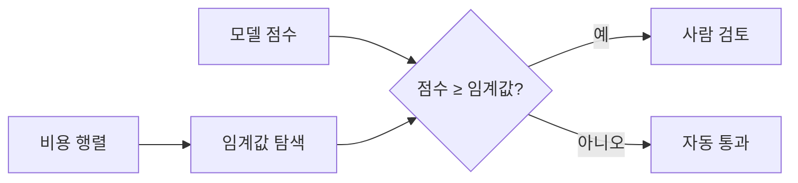
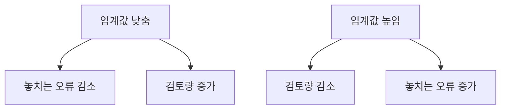

# 결정 임계값 튜닝

> 결정 임계값 튜닝은 모델의 확률·점수를 "예/아니오"로 바꾸는 기준선을 기본값 0.5로 두지 않고, 오류의 비용을 반영해 가장 이득이 큰 값으로 고르는 일이다. 모델을 다시 학습하지 않고 학습 후에 기준선만 조정한다.

## 쉽게 말하면
화재경보기 민감도를 정하는 일과 같다. 너무 둔하면 진짜 불을 놓치고 너무 예민하면 요리할 때마다 울린다. 놓쳤을 때의 피해와 오경보의 번거로움을 저울에 올려 적당한 민감도를 고른다.

## 자세히
- **기본값의 문제(scikit-learn 문서, 열람)**: `predict`는 `predict_proba`가 0.5를 넘으면 양성으로 판정한다. 이 기본값은 응용에 맞지 않는 경우가 많다. 의료 검진처럼 암을 놓치는 비용이 오경보 비용보다 훨씬 크면 임계값을 0.5보다 낮춰야 한다.
- **학습 후 튜닝(같은 문서)**: `TunedThresholdClassifierCV`는 학습 후 내부 교차검증으로 지정한 지표를 최대화하는 임계값을 고른다. 기본 지표는 균형 정확도이므로 용도에 맞는 지표로 바꾸라고 권한다. 기본 5겹 층화 교차검증, 양성 클래스가 기본이 아니면 `make_scorer`로 `pos_label`을 지정한다. 문서의 보험 사례에서는 사업 효용을 최적화한 분류기가 약 0.02 확률에서 관심 클래스를 예측했고 기본은 0.5였다. 두 분류기는 같은 `predict_proba`를 쓰므로 ROC·PR 곡선은 같고 라벨만 다르다.
- **주의(같은 문서)**: 학습에 쓴 데이터로 임계값을 맞추면 과적합 위험이 있다. `cv="prefit"`은 이미 학습된 모델과 새 검증 데이터가 있을 때만 쓴다. 수동 지정은 `FixedThresholdClassifier`를 쓴다. 문서는 확률 보정은 다루지 않는다.
- **순서(해석)**: ① [비용 행렬](#cost-matrix)로 네 칸 단가를 정한다 ② 검증 데이터에서 후보 임계값별 건수를 센다 ③ 기대 비용이 최소인 값을 고른다 ④ 보류 데이터로 최종 확인한다([보류 평가 세트](#held-out-eval-set)).
- **가상 예시(직접 시뮬레이션)**: 1만 건 중 오류가 5%인 문서를 가정한다. 점수는 오류 건이 Beta(5,2), 정상 건이 Beta(2,5)에서 나오고 2만 건을 뽑았다(시드 7). 단가는 놓친 오류 건당 20만 원 손실, 검토 건당 3,000원으로 가정한다. 1,000건당 기대 비용(백만 원):

| 임계값 | 기대 비용 | 놓친 오류 | 불필요 검토 |
| --- | --- | --- | --- |
| 0.5 | 1.5 | 109건 | 2,109건 |
| 0.4 | 1.2 | 36건 | 4,425건 |
| 0.3 | 1.4 | 11건 | 7,932건 |
| 0.1 | 2.7 | 0건 | 16,856건 |

  값은 전체 2만 건 기준 건수다. 0.4가 가장 낮아 0.5보다 약 20% 절감이지만 검토량이 두 배 넘게 는다. 그리드가 거칠어 0.35나 0.45가 더 나을 수 있다. 합성 데이터이므로 방향성만 본다.
- **검토량 제약**: 최적 임계값이 검토 인력 용량을 넘으면 용량에 맞는 값으로 타협한다([검토 큐 설계](#review-queue-design)).

## 그림으로 보기

## 예시
- 코드 스케치(scikit-learn): `TunedThresholdClassifierCV(LogisticRegression(), scoring=make_scorer(my_cost_score))`로 학습 후 임계값만 튜닝한다. 사용자 정의 효용은 callable scorer로 넘길 수 있다.
- 교육 활용: "정확도 95%면 충분한가?"를 묻고 오탐·미탐 단가를 바꿔 최적 임계값이 이동하는 것을 보여 준다.

## 헷갈리는 것과 비교
| 개념 | 차이 |
| --- | --- |
| [비용 행렬](#cost-matrix) | 단가표. 임계값 튜닝은 그 표로 기준선을 고르는 절차 |
| [확신 보정](#confidence-calibration-handoff) | 점수가 확률과 맞게 만드는 일. 튜닝은 보정된 점수에 기준선을 정함 |
| ROC 곡선 | 임계값 전체의 성능. 튜닝은 그중 한 점을 고름 |

## 더 읽을거리
- [scikit-learn: Tuning the decision threshold for class prediction](https://scikit-learn.org/stable/modules/classification_threshold.html) — TunedThresholdClassifierCV와 주의사항
