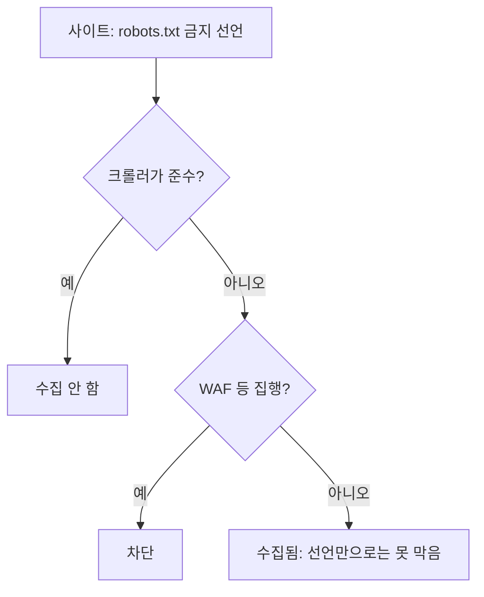
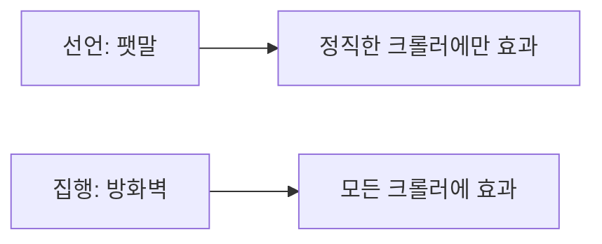

# 선언과 집행의 간극

> 사이트가 robots.txt로 "AI 수집 금지"를 **선언**해도, 그 선언을 크롤러가 지키는지는 별개이고, 사이트가 방화벽 규칙으로 **집행**하지 않으면 지켜지지 않을 수 있다는 간극이다.

## 쉽게 말하면
"출입 금지" 팻말만 세워 둔 것과 문을 잠근 것의 차이다. 팻말은 지나가는 사람이 읽고 따라 줘야 효과가 있고, 잠금은 읽지 않아도 막는다. 팻말을 무시하는 사람이 있으면 팻말 자체는 아무것도 막지 못한다.

## 자세히
(Cloudflare 블로그 글의 본문과 RFC 9309 요약을 직접 열어 확인. Cloudflare가 보고한 내용은 Cloudflare의 주장이며 이번에 확인한 글 본문에는 Perplexity 측 입장이 실려 있지 않았다.)
- **선언의 성격(RFC 9309)**: robots.txt는 크롤러에게 준수를 요청하는 규약이며 접근 권한 부여나 보안 수단이 아니다([robots.txt vs 이용약관](#robots-txt-vs-tos)). 준수는 크롤러의 자발성에 달려 있다.
- **Cloudflare의 시험(블로그 글에서 보고)**: 색인되지 않은 새 도메인 여러 개를 사 모든 자동 접근을 막는 robots.txt를 두고, Perplexity의 공개 크롤러 두 종류(`PerplexityBot`, `Perplexity-User`)를 방화벽 규칙으로도 막았다. 그런데도 Perplexity가 이 도메인들의 내용에 대해 상세히 답했다고 한다. Cloudflare는 두 가지 식별 방식을 구분한다.
  - **공개 식별**: `Perplexity-User/1.0`, 하루 약 2천~2천5백만 요청.
  - **비공개("스텔스")**: macOS의 Chrome 124를 흉내 낸 일반 사용자 에이전트, 하루 약 300만~600만 요청. 공개 크롤러가 막힌 뒤 쓰였고, 공개된 IP 대역에 없는 주소를 순환하며 여러 ASN에서 요청이 왔다고 한다. 수만 개 도메인에서 하루 수백만 요청을 관찰했다고 하며, 기계 학습과 네트워크 신호로 식별했다.
  - Cloudflare는 Perplexity가 robots.txt를 종종 무시하거나 아예 가져가지 않았다고 주장한다. 스텔스 크롤러를 막자 다른 출처에 의존했고 답이 덜 구체적이었다고 한다.
  - 대비 사례: ChatGPT-User는 robots.txt로 금지되거나 차단 페이지를 받으면 크롤링을 멈췄고 다른 사용자 에이전트의 후속 요청도 보이지 않았다고 Cloudflare가 적는다.
  - **Cloudflare의 조치**: Perplexity를 검증된 봇 목록에서 제외, 관리형 규칙에 휴리스틱과 스텔스 크롤러 시그니처를 추가해 무료 고객까지 쓸 수 있는 AI 크롤러 차단 규칙에 넣었다.
- **해석(제안)**: 이 글은 한 업체의 관측·주장이고 다른 크롤러 전반의 행태를 대표하지 않는다. 그러나 구조적 교훈은 명확하다 — 선언(robots.txt)은 정직한 크롤러에게만 작동하므로 **금지를 확실히 하려면 집행(WAF 봇 차단, IP·행동 기반 탐지, 인증)이 필요**하다. 반대로 데이터 수집자 입장에서는 "robots.txt가 허용"인지뿐 아니라 사이트가 막으려 했는지 존중하는 것이 윤리·평판 위험을 줄인다.
- **사이트 운영자 점검(제안)**: ① robots.txt에 AI 봇별 규칙 선언 ② 서버·WAF 로그에서 해당 봇 사용자 에이전트와 의심스러운 일반 브라우저 트래픽 비교 ③ 선언을 어기는 트래픽은 방화벽으로 차단 ④ 선언 내용과 실제 응답(예: 200/403)을 정기 점검해 불일치 확인.
- **수집자 점검(제안)**: ① 자사 크롤러의 사용자 에이전트를 공개하고 공개 IP 대역을 문서화 ② 봇 이름을 숨기지 않기 ③ 차단 응답을 받으면 중단.

## 그림으로 보기

## 예시
- 사이트 운영팀이 robots.txt에 AI 봇을 금지했지만 서버 로그에 일반 Chrome 사용자 에이전트가 하루 수십만 요청을 보내는 패턴을 발견 → WAF의 봇 점수 기반 차단을 추가하고 주간 로그 점검.
- 교육 소재: "AI에게 내 글을 쓰지 말라고 하려면 팻말과 자물쇠 둘 다 필요하다" — 콘텐츠 제작 업무 교육.

## 헷갈리는 것과 비교
| 개념 | 차이 |
|---|---|
| 선언과 집행의 간극 | 금지 선언 대 실제 차단 |
| [AI 크롤러 차단](#ai-crawler-blocking) | 차단 방식 전반 |
| [robots.txt vs 이용약관](#robots-txt-vs-tos) | 두 선언 장치의 차이 |
| [소급 불가 옵트아웃](#retroactive-opt-out-gap) | 선언 이전에 수집된 데이터 |

## 더 읽을거리
- [Cloudflare: Perplexity is using stealth, undeclared crawlers to evade website no-crawl directives](https://blog.cloudflare.com/perplexity-is-using-stealth-undeclared-crawlers-to-evade-website-no-crawl-directives/) — 시험 설정과 관측 주장(직접 확인, Cloudflare 측 기술).
- [RFC 9309: Robots Exclusion Protocol](https://www.rfc-editor.org/rfc/rfc9309.html) — robots.txt가 접근 권한이 아님(직접 확인).
