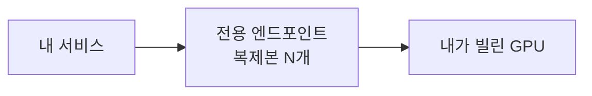
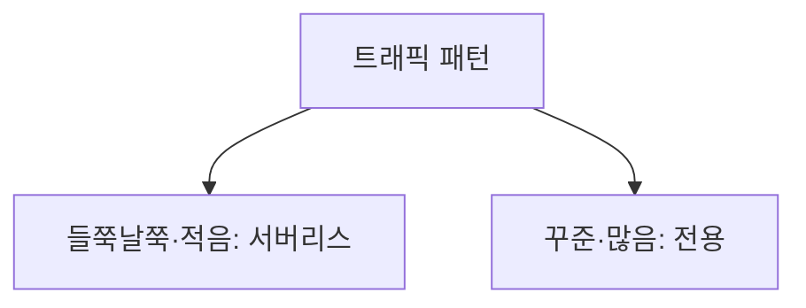

# 전용 엔드포인트

> 업체가 호스팅하는 모델을 **내 전용 GPU 용량(복제본)**에 올려 쓰는 방식. 토큰당이 아니라 **가동 시간당** 과금되고, 파인튜닝 모델을 올리기에 좋다.

## 쉽게 말하면
식당에서 합석 테이블(서버리스)에 앉는 대신 룸 하나를 통째로 빌리는 것이다. 사람이 적어도 룸 요금은 시간당 나가지만, 대기 없이 내 방식대로 쓸 수 있다.

## 자세히
(검색 요약 기준. 가격은 공급자·날짜별로 다르고 2차 글이 섞여 있다.)
- 과금: 전용 엔드포인트는 실행 중인 **복제본마다 분 단위**로 과금되고 토큰 양과 무관하다. 서버리스는 토큰당. Together 문서는 온디맨드(최소 약정 없음)와 예약 두 옵션을 제시한다.
- 가격 예(날짜 확인 필요): Together 전용 엔드포인트 H100 약 시간당 $3.99(2차 글), GMI Cloud 원시 GPU H100 $2.60·H200 $3.20(관리형 추론 계층 제외), DigitalOcean H200 GPU Droplet 온디맨드 $4.47(2026-08-01 적용).
- 손익분기: GMI Cloud는 가동률 약 40~50%를 제시. 다른 예시는 서버리스가 100만 토큰당 $1일 때 하루 약 7,200만 토큰(시간당 약 300만 토큰 지속)에서 교차.
- 파인튜닝 모델: Together는 인기 오픈 모델의 미세조정본을 업로드해 전용 엔드포인트로 돌릴 수 있다. 서버리스 파인튜닝 호스팅은 지원 기반 모델이 제한적이며 콜드 스타트로 최대 수백 ms 지연이 단점이라고 한다.
- "프로비저닝 처리량"이라는 별도 제품의 명확한 정의는 이번 검색에서 확인하지 못했다(특정 클라우드 서비스 용어일 수 있음).

## 그림으로 보기

## 예시
- 사내용으로 파인튜닝한 8B 모델을 Together 전용 엔드포인트에 올려 업무 시간에만 운영.
- 교육: 고정비 vs 변동비를 수강 회사의 SaaS 비용에 빗대어 설명.

## 헷갈리는 것과 비교
| 개념 | 차이 |
|---|---|
| 전용 엔드포인트 | 시간당·내 용량·파인튜닝 모델 가능 |
| 서버리스 | 토큰당·공유 용량·콜드 스타트 |
| [호스팅 결정](#hosting-decision-checklist) | 어떤 방식을 고르는 기준 |

## 더 읽을거리
- [Together: Dedicated Endpoints 가격](https://docs.together.ai/docs/dedicated-endpoints/pricing) — 과금 방식(검색 결과 확인).
- [DigitalOcean: dedicated vs serverless](https://www.digitalocean.com/community/conceptual-articles/dedicated-vs-serverless-inference-at-scale) — 비교 글.
