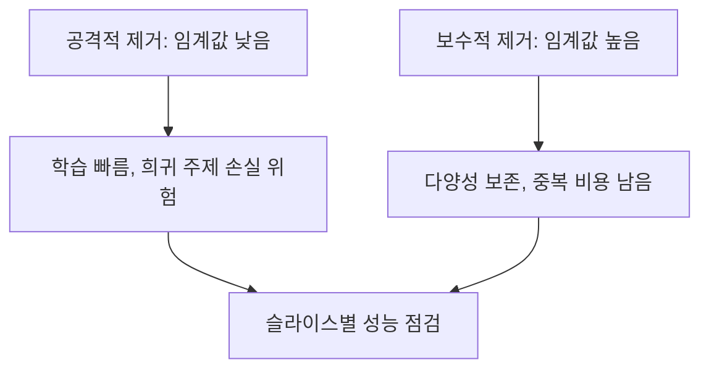

# 중복 제거와 다양성

> 중복을 많이 지울수록 학습은 빨라지지만, 임계값이 너무 공격적이면 희귀한 표현·소수 주제까지 사라진다. 그래서 최근 연구는 "얼마나 지우나"보다 "남긴 것이 다양한가"까지 함께 본다.

## 쉽게 말하면
요리 레시피 책에서 똑같은 김치찌개 레시피 100개는 한두 개만 남겨도 된다. 하지만 "비슷해 보인다"며 마라탕·타코·비빔밥까지 같이 지우면 책이 얇아지고 독자는 다양한 요리를 못 배운다. 같은 것은 지우고, 다른 것은 지키는 균형이 핵심이다.

## 자세히
- **의미 중복 제거 SemDeDup**(Abbas 외 2023, arXiv 2303.09540, 본문 요약 확인): 임베딩을 군집으로 나누고, 군집 안에서 코사인 유사도가 1−ε 이상인 쌍을 중복으로 본다. 남길 항목은 군집 중심과의 유사도가 가장 낮은 것. 선택 기준은 거의 상관없었다(LAION 40%에서 ImageNet 제로샷 66.90% / 무작위 66.90% / 66.73%).
- **효과의 크기가 데이터마다 다르다**: LAION-440M에서 50%를 제거해도 제로샷 정확도 손실은 0.47%, 학습은 약 2배 빨랐다. 반면 언어 모델 C4에서는 80%만 남겨도 NearDup(96.1% 유지)와 비슷했고 효율 이득은 약 15%로 작았다. C4는 이미 반복 문장이 제거돼 남은 중복이 적기 때문이라고 논문이 설명한다.
- **중복 제거 + 다양성 선택 D4**(Tirumala 외 2023, Meta, arXiv 2308.12284, 초록 확인): 임베딩으로 중복이 아니면서 서로 다양한 문서를 고른다. 6.7B 모델에서 약 20% 학습 효율 향상, 16개 NLP 과제 평균 정확도 최대 2% 상승. 선별한 데이터를 반복해 쓰면 기준선보다 낫지만 무작위 데이터를 반복하면 기준선보다 나빴다.
- **정리(해석)**: 중복 제거는 기본 위생이고, 그 위에서 "얼마나 지울지"는 임계값 ε·남길 비율로 정하는 조절 변수다. 지운 뒤에는 전체 평균뿐 아니라 희귀 주제 슬라이스 성능을 같이 본다.
- **주의**: 위 수치는 각 논문 저자 보고이며 직접 재현하지 않았다. 50% 제거 결과는 이미지-텍스트(LAION)이고 언어 모델 결과는 더 작다.

## 그림으로 보기

## 예시
- 사내 문서 코퍼스에서 같은 공지 템플릿 3천 건은 하나만 남기고, 부서별 특수 용어가 든 문서는 군집 경계를 보고 보존.
- 교육: 임계값을 바꿔 가며 "남은 문서 수 vs 희귀 주제 정확도" 그래프를 그려 보게 한다.

## 헷갈리는 것과 비교
| 개념 | 차이 |
|---|---|
| [패러프레이즈 중복의 한계](#paraphrase-dedup-limit) | 표면 중복 제거가 놓치는 문제 |
| [SemDeDup](#semdedup) | 임베딩으로 의미 중복 제거 |
| D4 | 중복 제거 위에 다양성 선택을 더함 |
| 데이터 가지치기 일반 | 품질·난이도 기준 선별. 중복과 별개 축 |

## 더 읽을거리
- [SemDeDup (ar5iv)](https://ar5iv.labs.arxiv.org/html/2303.09540) — ε, 군집, C4와 LAION 결과(열어 확인).
- [D4 초록](https://arxiv.org/abs/2308.12284) — 중복 제거+다양성 선택, 6.7B 결과(열어 확인).
