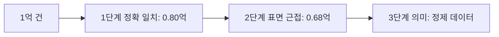
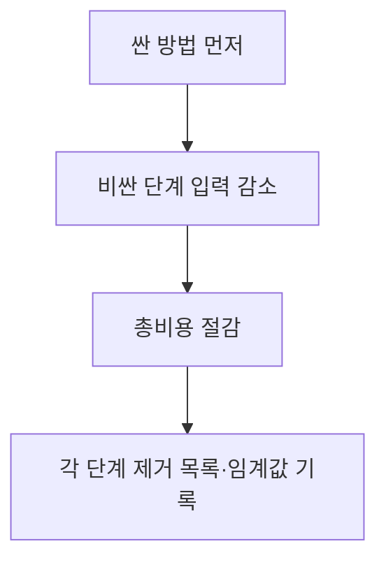

# 중복 제거 단계 순서

> 중복 제거는 **싼 방법부터, 정확 일치 → 표면 근접(섀글·MinHash/LSH) → 의미(임베딩)** 순으로 적용한다. 앞 단계가 대부분의 중복을 값싸게 줄여 주므로 뒤의 비싼 단계가 처리할 양이 크게 준다.

## 쉽게 말하면
이삿짐을 정리할 때 똑같은 물건은 먼저 한 번에 치우고, 비슷한 물건은 그다음에 살펴보고, 용도만 비슷한 물건은 마지막에 판단한다. 처음부터 모든 물건을 일일이 비교하면 시간이 너무 든다.

## 자세히
- **세 단계**
  | 단계 | 잡는 중복 | 도구 | 비용 |
  |---|---|---|---|
  | 1. 정확 일치 | 바이트/정규화 후 동일 | 해시 비교 | 매우 낮음 |
  | 2. 표면 근접 | 글자 조각이 많이 겹침 | 섀글 + 자카드/MinHash LSH([LSH](#lsh-post-verify), [섀글 크기](#shingle-size-choice)) | 중간 |
  | 3. 의미 중복 | 의미가 비슷 | 임베딩 + 군집/이웃([SemDeDup](#semdedup)) | 높음(임베딩 계산) |
- **순서의 이유(비용 모델, 가상 수치)**: 데이터 1억 건, 정확 중복 20%·표면 근접 중복 15%(남은 것 중)·의미 중복 20%(남은 것 중)라고 가정하고 단계별 처리량과 상대 비용을 비교.
  | 순서 | 1단계 입력 | 2단계 입력 | 3단계 입력 | 가장 비싼 단계 처리량 |
  |---|---|---|---|---|
  | 정확→표면→의미 | 1억 | 0.80억 | 0.68억 | 의미 0.68억 건 |
  | 의미 먼저 | 1억 | - | - | 의미 **1억 건** |
  (계산: 1억×(1−0.20)=0.80억, ×(1−0.15)=0.68억.) 싼 단계를 앞에 두면 가장 비싼 임베딩 단계의 처리량이 **32% 감소**한다(1억 → 0.68억). 중복 비율이 높을수록 이득이 커진다(수치는 설명용 가정).
- **각 단계의 주의**
  1. 정확 일치: 공백·대소문자·유니코드 정규화 후 해시([한국어 섀글링](#korean-shingling)의 전처리와 일관되게).
  2. 표면 근접: 임계값은 사람 판정 쌍으로 정하고, 후보는 정확한 자카드로 재검증([임계값](#jaccard-threshold-tuning), [재검증](#lsh-post-verify)). 해시 비트 수 확인([섀글 해시](#shingle-hashing)).
  3. 의미 중복: 소수 개념이 지워지지 않는지 슬라이스별 성능 확인.
- **되돌릴 수 있게**: 각 단계가 제거한 목록과 사유, 도구 버전·임계값을 기록한다.
- **평가 오염 점검과 병행**: 학습 데이터와 평가 데이터 사이의 근사 중복도 같은 파이프라인으로 점검한다([근사 중복과 학습-시험 누수](#near-duplicate-train-test-leakage)).
- **한계**: 순서가 항상 최적은 아니다. 의미 중복이 매우 많다면 표본 기반 분석으로 먼저 규모를 추정한 뒤 단계별 비용·이득을 계산한다.

## 그림으로 보기



## 예시
```python
docs = exact_dedup(docs)                      # 정규화 후 해시
docs = near_dedup(docs, k=3, threshold=0.7)   # MinHash LSH + 정확 자카드 재검증
docs = semantic_dedup(docs, sim=0.95)         # 임베딩 기반(소수 개념 보호 점검 후)
```
- 사내 FAQ 1,000만 건: 1단계에서 20%, 2단계에서 15%를 줄인 뒤 남은 약 680만 건에만 임베딩을 계산.

## 헷갈리는 것과 비교
| 항목 | 설명 |
|---|---|
| 순서 | 싼 것 → 비싼 것 |
| 임계값 | 단계마다 따로 정함 |
| 재검증 | 후보 단계 뒤에 필수 |
| 기록 | 각 단계 제거 목록·버전 |

## 더 읽을거리
- [SemDeDup (arXiv 2303.09540)](https://arxiv.org/abs/2303.09540) — 의미 중복 제거 단계(초록 열어 확인). 비용 표는 이 글의 가상 수치 직접 계산.
