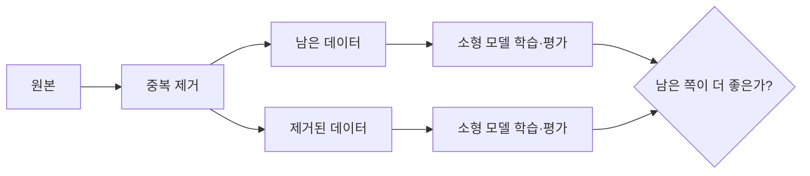
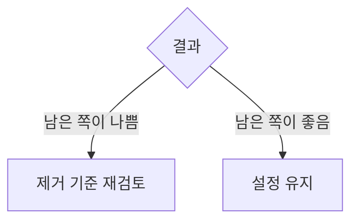

# 중복 제거 후 품질 점검

> 중복 제거가 데이터를 좋게 만들었는지 **"남은 것"과 "지운 것"을 직접 비교해 확인하는 절차**다. 중복 제거는 항상 품질을 올린다고 가정하면 안 된다.

## 쉽게 말하면
대청소 뒤에 버린 물건 더미와 남긴 물건 더미를 나란히 놓고 살펴본다. 남긴 쪽이 더 낡은 물건이라면 청소 기준이 틀렸다.

## 자세히
(FineWeb 논문, arXiv 2406.17557 PDF 본문)
- 사례: 2013-48 스냅샷에서 전역 중복 제거 시 원본의 약 90%가 제거됐다. 연구진은 두 데이터로 각각 모델을 학습해 비교했다.
  - (a) 전역 제거 후 **남은 것**(약 310억 토큰)
  - (b) 전역 제거에서 **제거된 것**(약 4,600억 토큰)을 그 스냅샷만으로 따로 중복 제거한 1,710억 토큰
- 결과: 남은 데이터(원본의 10%)가 **제거된 90%보다 품질이 나빴다.** 눈으로 봐도 남은 쪽에 광고, 뜻 없는 키워드 나열, 형식이 깨진 글이 더 많았다. 전역 제거가 품질이 낮은 데이터를 상대적으로 더 많이 남기는(업샘플링하는) 효과를 냈다는 설명이다.
- 이 점검이 가능했던 이유: 지운 데이터를 버리지 않고 보관해 두었기 때문이다([제외 문서 저장](#exclusion-writer)).
- 점검 절차(제안): ① 제거 전후 문서를 무작위 100개씩 뽑아 사람이 읽는다 ② 두 집합으로 소형 모델을 학습·평가해 비교한다 ③ 길이·언어·도메인 분포가 어떻게 바뀌었는지 본다 ④ 결과에 따라 중복 제거 범위(전역/스냅샷별)와 임계값을 조정한다.
- 주의: 한 스냅샷의 한 실험 결과다. 데이터와 평가에 따라 결론이 다를 수 있다.

## 그림으로 보기

## 예시
- 내 데이터 정제 후: 지운 문서 50개와 남은 문서 50개를 섞어 이름표를 가리고 읽어 어느 쪽이 더 좋은지 맞혀 본다.
- 교육: "정제 효과를 검증하지 않으면 정제가 오히려 해가 될 수 있다."

## 헷갈리는 것과 비교
| 개념 | 차이 |
|---|---|
| 이 점검 | 정제 결과의 품질을 비교 검증 |
| [중복 군집 크기](#duplicate-cluster-size) | 어떤 중복이 해로운지 설명하는 가설 |
| 품질 필터 | 낮은 품질을 규칙·모델로 걸러 냄 |

## 더 읽을거리
- [The FineWeb Datasets (arXiv 2406.17557)](https://arxiv.org/abs/2406.17557) — 2013-48 남은 데이터 vs 제거된 데이터 실험(PDF 본문 읽음).
