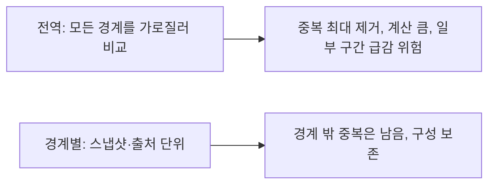
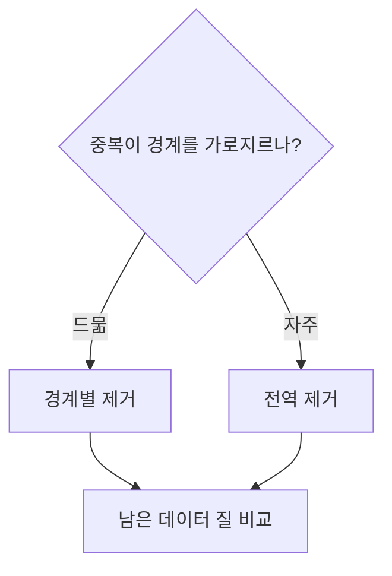

# 중복 제거 범위 선택

> 중복 제거를 **어느 범위 안에서** 할지(전체 전역 / 스냅샷·출처·분야별)는 "무엇을 중복으로 볼 것인가"와 "남기는 것의 질"을 함께 정한다. 범위가 좁으면 범위 밖 중복을 놓치고, 넓으면 계산이 커지고 남는 데이터의 질이 달라질 수 있다.

## 쉽게 말하면
도서관 전체에서 같은 책을 한 권만 남기느냐, 층별로 한 권씩 남기느냐의 선택이다. 전체에서 하면 중복이 가장 많이 사라지지만, 오래된 층에는 남는 책이 거의 없게 될 수 있다. 층별로 하면 일부 중복이 남지만 각 층의 구성이 보존된다.

## 자세히
- **FineWeb의 결과**(앞서 정리한 [스냅샷별 vs 전역](#per-snapshot-vs-global-dedup) 노드, FineWeb 논문 본문 기반): 96개 스냅샷을 전역으로 중복 제거하면 가장 오래된 스냅샷에서 최대 90%가 지워지고, 남은 10%가 지워진 90%보다 품질이 낮았다. 스냅샷별 제거가 더 좋은 모델을 냈다. 즉 "더 많이 지우면 더 좋다"가 아니었다.
- **직접 실험**(20 newsgroups 학습셋의 30단어 이상 글 9,373개, 단어 5-그램 MinHash(128)·LSH 후보를 **정확 자카드로 검증**한 근접 중복 쌍. 임계 0.8과 0.5):

| 임계값 | 검증된 중복 쌍 | 같은 뉴스그룹 안 | 뉴스그룹을 가로지름 | 무작위 2분할로 갈랐을 때 분할을 가로지르는 쌍 |
|---|---|---|---|---|
| 0.8 | 68 | 62 (91%) | 6 (9%) | 35 (51%) |
| 0.5 | 161 | 151 (94%) | 10 (6%) | 82 (51%) |

  제거되는 문서 수: 임계 0.8에서 **전역 64 / 뉴스그룹별 59 / 무작위 반반 33**, 임계 0.5에서 **전역 147 / 뉴스그룹별 138 / 무작위 반반 77**.
- **해석**: ① **의미 있는 단위(주제·출처)**로 범위를 나누면 중복은 대부분 그 안에 있어 손실이 작다(뉴스그룹별은 전역의 약 92% 제거). ② 중복과 무관한 기준(무작위 분할)으로 나누면 **약 절반을 놓친다**(51%가 분할을 가로지름). 즉 범위 선택의 핵심은 "중복이 그 경계를 넘나드는가"다. ③ 이 데이터에서 같은 글이 다른 뉴스그룹에 교차 게시된 경우가 가로지르는 쌍(6~9%)일 것이다(원인은 확인하지 않았다).
- **결정 기준(제안)**: ① 경계를 넘는 중복이 많다면(예: 스팸, 약관, 공유 기사) 전역으로. ② 경계가 시점·출처 품질을 대표하고 전역 제거가 한쪽 품질을 해친다면 경계별로(FineWeb). ③ 계산·메모리 한계가 있으면 경계별 후 보조 전역 단계. ④ 어느 쪽이든 제거 전후 **남은 데이터의 품질을 비교**([제거·보존 비교](#removed-vs-kept-comparison)). 한계: 20 newsgroups는 작고 오래된 데이터이며 FineWeb 규모의 결론을 뒷받침하지 않는다.

## 그림으로 보기

## 예시
- 사내 문서: 부서별 문서는 부서 안에서 중복이 대부분이므로 부서별 제거 후, 전사 공통 문구만 전역 제거.
- 교육: 범위를 바꿔 제거 문서 수를 비교하는 위 표를 직접 재현.

## 헷갈리는 것과 비교
| 개념 | 차이 |
|---|---|
| 전역 중복 제거 | 전체 데이터에서 비교 |
| 경계별 중복 제거 | 스냅샷·출처·분야 안에서만 비교 |
| [스냅샷별 vs 전역](#per-snapshot-vs-global-dedup) | FineWeb 사례 |
| [중복 제거 품질 점검](#dedup-quality-check) | 선택한 범위의 결과를 점검 |

## 더 읽을거리
- [FineWeb 논문 초록](https://arxiv.org/abs/2406.17557) — 96개 스냅샷 15조 토큰(열어 확인, 스냅샷별 제거 서술은 이전에 읽은 본문 기반).
- [scikit-learn 실제 데이터셋 문서](https://scikit-learn.org/stable/datasets/real_world.html) — 20 newsgroups(열어 확인).
