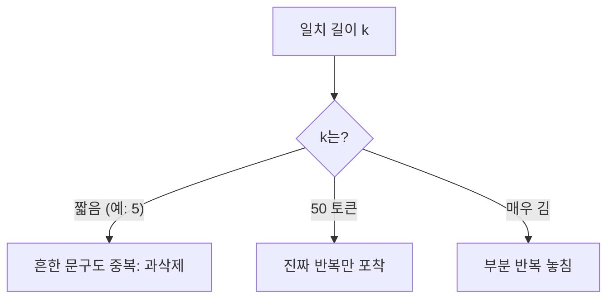
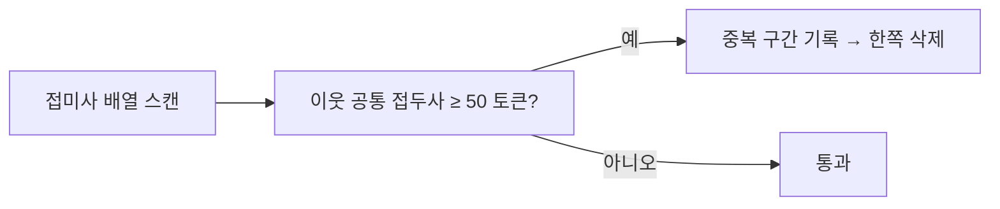

# 중복 임계 길이(50토큰)

> 정확 부분문자열 중복 제거에서 **"연속 50토큰 이상 같을 때만 중복"**으로 보는 최소 일치 길이다. 너무 짧으면 흔한 문구가 전부 중복으로 잡히고, 너무 길면 실제 반복을 놓친다.

## 쉽게 말하면
"안녕하세요"는 어느 글에나 있으니 겹쳤다고 베낀 것은 아니다. 하지만 한 문단이 통째로 같다면 이야기가 달라진다. 몇 글자부터를 "우연이 아니다"로 볼지 정하는 선이 임계 길이다.

## 자세히
- Lee 외(Deduplicating Training Data Makes Language Models Better, arXiv 2107.06499) 본문(직접 읽음): ExactSubstr 방식은 두 문서가 충분히 긴 부분 문자열을 공유하면 한쪽에서 그 구간을 지운다. 통계 분석(부록 B)을 근거로 **k = 50 토큰**을 최소 일치 길이로 골랐고, 접미사 배열의 이웃 접두사 길이가 50 BPE 토큰 이상일 때 기록한다.
- 임계 아래 문서는 후보가 못 된다: LM1B는 문서의 90%가 50토큰 미만이라 통째로 같아도 대상이 아니며, 그래서 ExactSubstr가 제거한 양이 NearDup의 1/8이었다.
- 제거량: C4에서 ExactSubstr는 전체 토큰의 7.18%를 제거했다(문서는 지우지 않고 구간만). NearDup으로 지워진 C4 학습 예제의 77%는 길이 50 일치도 하나 이상 있었다.
- NearDup 설정 예: MinHash 임계 자카드 0.8에서 b=20, r=450(서명 9,000개)을 써 후보를 만들고, 실제 자카드 0.8 초과·편집 유사도 0.8 초과인 쌍만 중복으로 확정했다. 0.9 설정은 b=20, r=40(서명 800).
- 50은 이 논문·영어 데이터·BPE 토큰 기준의 선택이다. 다른 언어·토크나이저에서는 같은 값이 같은 의미가 아니므로 직접 분포를 보고 정한다(제안).

## 그림으로 보기

## 예시
- 약관·라이선스 문구가 수만 번 반복되는 웹 데이터에서 그 문단(50토큰 이상)을 한 번만 남긴다.
- 교육: "몇 글자 겹쳐야 베낀 것인가"를 토론 주제로 삼는다.

## 헷갈리는 것과 비교
| 개념 | 차이 |
|---|---|
| 50토큰 일치 | 정확한 반복 구간 기준 |
| 자카드 0.8 | 문서 전체의 집합 겹침 기준([자카드](#jaccard-similarity)) |
| [접미사 배열](#suffix-array) | 50토큰 일치를 찾는 색인 |

## 더 읽을거리
- [Lee 외, Deduplicating Training Data Makes Language Models Better](https://arxiv.org/abs/2107.06499) — k=50, C4 7.18%, NearDup 설정(PDF 본문 읽음).
