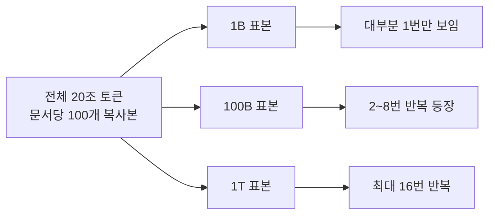
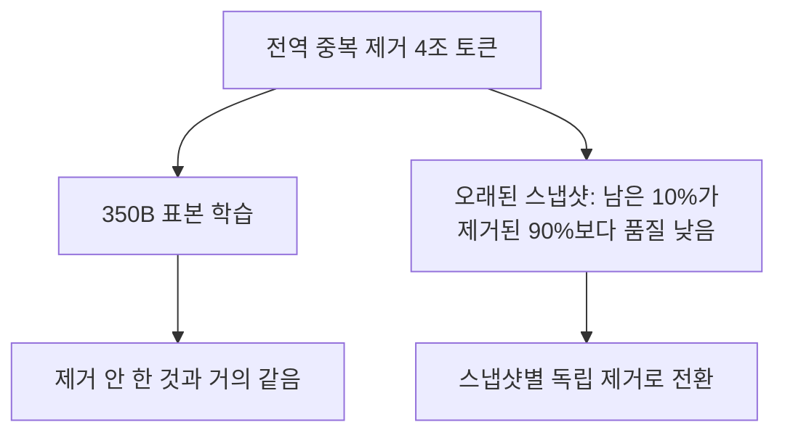

# 중복 가시성과 표본 크기

> 데이터 전체에서는 같은 문서가 수백 번 반복돼도, **학습용으로 작게 뽑은 표본에는 그 반복이 거의 보이지 않는다.** 그래서 작은 실험으로는 중복 제거 효과를 제대로 잴 수 없다.

## 쉽게 말하면
도서관에 똑같은 책이 100권씩 있어도, 책장에서 무작위로 한 권만 뽑으면 같은 책을 두 번 뽑을 일은 거의 없다. 한 번에 수천 권을 뽑아야 "같은 책이 여러 번 나온다"는 문제가 눈에 띈다. 작은 규모의 실험은 중복이라는 병을 검사하기엔 너무 가벼운 검사다.

## 자세히
(FineWeb 논문 부록, arXiv 2406.17557 PDF 본문 직접 읽음)
- **시뮬레이션**: 스냅샷 100개, 각 2,000억 토큰(합계 20조 토큰)이 서로 **완전히 같은 복사본**이라는 극단적 최악 가정. 문서마다 전체에는 100번 들어 있다. 여기서 무작위로 1B·10B·100B·350B·1T 토큰 표본을 뽑아 문서 반복 횟수 분포를 본다.
- **논문의 관찰**: 1B 표본에서는 거의 모든 문서가 1번만 나온다(전체에선 100번인데도). 100B(전체의 0.5%)에서는 2번 반복되는 문서가 늘고 일부는 4~8번, 1T(5%)에서는 대부분 최대 8번, 일부 16번까지 반복된다. 저자들은 가장 큰 중복 군집을 지운 뒤에는 큰 모델에서 중복 제거 영향을 재기 어렵다고 결론짓는다.
- **직접 계산(같은 가정, 문서당 100개 복사본이 각각 독립적으로 뽑힌다고 근사)**: 표본 비율 f=T/20조일 때 문서당 평균 등장 횟수는 100f. 표본에 등장한 문서 중 **2번 이상 나오는 비율**은 1B 0.25%, 10B 2.5%, 100B 23%, 350B 63%, 1T 97%. 소규모 표본일수록 중복이 "투명"하다. (단순 근사이며 논문 그림과 같은 값은 아니다.)
- **실제 ablation 결과**: 20조 토큰 전체를 전역(여러 스냅샷에 걸쳐) 중복 제거하면 4조 토큰이 남는데, 그중 3,500억 토큰 표본으로 학습한 모델은 중복 제거하지 않은 모델과 거의 차이가 없었다(RefinedWeb보다 한참 낮음). 가장 오래된 스냅샷(2013-48)에서는 전역 제거 후 **남은 10%가 제거된 90%보다 품질이 나빴고**(광고·키워드 나열이 더 많음), 그래서 FineWeb은 **스냅샷별 독립 중복 제거**(20조 토큰)를 택해 RefinedWeb 수준에 맞췄다.
- 가설(논문): 중복 제거의 주된 이득은 수십만 문서짜리 거대 중복 군집을 지우는 데서 나오고, 100개 안팎 이하의 작은 군집까지 더 지우는 것은 오히려 해가 될 수 있다.
- 교훈: 중복 제거 실험은 표본을 크게(수백B 토큰) 잡아야 하고, 작은 규모 결과를 그대로 일반화하면 안 된다.

## 그림으로 보기

## 예시
| 표본 크기 | 등장한 문서 중 2번 이상 비율(직접 계산) |
|---|---|
| 1B | 0.25% |
| 10B | 2.5% |
| 100B | 23% |
| 350B | 63% |
| 1T | 97% |
- 업무 장면: 사내 문서 100만 건의 중복 제거를 시험하려고 1,000건 표본만 보면 중복이 거의 안 보여 "효과 없음"이라고 잘못 결론 내릴 수 있다. 전체 또는 큰 표본으로 중복 군집 크기 분포를 본다.

## 헷갈리는 것과 비교
| 개념 | 차이 |
|---|---|
| 중복 가시성과 표본 크기 | 표본이 작으면 중복이 보이지 않음 |
| [소규모 ablation 벤치마크 선택](#benchmark-selection-small-scale) | 작은 실험에서 쓸 지표 고르기 |
| [단계별 규모 검증](#staged-validation) | 작은 규모 선별 후 큰 규모 재확인 |
| 전역 vs 스냅샷별 중복 제거 | 전역은 과도 제거로 품질이 낮아질 수 있음 |

## 더 읽을거리
- [The FineWeb Datasets (arXiv 2406.17557)](https://arxiv.org/abs/2406.17557) — 부록 E의 표본 크기 시뮬레이션과 본문 3.4절 중복 제거(PDF 직접 읽음).
