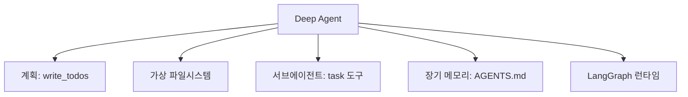

# Deep Agents

> **Deep Agents**는 LangChain·LangGraph 위에 **계획 도구, 가상 파일시스템, 서브에이전트, 장기 메모리**를 얹은 에이전트 하네스(SDK)다. 오래 걸리는 복잡한 작업용 뼈대를 미리 갖춰 준다.

## 쉽게 말하면
일을 맡은 에이전트에게 할 일 목록, 작업 노트 폴더, 조수 몇 명, 기억 노트를 한 세트로 지급하는 것이다. 매번 직접 만들 필요 없이 책상이 준비되어 있다.

## 자세히
(LangChain Deep Agents 개요 문서 확인; 예시 속 모델명은 문서의 자리표시자일 수 있음)
- **정의**: "계획, 서브에이전트, 파일시스템 컨텍스트를 위한 에이전트 하네스". 호스팅형 **Managed Deep Agents**(LangSmith)와 오픈소스 **Deep Agents SDK**(자체 호스팅)가 있다.
- **계획**: 선택(opt-in, v0.7부터) `write_todos` 도구, 상태 `pending·in_progress·completed`.
- **파일시스템**: `ls`, `read_file`, `write_file`, `edit_file`, `delete`, `glob`, `grep`(`execute`는 샌드박스 백엔드에서만). 백엔드는 메모리 상태·로컬 디스크·LangGraph 스토어·복합 라우팅.
- **서브에이전트**: 내장 `task` 도구. 기본은 동기, 비동기 서브에이전트는 launch/check/update/cancel 도구로 병렬 실행. 범용 서브에이전트가 기본 활성화.
- **장기 메모리**: `memory=`로 넘기는 `AGENTS.md` 파일, 항상 로드되고 에이전트가 갱신 가능.
- **기타**: 스킬(`SKILL.md`, Agent Skills 표준), 요약·컨텍스트 오프로딩, 프롬프트 캐싱, `interrupt_on`으로 사람 개입, 파일 권한, 샌드박스, MCP 도구.
- **LangGraph와의 관계**: LangGraph 런타임(내구성 있는 실행·스트리밍·사람 개입)을 쓴다. 이런 기능이 필요 없으면 `create_agent`나 직접 만든 LangGraph 워크플로를 권한다.
- 예: `create_deep_agent(model=..., tools=[...], system_prompt=...)` 후 `invoke`.

## 그림으로 보기

## 예시
- 시장 조사 에이전트: 할 일을 쪼개고, 서브에이전트가 병렬로 조사해 파일에 저장하고, 메인이 파일을 읽어 보고서 작성.

## 헷갈리는 것과 비교
| 개념 | 차이 |
|---|---|
| Deep Agents | 계획·파일·서브에이전트가 포함된 하네스 |
| LangGraph | 저수준 런타임 |
| [감독자(서브에이전트) 패턴](#supervisor-pattern) | Deep Agents가 내장한 구조 |
| [JIT 검색](#just-in-time-retrieval) | 파일시스템 탐색과 연결되는 전략 |

## 더 읽을거리
- [Deep Agents overview](https://docs.langchain.com/oss/python/deepagents/overview.md)
