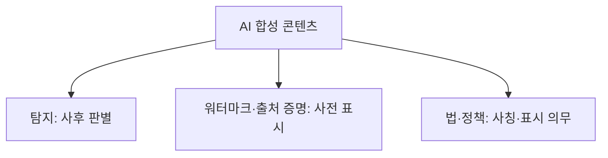
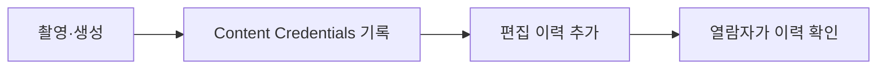

# 딥페이크와 합성물 표시

> **딥페이크**는 AI로 실존 인물의 얼굴·목소리·행동을 그럴듯하게 합성한 콘텐츠다. 대응책은 탐지, 법적 규제, 그리고 출처를 알려 주는 **표시·워터마크·출처 증명**으로 나뉜다.

## 쉽게 말하면
위조지폐가 정교해질수록 "진짜 같은지 눈으로 구분"하기보다 "발행 기록이 있는지"를 확인해야 한다. 디지털 콘텐츠에도 만든 이력 라벨을 붙이자는 흐름이다.

## 자세히
- **C2PA / Content Credentials**: 출판사·제작자·소비자가 콘텐츠의 출처와 편집 이력을 확인하도록 돕는 개방형 표준. 사이트는 이를 "디지털 콘텐츠의 영양성분표"에 비유한다. 운영위원회에 Adobe, Amazon, BBC, Google, Meta, Microsoft, OpenAI, Sony, TikTok 등이 있다. 사양 버전은 2.3으로 안내(c2pa.org 확인). 메타데이터가 지워진 경우의 한계는 페이지에 설명이 없다(일반적으로 메타데이터는 제거될 수 있어 워터마크 등과 병행한다는 지적이 있음).
- **규제 사례**: 미국 FTC 사칭 규칙이 2024-04-01 발효했다. 정부·기업 사칭 사기를 대상으로 하며, 개인 사칭으로 확대하는 보충 규칙안(의견 마감 2024-04-30)이 있었다. 페이지에는 AI 음성·딥페이크 내용이 직접 나오지 않았고 관련 보도자료 링크만 있다.
- 한국·EU의 AI 생성물 표시 의무는 이 글에서 확인하지 않았다(새 가지에서 조사).
- 실무: 합성물은 표시하고, 동의 없는 실존 인물 합성을 피하며, 수신한 의심 콘텐츠는 출처를 교차 확인한다.

## 그림으로 보기

## 예시
- 기업 홍보 영상에 AI 합성 장면이 있으면 "AI 생성" 표기를 하고 출처 메타데이터를 남긴다.
- 임원 목소리 요청 전화는 두 번째 채널로 본인 확인하는 절차를 둔다(일반적 권고).

## 헷갈리는 것과 비교
| 개념 | 차이 |
|---|---|
| 딥페이크 | 실존 인물을 합성한 콘텐츠 |
| 합성 미디어 | AI로 만든 모든 콘텐츠 |
| C2PA | 출처 이력 표준 |
| 워터마크 | 콘텐츠에 심는 신호 |
| [음성 복제](#voice-cloning-ethics) | 목소리에 특화된 합성 |

## 더 읽을거리
- [C2PA](https://c2pa.org/) — Content Credentials 개요.
- [FTC 사칭 규칙 발효 보도자료](https://www.ftc.gov/news-events/news/press-releases/2024/04/ftc-announces-impersonation-rule-goes-effect-today)
