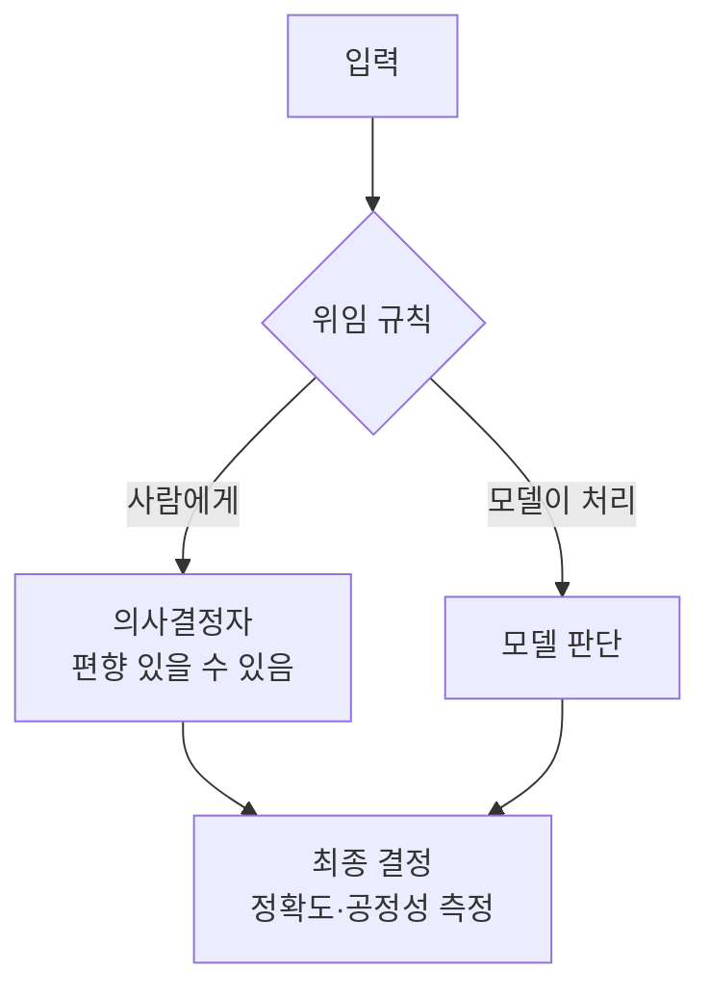

# 위임과 공정성

> 위임 학습은 AI가 사람에게 넘길 건을 고를 때 사람 의사결정자의 편향까지 고려해 정확도와 공정성을 함께 높이려는 접근이다. 하지만 어떤 건을 넘기느냐의 분포가 치우치면 오히려 새로운 편향이 생길 수 있다.

## 쉽게 말하면
신입이 선배에게 넘길 건을 고르는데, 그 선배가 특정 집단에게 가혹하다면 그 집단의 건은 선배에게 넘기지 않는 편이 낫다. 반대로 넘기는 건이 한쪽 유형으로 쏠리면 선배의 판단 습관도 흐트러질 수 있다.

## 자세히
- **Predict Responsibly(Madras·Pitassi·Zemel, NeurIPS 2018, arXiv 1711.06664, 본문 열람)**: 자동 모델이 결정을 넘기는(pass) 2단계 체계에서, 하류 의사결정자(DM)의 영향과 편향까지 반영해 학습한다. 공정성 기준은 두 집단의 거짓 양성률·거짓 음성률이 같아야 한다는 equalized odds이고, 그 격차를 연속 완화한 값을 규제항으로 쓴다.
- **실험 설정**: COMPAS(재범 예측, 인종 기준, 학습 7,718·테스트 3,309)와 Heritage Health(Charlson 지수, 나이 70 기준, 학습 46,769·테스트 20,044). DM의 편향은 모의로 만들었다: 편향 심한 DM(공정성 계수 −0.1로 학습), 일관성 없는 DM(하위 집단에서 30% 확률로 판단 뒤집기), 모델이 모르는 정보를 가진 고정확도 DM.
- **저자 보고 결과**: 고정확도 DM에서는 위임 학습이 reject 학습보다 정확도-공정성 절충이 좋았고 이득 대부분이 공정성에서 왔다. 편향 심한 DM에서는 두 집단에 다른 비율로 위임해 보정했다. 일관성 없는 DM에서는 같은 위임 비율에서 더 정확했고 최고 모델은 DM 단독과 이진 기준 모두를 앞섰다. 정확한 최종 수치는 본문에 없고 그림에만 있다. 사람 DM은 실제가 아니라 모의 모델이다.
- **반론(Too Much of the Same, arXiv 2608.28050, 초록 열람)**: 불균형 데이터에서 표준 위임 방식은 소수 클래스 건을 더 자주 넘기는 경향이 있고, 이렇게 치우친 위임이 사람의 판단에 영향을 준다. 226명 실험에서 크게 불균형한 건을 받은 사람은 다수 클래스에서 더 부정확했다. 저자는 사람이 클래스 빈도를 기대하는 것과 실제 분포의 충돌("Test-taker's effect")을 원인으로 추정한다.
- **후속 방향**: "Who Should Predict?" 논문은 사람을 고정 예측기로 두고 집단 간 오류율을 맞추는 공정성 제약과 위임 비율 상한을 두는 정확 알고리즘을 다룬다(검색 요약, 본문 미열람).
- **실무 해석**: 위임 비율을 집단별로 점검하고, 넘기는 건의 분포가 사람의 판단 품질에 미치는 영향도 측정한다(해석).

## 그림으로 보기

## 예시
- 대출 심사: 심사역이 특정 연령대에 보수적이라면 그 연령대 건을 모델이 직접 처리하도록 위임 규칙을 학습시키고, 집단별 위임율·오류율을 월 단위로 점검한다.
- 교육 활용: "사람에게 넘기면 공정해지는가?"를 토론 주제로 삼아 두 논문의 상반된 결과를 비교한다.

## 헷갈리는 것과 비교
| 개념 | 차이 |
| --- | --- |
| [위임 학습](#learning-to-defer) | 상위 주제. 이 글은 그 공정성 측면 |
| equalized odds | 집단 간 오류율 동일. 위임 학습이 맞추려는 기준의 하나 |
| 인간 개입(human in the loop) | 넘기는 규칙이 학습되지 않아도 됨 |

## 더 읽을거리
- [Predict Responsibly (arXiv 1711.06664)](https://ar5iv.labs.arxiv.org/html/1711.06664) — 위임 학습과 공정성 실험
- [Too Much of the Same (arXiv 2608.28050)](https://arxiv.org/abs/2608.28050) — 위임 쏠림이 사람 판단에 미치는 영향
