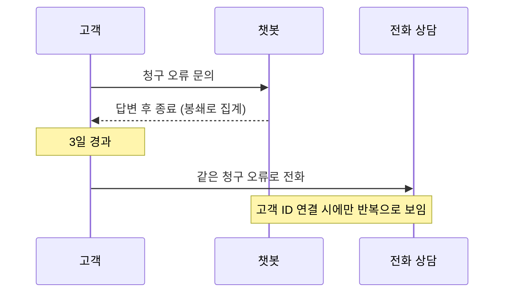
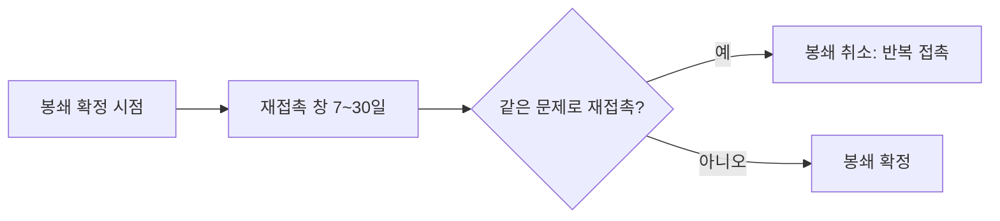

# 지연 재접촉

> 챗봇 대화가 "봉쇄(해결)"로 끝난 뒤 며칠 지나 같은 문제로 다른 채널(전화·이메일·매장)로 다시 연락하는 것이다. 챗봇 로그만 보면 보이지 않아, 봉쇄율이 실제보다 좋아 보이게 만든다.

## 쉽게 말하면
수리 기사가 "고쳤습니다" 하고 간 뒤, 사흘 뒤 같은 곳이 또 새서 고객센터에 전화가 왔다. 기사 방문 기록만 보면 성공이지만 고객 입장에서는 해결되지 않았다. 재접촉을 이어 붙여 봐야 진짜 해결을 알 수 있다.

## 자세히
- **표준 지표**: 같은 미해결 문제로 일정 기간 안에 다시 연락한 고객 비율이 반복 접촉률(Repeat Contact Rate)이다. 공식은 기간 내 반복 접촉 ÷ 해당 기간 전체 접촉 × 100이고, 첫 접촉 해결률(FCR)의 반대 개념이라 FCR 70%면 반복률이 대략 30%다(Kustomer 용어집 확인).
- **기간**: 보통 7~30일. 7일을 표준으로 보는 출처, B2B는 14일 이상을 권하는 출처가 있다(검색 결과 기준). 기간을 줄이면 보고 수치가 바로 달라지므로 여러 기간을 같이 보라는 권고도 있다.
- **같은 문제 판정**: 문의 유형·케이스 ID로 태깅하고 개별 고객에게 맞춘다. 월요일과 목요일의 같은 청구 오류는 반복이지만 석 달 뒤의 다른 배송 문제는 아니다(Kustomer).
- **채널 간 연결**: 채널을 가로지르는 고객 식별(identity resolution)이 없으면 반복을 과소 집계한다. "다른 채널"로 오는 재접촉이 지연 재접촉의 핵심이라 이 연결이 전제다.
- **원인(Kustomer)**: 상담원·봇의 지식 부족이나 불완전한 안내, 다음 단계 불명확, 약속한 후속 조치 지연, 증상만 고치고 근본 원인 미해결, 고객이 다른 방법으로 해결 후 확인차 연락.
- **시차 문제**: 반복 접촉 창이 며칠 뒤에야 닫히므로 이번 달 봉쇄율은 잠정값이다([봉쇄율의 함정](#containment-rate-trap)).
- 벤치마크 수치(7일 중앙값 23% 등)는 2차 자료 인용이라 원문 미확인.

## 그림으로 보기

## 예시
- 월말 보고서의 봉쇄율에 "재접촉 7일 창 닫힘 전 잠정" 표시를 달고, 다음 달 초에 확정값으로 정정.
- 문의 사유 태그(청구 오류)와 고객 ID로 챗봇·콜센터 로그를 조인해 재접촉 비율을 사유별로 본다.

## 헷갈리는 것과 비교
| 개념 | 차이 |
|---|---|
| 지연 재접촉 | 며칠 뒤 다른 채널로 다시 옴 |
| [반복 접촉 창](#repeat-contact-window) | 재접촉을 세는 기간 정의 |
| [무언의 이탈](#silent-abandonment) | 아예 연락 없이 사라짐 |
| 첫 접촉 해결률(FCR) | 반복 접촉률의 반대 지표 |

## 더 읽을거리
- [Kustomer: Repeat Contact Rate](https://kustomer.com/glossary/repeat-contact-rate/) — 정의·공식·기간·원인(직접 열어 확인, 벤더 글).
- [Decagon: Recontact rate](https://decagon.ai/glossary/what-is-recontact-rate) — AI 상담 맥락의 재접촉률(검색 결과 기준, 본문 미열람).
