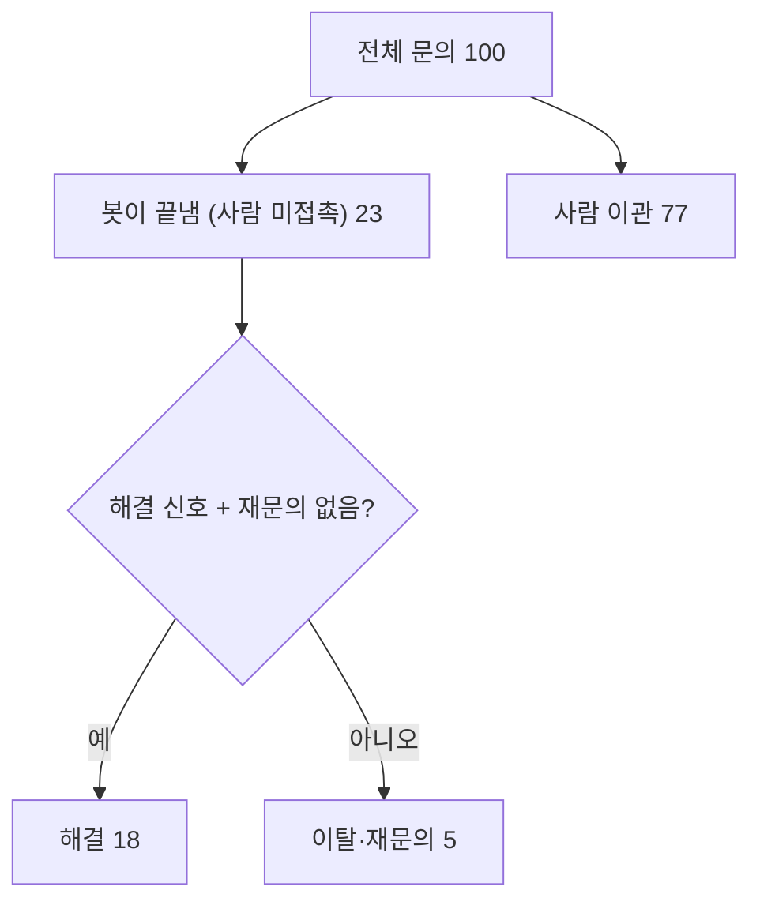
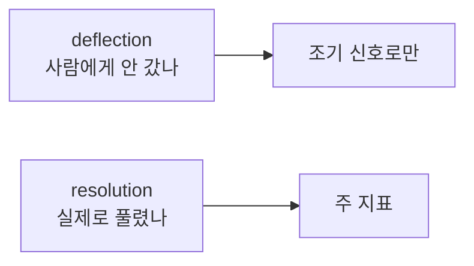

# 응대 전환율 deflection

> 고객 문의 중 사람 상담사에게 가지 않고 끝난 비율. 챗봇 성과의 가장 흔한 지표지만, "해결"이 아니라 "사람에게 안 갔다"만 센다는 함정이 있다.

## 쉽게 말하면
식당 입구 안내 직원이 "손님 중 몇 %를 주방에 안 보내고 돌려보냈나"를 자랑하는 것과 같다. 돌려보낸 손님이 만족했는지, 화나서 그냥 나갔는지는 이 숫자에 없다.

## 자세히
- **기본식**: 사람에게 닿지 않은 문의 ÷ 전체 문의. 벤더마다 정의가 달라 비교가 어렵다(예: "일정 기간 내 같은 사람이 티켓을 안 열어야 인정").
- **엄격한 식(Metabase 예시)**: 셀프서비스 해결 ÷ (셀프서비스 해결 + 생성된 티켓). 해결은 "도움이 됐다" 같은 명시 신호가 있고 **72시간 안에 티켓이 없을 때만** 인정. 창이 닫히지 않은 최근 건은 제외해야 수치가 부풀었다 되돌아가지 않는다.
- **함정**
  - 포기(이탈)도 deflection으로 잡힌다. 고객이 지쳐 창을 닫아도 성공.
  - 페이지 조회는 해결이 아니다.
  - 창(72시간 등)을 중간에 바꾸면 추세가 가짜로 변한다.
- **보완 지표**: 해결률(resolution rate), 같은 주제 재문의율(reopened-as-ticket), 셀프서비스 이용자 CSAT, 지식베이스 커버리지.
- 주장: 한 벤더는 deflection 90%인데 해결률 40%일 수 있다고 쓰지만 예시 수치이며 측정값이 아니다. 출처 대부분이 해결 중심 제품을 파는 벤더다.

## 그림으로 보기

## 예시
- 월간 보고: "deflection 40%"만 보고하지 않고 "해결 확인 28%, 72시간 내 재문의 6%"로 함께 적는다.
- 교육 실습: 챗봇 로그 20건을 직접 나눠 해결·이탈·재문의로 분류해 보게 한다.

## 헷갈리는 것과 비교
| 개념 | 차이 |
|---|---|
| deflection | 사람에게 안 간 비율. 이탈 포함 |
| 해결률 | 실제로 풀린 비율. 확인 신호 필요 |
| [이관 트리거 신호](#escalation-triggers) | 언제 사람에게 넘길지(deflection의 반대편) |
| [챗봇 vs 어시스트 도입 순서](#ai-chatbot-vs-assist) | 지표를 보고 도입 범위를 정하는 상위 주제 |

## 더 읽을거리
- [Fin: Deflection rate](https://fin.ai/glossary/deflection-rate) — 레거시 지표라는 관점(벤더)
- [Metabase: Deflection rate metric](https://www.metabase.com/metrics/deflection-rate) — 72시간 창·보호 지표 정의
- [Mavenoid: Deflection vs. Resolution](https://www.mavenoid.com/en/blog/deflection-vs-resolution-why-chatbots-struggle-in-tech-support) — 검색에서 확인한 글(벤더, 본문은 직접 열지 않음)
