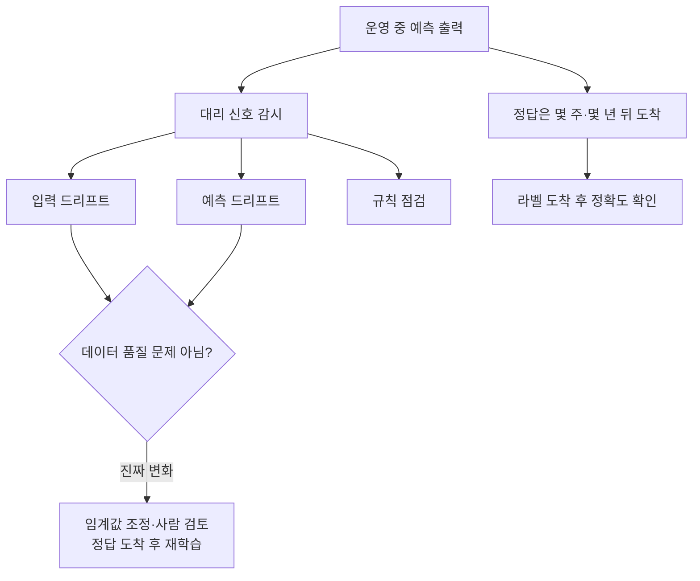

# 지연 라벨 모니터링

> 운영 중인 모델의 정답(라벨)이 한참 뒤에야 확인되거나 아예 오지 않을 때, 정답 없이 볼 수 있는 대리 신호(입력 분포, 예측 분포, 규칙 점검)로 먼저 감시하는 방법.

## 쉽게 말하면
대출 심사 AI는 "이 사람이 정말 갚았는가"를 몇 년 뒤에야 안다. 그동안 성적표가 안 나오니, 지원자 구성이 갑자기 바뀌거나 AI의 승인율이 급변하는 것을 보고 이상 징후를 먼저 잡는다.

## 자세히
출처: Evidently AI 가이드(열어서 읽음), Lu 외 "Learning under Concept Drift: A Review"(arXiv 2004.05785, 원문 PDF에서 관련 부분만 확인).
- **상황**: 의료에서 진단 확정, 대출의 상환, 이탈 예측의 실제 이탈 등은 정답이 늦게 온다. 이때 정확도를 바로 계산할 수 없다. 연구 문헌은 정답이 매우 늦거나 부족한 경우를 "extreme verification latency"(극단적 검증 지연)라고 부르며, 라벨이 적을 때를 위한 감지 기법(예: 비지도·준지도 방식)이 있다고 논문이 소개한다.
- **대리 신호(Evidently 권고)**:
  - **입력 드리프트**와 **예측 드리프트**를 정답이 오기 전의 조기 신호로 감시. 정확도를 직접 못 잴 때는 예측 드리프트가 가장 좋은 대리 지표인 경우가 많다.
  - **규칙 기반 점검**: 새 범주 값, 범위 밖 값, 예측 클래스 비율 상한.
- **주의 사항**:
  - 드리프트가 곧 성능 저하는 아니다. 예측 분포 변화가 실제 세계 변화(사기 증가)를 정확히 반영한 것일 수 있다.
  - 분포 변화가 진짜인지 확인하기 전에 **데이터 품질**(결측·형식 오류)을 먼저 배제한다.
  - 드리프트는 **조사의 방아쇠**이지 자동 재학습 명령이 아니다. 검증된 라벨이 모인 뒤에 재학습한다.
- **기다리는 동안의 조치**: 의사결정 임계값 조정, 업무 규칙 추가, 사람 검토로 라우팅, 영향 구간의 예측 일시 중단.
- **라벨을 빨리 얻는 설계(일반 실무, 출처 없음)**: 일부 표본에 대한 전문가 재판독, 확인된 사례만 모아 정기 성능 점검.

## 그림으로 보기

## 예시
- 암 재발 예측 AI: 재발 확인에 2~5년 → 환자군 분포와 고위험 판정 비율을 매월 점검하고, 급변 시 표본 재판독.
- 점검 질문: "라벨이 늦게 오는 동안 어떤 신호를 누가 보는가? 경보 후 임시 조치 절차가 있는가?"

## 헷갈리는 것과 비교
| 개념 | 차이 |
|---|---|
| 지연 라벨 모니터링 | 정답이 늦을 때 쓰는 대리 감시 |
| [데이터 드리프트](#data-drift) | 입력 분포 변화, 대리 신호의 하나 |
| [개념 드리프트](#concept-drift) | 정답 관계 변화, 정답 없이는 직접 확인이 어려움 |
| [모델 드리프트 모니터링](#model-drift-monitoring) | 상위 활동 |

## 더 읽을거리
- [Data drift (Evidently AI)](https://www.evidentlyai.com/ml-in-production/data-drift) — 라벨 지연 시 조언(열어서 확인)
- [Learning under Concept Drift: A Review (arXiv 2004.05785)](https://arxiv.org/abs/2004.05785) — 검증 지연과 라벨 적은 감지(원문 일부 확인)
