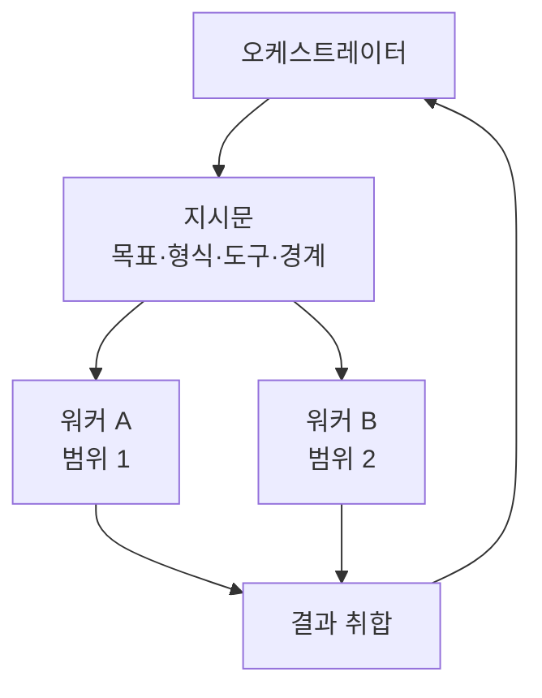

# 위임 지시문 쓰기

> 오케스트레이터가 워커(서브에이전트)에게 일을 맡길 때, 워커가 오해하지 않도록 목표·형식·도구·경계를 명세한 지시문.

## 쉽게 말하면
외주 맡기는 의뢰서다. "시장 조사해 주세요" 한 줄이면 사람마다 다르게 해석한다. 무엇을, 어떤 형식으로, 어디까지, 누구와 겹치지 않게 할지 적어야 한다. 워커는 나의 머릿속 맥락을 모른다.

## 자세히
Anthropic "How we built our multi-agent research system"의 교훈:
- 지시문에 넣을 것: **목표**, **출력 형식**, **도구·출처 안내**, **작업 경계**(다른 워커와의 분담).
- 실패 사례: "반도체 부족을 조사해"처럼 짧은 지시 때문에 한 워커는 2021년 자동차 칩 위기를, 다른 두 워커는 같은 2025년 공급망을 중복 조사했다.
- 초기 시스템은 단순 질문에 서브에이전트를 50개 만들거나 없는 출처를 계속 찾기도 했다. 그래서 **노력 규모 규칙**을 지시문에 박는다: 사실 확인은 1개 에이전트·3~10회 도구 호출, 직접 비교는 2~4개·각 10~15회, 복잡한 연구는 10개 이상에 책임을 명확히 나눈다.
- 도구 지침: 가능한 도구를 먼저 훑고, 의도에 맞는 도구를 고르고, 일반 도구보다 전문 도구를 우선한다.
- 검색은 짧고 넓게 시작해 점차 좁힌다.
- 구조는 [오케스트레이터-워커](#orchestrator-workers) 패턴의 핵심 기술이며, [컨텍스트 엔지니어링](#context-engineering)의 한 부분이다.

## 그림으로 보기

## 예시
나쁜 지시: "경쟁사 조사해."
좋은 지시: "목표: A사의 2025년 가격 정책 변화 파악. 출처: 공식 가격 페이지와 보도자료만. 출력: 표(항목/변경 전/후/출처 URL). 범위 밖: 제품 기능 비교(다른 워커 담당). 도구 호출은 최대 15회."

## 헷갈리는 것과 비교
| 개념 | 차이 |
|---|---|
| 위임 지시문 | AI가 다른 AI에게 주는 명세 |
| [위임 판단하기](#delegation-skill) | 사람이 AI에 맡길지 정하는 판단 |
| 시스템 프롬프트 | 역할 전체의 상시 지침 |

## 더 읽을거리
- [How we built our multi-agent research system(Anthropic)](https://www.anthropic.com/engineering/multi-agent-research-system) — 위임 지시문 실패 사례와 규칙.
