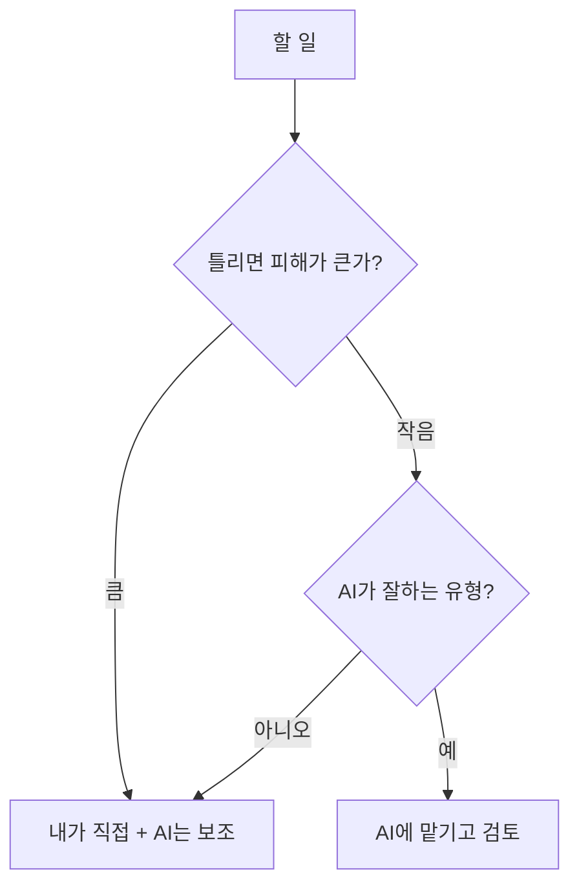

# 위임 판단하기

> AI 유창성 4D의 첫 번째 역량. 어떤 일을 AI에 맡기고, 어떤 일은 내가 직접 할지 정하는 판단.

## 쉽게 말하면
신입 직원에게 일을 줄 때와 같다. 정해진 형식의 자료 정리는 맡기고, 고객과의 민감한 협상은 내가 한다. 맡기기 전에 "이 직원이 이걸 잘할까, 틀리면 누가 책임지나"를 먼저 따진다.

## 자세히
Anthropic·Rick Dakan·Joseph Feller의 [AI Fluency 프레임워크](#ai-fluency-4d)에서 Delegation은 사람과 AI의 강점에 맞춰 일을 나누는 역량이다. 세 질문으로 쓸 수 있다.
1. **문제 인식**: 목표가 무엇이고 어떤 결과물이 필요한가?
2. **플랫폼 이해**: 쓰려는 AI가 이 일에 무엇을 잘하고 못하는가(지식 시점, 도구, [환각](#hallucination) 경향)?
3. **일 분배**: 어느 부분을 AI가, 어느 부분을 내가, 어느 부분을 같이 할 것인가?
- 맡기기 좋은 일: 초안, 요약, 형식 변환, 아이디어 확장, 반복 작업.
- 내가 쥐어야 할 일: 최종 판단, 책임이 따르는 결정, 맥락·관계 판단, 검증이 어려운 사실.
- 분배 방식: 자동화(AI 단독), 증강(함께), 에이전시(AI가 알아서 진행) 같은 협업 모드로 나눠 생각한다.
- 위임이 끝이 아니다: 결과는 [설명](#description-skill)→[평가](#discernment-skill) 순환으로 이어진다.

## 그림으로 보기

## 예시
- 회의록: 녹취 요약은 AI, 결정 사항 확정은 사람.
- 고객 제안서: 시장 조사 초안은 AI, 가격·약속 조항은 사람.

## 헷갈리는 것과 비교
| 개념 | 차이 |
|---|---|
| 위임 판단 | 맡길지 말지·어디까지 정함 (시작 전) |
| [결과 평가 습관](#discernment-skill) | 받은 결과를 어떻게 읽을지 (끝난 후) |
| [휴먼 인 더 루프](#human-in-the-loop) | 시스템 설계에서 사람 개입 지점 |

## 더 읽을거리
- [Description–Discernment loop(Anthropic)](https://www.anthropic.com/ai-fluency/description-discernment-loop) — 4D 중 순환 구조 설명.
- [Inside Anthropic's AI Fluency Masterclass(The Neuron)](https://www.theneuron.ai/explainer-articles/inside-anthropics-ai-fluency-masterclass-on-human-ai-collaboration) — 강의 요약(2차 자료).
