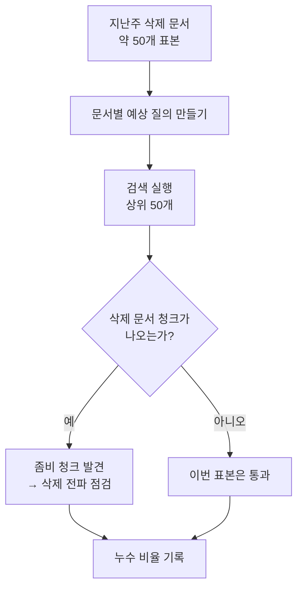
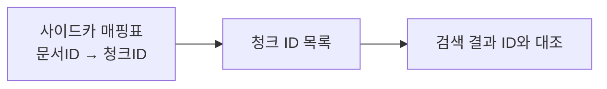

# 삭제 감사 표본

> 최근 지운 문서 일부를 **표본으로 뽑아**, 그 문서를 찾을 법한 질문을 던져 봤을 때 지운 문서의 청크가 검색 결과에 아직 나오는지 확인하는 점검이다. [좀비 문서](#zombie-documents)가 실제로 있는지 숫자로 알려 준다.

## 쉽게 말하면
도서관이 지난주 폐기한 책 50권을 골라 검색대에서 그 책 제목·주제로 찾아 보는 일이다. 몇 권이라도 검색 카드가 남아 있으면 "폐기 절차가 카드까지 지우지 못한다"는 증거다. 전수 조사 대신 표본으로 싸게 확인한다.

## 자세히
(개인 블로그·벤더 블로그 기반의 실무 절차이며 표준은 아니다. 두 글을 직접 열어 확인했다.)
- **기본 절차(tianpan.co, 2026-05-09 글)**: ① 지난주 삭제한 원본 문서 약 50개를 뽑는다 ② 문서마다 그 문서를 찾게 될 법한 질의를 만든다 ③ 상위 50개 결과에 그 문서의 청크가 있는지 본다 ④ 자주 나오면 좀비 문제. 글은 합격선(몇 % 이하)이나 질의 만드는 법은 정하지 않았다 — 직접 정해야 한다. 지표로는 "표본 중 청크가 하나라도 나온 문서 비율"이 자연스럽다(이건 글의 암시이지 명시가 아니다).
- **선행 조건**: 문서→청크 **사이드카 매핑표**가 없으면 어떤 청크가 그 문서 것인지 알 수 없어 감사 자체가 어렵다. 안정적인 문서·청크 ID를 메타데이터로 넣어 둔다.
- **표본을 층화하기(QASkills 글)**: 색인된 뒤 삭제 / 수집 중 삭제 / 이미 정리됨, 여러 버전 중 옛 버전만 삭제, 다른 테넌트, 접근 권한이 나중에 회수된 문서를 골고루 넣는다. 삭제 전에 대상이 모든 경로로 실제 검색되는지 먼저 확인해야 "안 나옴"이 의미를 갖는다.
- **질의 종류**: 원문 그대로의 질문, 바꿔 말한 질문(의미 캐시·임베딩 이웃 누수), 같은 질문 반복(캐시), 엔티티·관계 질문(그래프·요약 누수), 프로세스 재시작 후 질문. 벡터·키워드·하이브리드·캐시·리랭커 경로를 모두 본다.
- **합격 기준 예(QASkills)**: 삭제 확인 후 삭제된 버전이 어느 단계(후보·프롬프트·답·인용)에도 나타난 횟수 0, 캐시 누수 0. 물리 삭제 시각(time-to-purge)과 논리 삭제 시각(time-to-denial)을 따로 잰다.
- 표본 감사는 **사후 점검**이다. 상시 경보는 [카나리 문서 프로브](#canary-document-probe)가 맡는다.

## 그림으로 보기

## 예시
- 사내 규정 챗봇: 매주 월요일 지난주 삭제 문서 50개를 뽑아 제목·핵심 키워드로 질의 → 3개 문서의 청크가 나오면 "누수 6%"로 기록하고 동기화 로그를 확인한다.
- 교육 소재: "AI가 '지운 정보'를 계속 말하는지 어떻게 검사하나?"를 표본 감사로 실습.

## 헷갈리는 것과 비교
| 개념 | 차이 |
|---|---|
| 삭제 감사 표본 | 실제 삭제 문서를 뽑아 사후에 검사 |
| [카나리 문서 프로브](#canary-document-probe) | 가짜 문서를 만들어 지우고 상시 경보 |
| [좀비 문서](#zombie-documents) | 점검 대상이 되는 문제 자체 |

## 더 읽을거리
- [Retrieval Cascade Failure (tianpan.co)](https://tianpan.co/blog/2026/05/09/retrieval-cascade-failure-document-deletion-rag) — 표본 50개·상위 50개 감사와 완화책(개인 블로그).
- [Testing RAG deleted document tombstones (QASkills)](https://qaskills.sh/blog/testing-rag-deleted-document-tombstones) — 층화 표본, 질의 종류, 합격 기준 예.
