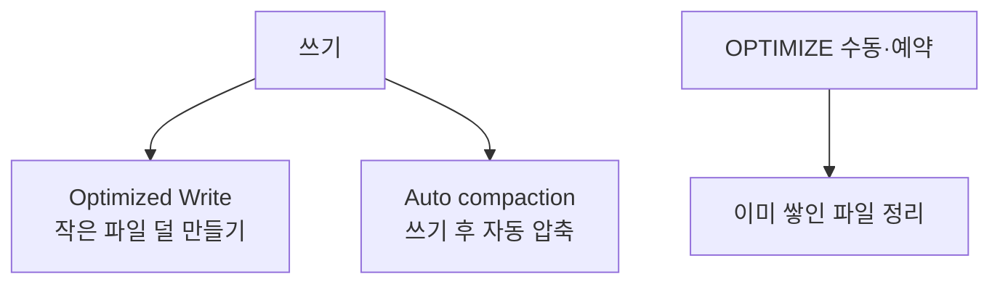

# Delta OPTIMIZE 압축

> Delta Lake의 `OPTIMIZE` 명령은 **작은 파일 여러 개를 큰 파일로 합쳐(bin-packing 압축)** 읽기 속도를 높인다. 같은 명령을 두 번 돌려도 두 번째는 아무 일도 하지 않는다(멱등).

## 쉽게 말하면
자잘하게 쪼개진 종이쪽지 수천 장을 파일철 몇 권으로 묶어 정리하는 일이다. 내용은 그대로고 찾을 때 넘길 철이 줄어든다. 이미 정리한 철을 다시 정리해도 바뀌지 않는다.

## 자세히
(Delta Lake 공식 문서의 최적화 페이지와 Databricks의 OPTIMIZE 문서를 직접 읽었다. 버전 조건은 문서 기준이다. 위 두 문서는 일부 항목(기본 목표 크기 등)이 서로 다르거나 없어 구분해서 적는다.)
- **하는 일(Delta 문서)**: Delta Lake 1.2.0 이상에서 사용 가능. 작은 파일을 큰 파일로 합쳐 읽기를 빠르게 한다. 구문은 `OPTIMIZE <table>`이고 `WHERE <파티션 조건>`으로 일부만 대상으로 할 수 있다. Python·Scala `optimize()` API는 2.0 이상.
- **bin-packing(두 문서)**: 파일을 **디스크 크기 기준**으로 고르게 맞추는 것이 목표이며 행 수 기준이 아니다. 파티션이 있으면 **파티션 안에서** 압축한다. `spark.databricks.delta.optimize.repartition.enabled=true`로 두면 `coalesce(1)` 대신 `repartition(1)`을 써 작은 파일이 많을 때 더 낫게 동작할 수 있다(Delta 문서).
- **멱등성(두 문서)**: bin-packing은 멱등이다. 같은 데이터에 다시 돌려도 효과가 없다. 반면 `ZORDER BY`는 멱등이 아니다(Delta 문서). 읽는 쪽은 스냅샷 격리라 `OPTIMIZE` 중에도 읽기가 끊기지 않고 전후 결과가 같다.
- **예시 명령(Delta 문서)**: `OPTIMIZE delta_table_name;`, `OPTIMIZE delta_table_name WHERE date >= '2017-01-01'`, Python `deltaTable.optimize().executeCompaction()`, `deltaTable.optimize().where("date='2021-11-18'").executeCompaction()`.
- **결과 지표(Databricks 문서)**: 제거·추가된 파일의 통계(최소·최대·합계)와 Z-order 통계, 처리한 배치·파티션 수를 돌려준다. 특정 필드명은 문서에서 확인하지 못했다.
- **자동으로 돌지 않는다(Databricks 문서)**: `OPTIMIZE`는 기본적으로 자동 적용되지 않는다. Unity Catalog 관리형 테이블에서는 **예측 최적화**가 자동 실행하고, **Auto compaction**은 별도 기능으로 쓰기 후 작은 파일을 자동 압축한다.
- **목표 파일 크기**: 읽은 두 문서에는 bin-packing의 기본 목표 크기(예: 1GB)가 적혀 있지 않았다. Delta 문서의 숫자 중 128MB는 **auto compaction의 기본 목표 크기**다. 이 둘을 혼동하지 않는다.
- **연결**: 앞서 읽은 Athena 문서는 "작은 파일은 쓰기 전에 합치는 것이 가장 좋다"고 했다. Delta에서는 [Optimized Write](#optimized-write)와 [Auto compaction](#auto-compaction)이 그 역할을 하고, `OPTIMIZE`는 이미 쌓인 작은 파일을 사후에 정리한다.

## 그림으로 보기



## 예시
```sql
OPTIMIZE events;
OPTIMIZE events WHERE event_date >= '2026-11-01';
```
- 교육 소재: "정리했는데 또 정리하면?" 멱등성 이야기.

## 헷갈리는 것과 비교
| 개념 | 차이 |
|---|---|
| OPTIMIZE(압축) | 이미 있는 작은 파일을 합침, 멱등 |
| ZORDER BY | 값이 비슷한 행을 모음, 멱등 아님 |
| [Optimized Write](#optimized-write) | 쓰는 순간 작은 파일이 덜 생기게 함 |
| [Auto compaction](#auto-compaction) | 쓰기 후 자동으로 작은 파일 압축 |

## 더 읽을거리
- [Optimizations (Delta Lake docs)](https://docs.delta.io/latest/optimizations-oss.html) — OPTIMIZE·Auto compaction·Optimized Write(직접 읽음).
- [OPTIMIZE (Databricks)](https://docs.databricks.com/aws/en/delta/optimize) — 멱등성·예측 최적화(직접 읽음).
