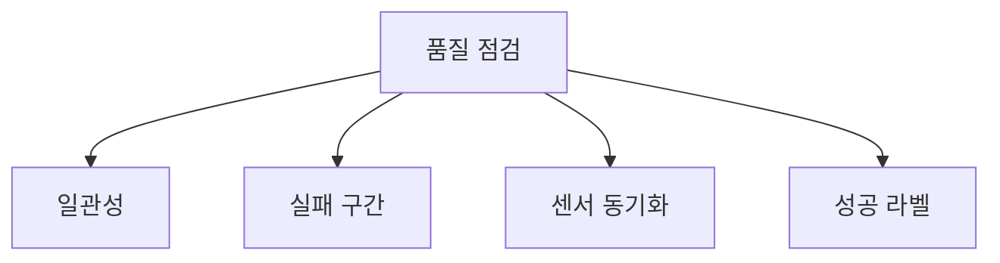

# 시연 데이터 품질

> [모방 학습](#imitation-learning)은 시연을 정답으로 삼으므로, **시연의 일관성·숙련도·실패 포함 여부**가 학습된 정책의 상한을 정한다.

## 쉽게 말하면
요리 학원에서 선생님마다 다른 방식으로 시범을 보이거나, 가끔 손이 미끄러진 시범을 섞어 보여 주면 학생은 헷갈린다. 시범의 질이 곧 학생의 실력이다.

## 자세히
- Mandlekar 외(CoRL 2021, arXiv 2108.03298) "What Matters in Learning from Offline Human Demonstrations"는 6개 오프라인 학습 알고리즘을 시뮬레이션 5과제·실제 3과제에서 비교했다(검색 요약으로 확인).
- 품질 실험: RoboTurk로 **6명의 조작자가 모은 300개 시연**을 숙련도에 따라 "Worse/Okay/Better" 세 그룹으로 나눈 혼합 품질 데이터를 만들었다.
- 주요 교훈(프로젝트 페이지 기준): 배치 오프라인 RL은 **최적이 아닌 사람 데이터에 약하다**, 관찰 공간과 하이퍼파라미터의 영향이 크다, 오프라인 정책 선택이 어렵다, 사람 시연 데이터는 유망하다.
- 사람 시연의 특성: 사람은 현재 관찰만으로 행동하지 않아 **비마르코프**적일 수 있어 기계 생성 데이터와 다르다.
- 실제 로봇 실험은 과제당 시연 200개와 BC-RNN을 시뮬레이션과 같은 하이퍼파라미터로 사용했다. 구체 수치는 확인하지 못했다.
- 실무 점검표: 조작자 간 편차, 실패·망설임 구간 포함 여부, 카메라·동기화 오류, 라벨(성공/실패) 정확도.

## 그림으로 보기

## 예시
- 같은 컵 집기를 서로 다른 방식으로 시연한 데이터는 정책이 평균 동작을 내 어정쩡한 행동을 하게 만들 수 있다.
- 교육: 사내 AI 학습에 쓸 "모범 사례 문서"를 만들 때 품질 편차를 정리하는 사례.

## 헷갈리는 것과 비교
| 개념 | 차이 |
|---|---|
| 시연 품질 | 사람 데이터의 질 |
| [분포 이동](#distribution-shift) | 시연 밖 상태로 가는 문제 |
| [Open X-Embodiment](#open-x-embodiment) | 규모를 키울 때 품질 편차가 문제가 됨 |

## 더 읽을거리
- [robomimic 연구 페이지](https://robomimic.github.io/study) — 교훈 목록(검색 결과로 확인).
- [논문 arXiv 2108.03298](https://arxiv.org/abs/2108.03298) — 원문.
