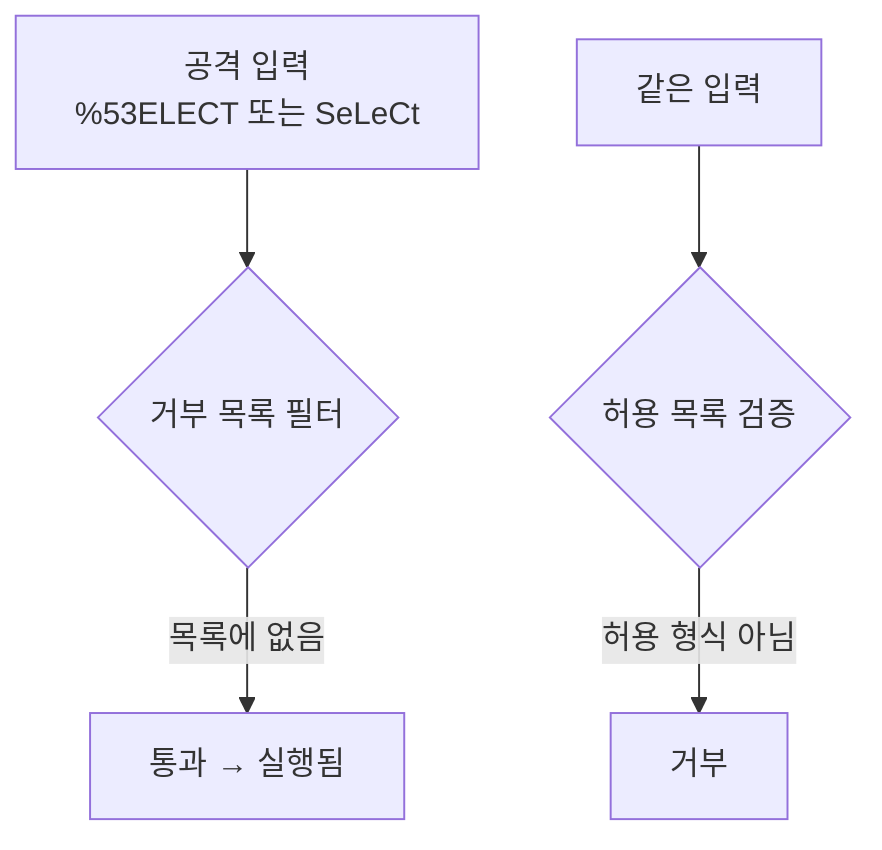

# 거부 목록 우회 (Denylist Bypass)

> 거부 목록(차단 목록)은 "나쁜 문자열"을 미리 적어 두고 막는 방식인데, 공격자가 인코딩·대소문자·변형으로 그 목록을 피해 가기 쉬워 근본 방어가 되지 못한다.

## 쉽게 말하면
클럽 입구에서 "이 사람들은 입장 금지" 명단만 들고 있으면, 변장하거나 이름을 살짝 바꾼 사람은 통과한다. 반대로 "초대장 명단에 있는 사람만 입장"이면 명단에 없는 변종은 자동으로 막힌다. 전자가 거부 목록, 후자가 허용 목록이다.

## 자세히
OWASP Input Validation Cheat Sheet(2026-11 확인)의 입장:
- "모든 악성 문자열을 알아내려 하지 마라" — 허용 목록(받아들일 형식·길이·값의 집합)을 정의하고 나머지는 거부한다. "입력을 지우거나 정제하는 방식(denylisting/cleaning)"은 흔한 함정으로 꼽는다.
- 약한 이유: ① 모든 악성 패턴을 예측할 수 없다. ② 작은따옴표 같은 문자를 막으면 정상 이름(O'Brien)이 거부되는데 쿼리는 여전히 안전하지 않다. ③ 의심 문자를 제거하면 입력 의미가 바뀌고, 파라미터화 쿼리·출력 인코딩을 대체하지 못한다.
- **우회 유형(일반 보안 지식)**: 대소문자 변형(`SeLeCt`), URL·유니코드 인코딩, 이중 인코딩, 공백 대신 주석 사용, 제거 필터를 역이용한 중첩(`SELSELECTECT`).
- 이 문서가 직접 설명하는 관련 위험은 **디코딩 불일치**다. 검사 시점과 실제 사용 시점의 표현이 다르면(검사 후 다시 디코딩) 검증이 무력해진다. 해법은 프로토콜 디코딩 후 한 번 검증하고, 유니코드는 한 가지 정규화 정책을 일관되게 쓰는 것이다.

## 그림으로 보기

## 예시
- AI가 짠 코드가 `if "DROP" in text: reject`로 막고 있다면, `drop`·`%44ROP`는 통과한다 → "문자열 차단 대신 파라미터화 쿼리 + 허용 목록으로 바꿔 줘"라고 요청.
- 정렬 컬럼 파라미터: 차단하지 말고 `["name","date"]` 중 하나만 받게 한다.

## 헷갈리는 것과 비교
| 개념 | 차이 |
|---|---|
| 거부 목록 | 알려진 나쁜 것만 막음 — 새 변종에 취약 |
| [허용 목록 검증](#allow-list-validation) | 알려진 좋은 것만 통과 — 기본 권장 |
| [SQL 인젝션](#sql-injection) | 거부 목록 우회가 자주 쓰이는 공격 |
| [대량 할당](#mass-assignment) | 차단 필드 목록 방식도 같은 이유로 약함 |

## 더 읽을거리
- [OWASP Input Validation Cheat Sheet](https://cheatsheetseries.owasp.org/cheatsheets/Input_Validation_Cheat_Sheet.html) — 허용 목록 우선, 정제 방식의 한계, 디코딩·정규화 원칙.
