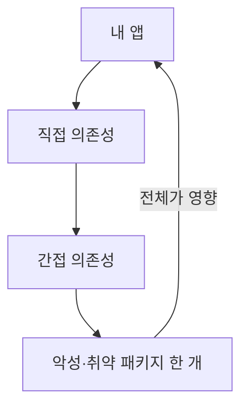
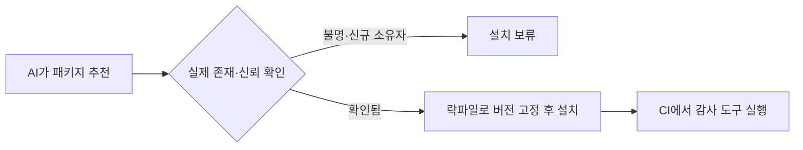

# 패키지 의존성 위험

> 내 앱이 가져다 쓰는 외부 패키지(npm·PyPI 등)와 그 하위 패키지 전체가 공격 경로가 될 수 있다는 위험. AI가 제안한 패키지 이름이 존재하지 않거나 가짜일 수도 있다.

## 쉽게 말하면
요리에 쓰는 재료를 도매상에게서 받는 것과 같다. 내가 만든 요리가 안전해도 납품 재료에 이물질이 섞이면 사고가 난다. 그리고 AI 점원이 "이 재료 유명해요"라며 존재하지도 않는 상표를 추천할 수 있고, 그 이름을 먼저 등록해 둔 악당이 있을 수도 있다.

## 자세히
- **범위**: OWASP Top 10 2025는 "Software Supply Chain Failures"를 3위로 올리며, 옛 "취약하고 오래된 구성요소"보다 범위를 넓혀 외부 의존성, 빌드 파이프라인, 컨테이너 베이스 이미지까지 포함한다(2차 자료로 확인, 공식 본문 직접 열람은 못 함 — 주장 수준).
- **위험 유형**: ① 알려진 취약 버전 사용 ② 이름 헷갈리게 만든 가짜 패키지(typosquatting) ③ AI가 지어낸 패키지 이름을 공격자가 선점(할루시네이션 기반 공급망 공격, 흔히 slopsquatting이라 불림) ④ 정상 패키지가 탈취되어 악성 업데이트 배포 ⑤ 설치 스크립트(postinstall) 실행.
- **점검 습관**: 설치 전 패키지 존재 여부·다운로드 수·저장소·최근 갱신·소유자 확인, 락파일(`package-lock.json`, `uv.lock` 등)로 버전 고정, CI에서 `npm ci`처럼 락파일 그대로 설치, `npm audit`/`pip-audit` 같은 감사 도구를 CI 게이트로, 가능하면 `--ignore-scripts`.
- **SBOM**: 직·간접 의존성 목록을 SPDX·CycloneDX 같은 형식으로 빌드 때 생성해 두면 취약점이 터졌을 때 영향 범위를 빨리 안다.
- **AI 코딩 때**: "새 의존성은 추가하기 전에 이유와 대안을 설명하고, 표준 라이브러리로 되면 그걸 써라"를 규칙으로 둔다. 새로 추가된 의존성은 리뷰 체크 항목이다.

## 그림으로 보기

## 예시
- 설치 전: "`foo-utils` 패키지의 npm 등록일, 주간 다운로드, 저장소 링크, 마지막 릴리스를 확인해 요약해 줘. 의심되면 대안을 제시해."
- CI: `npm ci && npm audit --audit-level=high`.

## 헷갈리는 것과 비교
| 개념 | 차이 |
| --- | --- |
| 취약한 버전 | 정상 패키지의 알려진 버그 — 업데이트로 해결 |
| 악성 패키지 | 처음부터 공격 목적 — 설치 자체를 피해야 함 |
| 락파일 | 버전을 고정해 재현성 확보. 안전 보증은 아님 |
| [바이브코딩 안전](#vibecoding-safety) | 상위 주제 |
| [CI/CD](#ci-cd) | 감사 도구를 자동으로 돌리는 자리 |

## 더 읽을거리
- [OWASP Top 10:2025 A03 (요약 해설)](https://www.securecodewarrior.com/blog/owasp-top-10-2025-software-supply-chain-failures) — 범위·SBOM·락파일 (2차 자료)
- [OWASP 공식 Top 10 사이트](https://top10.owasp.org/) — 원문 확인용
