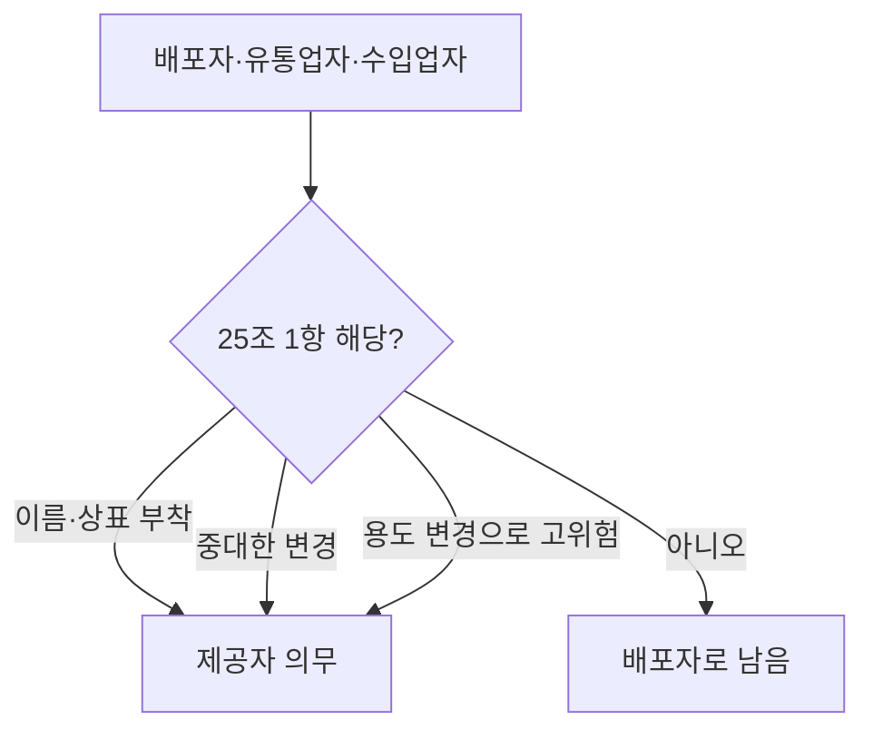
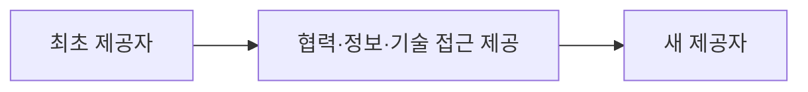

# 제공자 vs 배포자 (AI Act의 역할 구분)

> EU AI Act는 AI를 만들어 시장에 내놓는 쪽(제공자, provider)과 자기 업무에 쓰는 쪽(배포자, deployer)에게 서로 다른 의무를 지운다. 배포자가 이름을 붙이거나 용도를 바꾸는 등의 일을 하면 제공자의 의무를 지게 될 수 있다.

## 쉽게 말하면
자동차 제조사와 렌터카 회사의 차이와 같다. 제조사는 안전 인증을 받고, 렌터카 회사는 정해진 용도로 안전하게 운영한다. 그러나 렌터카 회사가 차를 개조하거나 자기 브랜드를 붙여 판다면 제조사 책임을 질 수 있다.

## 자세히
출처는 artificialintelligenceact.eu의 25조(열람, 고위험 AI 가치 사슬 책임). 25조는 고위험 AI 시스템에 관한 조항이며 정의 조항(3조)은 이번에 열지 않았다. 법률 자문이 아니다.
- **적용 시기(113조 (c) 기준으로 25조 페이지에 적힘)**: 부속서 III 고위험 시스템은 2027-12-02, 부속서 I 시스템은 2028-08-02(옴니버스 개정 반영 여부는 [부속서 III 적용 연기](#annex-iii-delay) 참고).
- **제공자가 되는 경우(25조 1항)**: 유통업자·수입업자·배포자·기타 제3자는 다음 중 하나면 16조의 제공자 의무를 진다.
  - (a) 이미 시장에 있거나 사용 중인 고위험 AI 시스템에 자기 이름이나 상표를 붙임(계약으로 의무를 달리 배분한 경우는 별개).
  - (b) 시장 출시 후 고위험 시스템에 중대한 변경을 가하고 그 시스템이 고위험으로 남음.
  - (c) AI 시스템(고위험으로 분류되지 않았던 범용 AI 시스템 포함)의 의도된 목적을 바꿔 6조에 따라 고위험이 되게 함.
- **최초 제공자의 의무(25조 2항)**: 그 시스템의 제공자로 더는 취급되지 않으며, 새 제공자와 긴밀히 협력하고 필요한 정보, 합리적으로 기대되는 기술적 접근, 적합성 평가를 위한 지원을 제공한다. 개정 문구는 16조 준수 평가에 충분한 문서, 알려진 한계·고장 방식 통지, 시험·검증용 표적 기술 접근을 명시한다. 최초 제공자가 고위험 시스템으로 바뀌지 말라고 명확히 지정한 경우는 제외.
- **제품 제조사(25조 3항)**: 부속서 I 섹션 A 제품의 고위험 안전 구성요소는 AI가 제조사 이름·상표로 시장에 출시되거나 제품 출시 후 그 이름으로 사용 개시되면 제조사가 제공자다.
- **제3자 공급자(25조 4항)**: 제공자와 도구·서비스·구성요소·공정 공급자는 제공자가 완전히 준수하는 데 필요한 정보·역량·기술 접근·지원을 서면 계약에 정해야 한다(자유·오픈소스 도구는 범용 AI 모델이 아닌 한 제외). AI Office가 자발적 모델 계약 조항을 만들 수 있다.
- **보호 이익(25조 5항)**: 지식재산, 기밀 영업 정보, 영업비밀 보호가 우선할 수 있다.
- **배포자 고유 의무**(26조 등)는 이번에 열지 않아 다루지 않았다.

## 그림으로 보기

## 예시
- 은행이 범용 AI를 가져와 대출 심사 용도로 바꿔 고위험이 된다면, 25조 1항 (c)에 따라 제공자 의무를 질 수 있다(조문 구조에 따른 설명 예, 개별 판단은 법률 검토).
- 교육 실습: 자기 회사가 모델 제공사, 통합 회사, 최종 사용 회사 중 어디에 해당하는지 시나리오 3개로 분류.

## 헷갈리는 것과 비교
| 개념 | 차이 |
|---|---|
| 제공자 | 개발해 시장에 출시·사용 개시 |
| 배포자 | 자기 권한으로 AI를 사용 |
| 하류 제공자 | GPAI 모델을 자기 시스템에 통합 |
| [부속서 XII 정보 항목](#annex-xii-info) | 하류 제공자에게 주는 정보 |

## 더 읽을거리
- [AI Act Article 25](https://artificialintelligenceact.eu/article/25/) — 가치 사슬 책임(열람)
