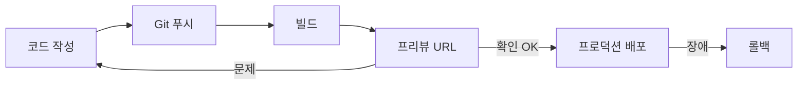
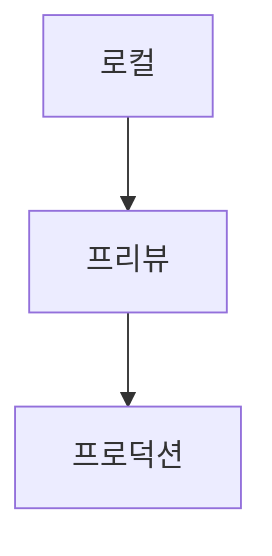

# 배포 기초

> 배포(deployment)는 내 컴퓨터에서 돌아가던 앱을 빌드해서 인터넷의 서버에 올리고, 다른 사람이 URL로 쓸 수 있게 만드는 일이다.

## 쉽게 말하면
식당 주방에서 연습한 요리를 손님이 앉은 홀로 내보내는 일과 같다. 주방(내 PC)에서 맛있어도 홀(서버)에 못 내가면 손님은 먹을 수 없다. 먼저 시식용 접시(미리보기)를 내보내 확인하고, 문제없으면 정식 메뉴(프로덕션)로 올린다.

## 자세히
- **빌드 → 업로드 → URL**: 소스를 컴파일·번들링한 결과물을 호스팅에 올리면 고유 URL이 생긴다. Vercel 문서 기준 "배포는 프로젝트의 빌드가 성공한 결과"이며 배포마다 고유 URL이 만들어진다(2026-09 문서).
- **환경 3종**: 로컬(내 PC) → 프리뷰(검수·협업용, 실서비스 영향 없음) → 프로덕션(실제 사용자 도메인).
- **배포 방법**: ① Git 저장소 연결(푸시·PR마다 자동 배포, 가장 흔함) ② CLI(`vercel deploy`, 프로덕션은 `--prod`) ③ 폴더 끌어놓기(Vercel Drop) ④ 배포 훅 URL 호출 ⑤ REST API.
- **GitHub flow**와 짝: 브랜치 → 커밋 → PR → 리뷰 → 머지 → 브랜치 삭제. 머지(또는 PR)가 배포를 일으키도록 이어 두는 것이 일반적이다.
- **되돌리기**: 문제가 생기면 이전 프로덕션 배포로 롤백한다. 배포는 "되돌릴 수 있어야" 안전하다.
- **환경변수·비밀키**: 키는 코드에 넣지 말고 호스팅의 환경변수에 둔다.

## 그림으로 보기

## 예시
- 바이브코딩으로 만든 앱: "GitHub에 푸시하면 자동으로 프리뷰 배포되게 하고, 프리뷰 URL에서 로그인·결제 흐름을 점검할 체크리스트를 만들어 줘."
- 배포 후 확인: 프리뷰 URL을 열어 핵심 화면, 에러 로그, 환경변수 누락 여부를 본다.

## 헷갈리는 것과 비교
| 개념 | 차이 |
| --- | --- |
| 빌드 | 결과물을 만드는 단계. 배포는 그것을 올려 서비스하는 단계 |
| 프리뷰 vs 프로덕션 | 프리뷰는 검수용 임시 URL, 프로덕션은 실사용자용 |
| [프런트엔드·백엔드](#frontend-backend) | 배포 대상이 되는 두 부분 |
| 롤백 vs 재배포 | 롤백은 이전 정상 버전으로 복귀 |

## 더 읽을거리
- [Vercel: Deploying to Vercel](https://vercel.com/docs/deployments) — 배포 방법·환경·롤백
- [GitHub: GitHub flow](https://docs.github.com/en/get-started/using-github/github-flow) — 브랜치·PR·머지 흐름
