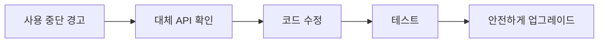
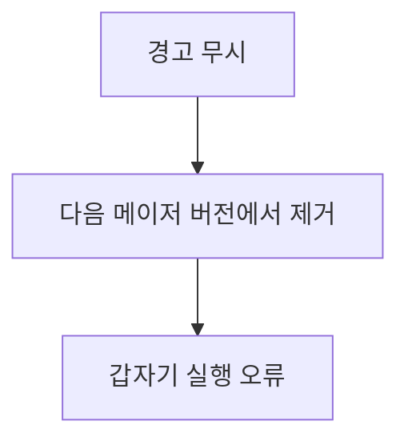

# 사용 중단 경고 읽기

> 라이브러리는 이름·인자를 바꾸기 전에 **사용 중단(deprecation) 경고**로 예고한다. 이 경고를 무시하지 않고 읽으면 업그레이드 때 코드가 갑자기 깨지는 일을 줄일 수 있다.

## 쉽게 말하면
이사 가기 전에 우체국이 "다음 달부터 이 주소로 우편물이 가지 않습니다"라고 알려 주는 것과 같다. 안내를 미리 읽고 새 주소를 써 두면 우편물이 끊기지 않는다.

## 자세히
- 직접 확인(Albumentations 2.0.8): `A.ShiftScaleRotate(p=1)`을 만들면 `UserWarning: ShiftScaleRotate is a special case of Affine transform. Please use Affine transform instead.`가 출력된다. 동작은 하지만 **더 일반적인 `Affine`으로 옮기라는 예고**다.
- 경고 읽는 법: ① 무엇이(이름) ② 왜(다른 것의 특수 경우·이름 변경) ③ 무엇으로 바꿀지(대체 API)를 본다. 대체 API가 안 적혀 있으면 릴리스 노트·마이그레이션 가이드를 확인한다.
- 버전 드리프트 사례: 설치된 2.0.8의 `BboxParams` 시그니처는 `format='coco'|'pascal_voc'|'albumentations'|'yolo'`를 받는다. 웹 검색으로 확인한 더 새 문서에서는 같은 인자가 `coord_format`으로 안내되고 `cxcywh` 등이 추가됐다. 즉 **문서와 설치 버전이 어긋날 수 있으므로 설치된 버전의 시그니처를 직접 본다**(`inspect.signature`).
- 경고를 눈에 띄게 하기(제안): 개발·CI에서는 `python -W error::DeprecationWarning`이나 `warnings.simplefilter("error")`로 경고를 에러로 승격해 조기에 고친다. 단 `UserWarning`은 라이브러리마다 사용 중단에 `UserWarning`을 쓰기도 해(위 사례) 범주만 보고 거르지 않는다.
- 한계: 일부 라이브러리는 사용 중단을 경고 없이 문서에만 적는다. 경고가 없다고 안전한 것은 아니다.

## 그림으로 보기



## 예시
```python
# 경고가 나는 코드
A.ShiftScaleRotate(shift_limit=0.1, scale_limit=0.1, rotate_limit=15)
# 대체: A.Affine(translate_percent=..., scale=..., rotate=...)
```
- 교육: 교육용 노트북이 몇 달 뒤 깨지는 이유와 예방법 설명.

## 헷갈리는 것과 비교
| 개념 | 차이 |
|---|---|
| 사용 중단 경고 | 아직 동작하지만 곧 사라질 예정 |
| 에러 | 이미 동작하지 않음 |
| [의존성 버전 고정](#pin-dependency-versions) | 업그레이드 시점을 내가 정하게 함 |

## 더 읽을거리
- [Albumentations 문서](https://albumentations.ai/docs/) — 변환 목록과 최신 인자 확인.
- 직접 실행: Albumentations 2.0.8 경고·시그니처 확인.
